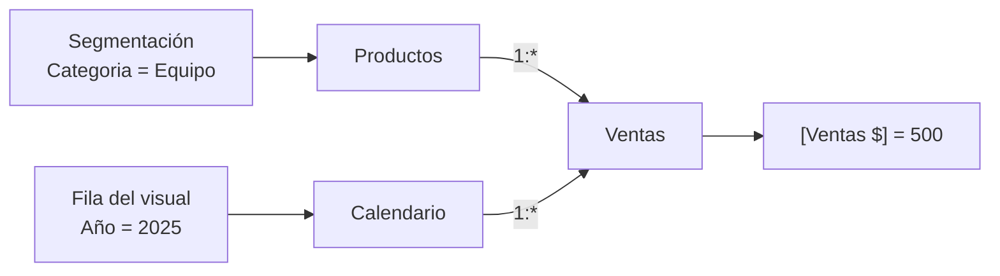

# DAX - contexto de filtro

Parte de: [[17-Power-BI/04 DAX/_Índice DAX|DAX]]

> [!info] Cómo avanzar
> `progreso`: **pendiente** → **viendo** (estudiando) → **visto** (contestaste la autoevaluación sin abrir las respuestas) → **dominado** (hiciste el laboratorio o lo aplicaste de verdad).

## Contenido

### Qué es
El **contexto de filtro** es el conjunto de filtros activos cuando se evalúa una medida: los que pone el visual (filas, columnas, ejes), las segmentaciones, los filtros de página e informe, la seguridad de filas (RLS) y los que agregue `CALCULATE`. Una misma medida da valores distintos en cada celda porque cada celda tiene su propio contexto de filtro.

### Cómo funciona
1. Cada celda del visual define filtros sobre columnas: la celda "Bebidas / 2024" filtra `Productos[Categoria] = "Bebidas"` y `Calendario[Año] = 2024`.
2. Los filtros se aplican a las tablas de dimensión y **se propagan por las relaciones** del lado uno al lado muchos: filtrar Productos filtra Ventas.
3. La medida se evalúa sobre las filas de Ventas que sobreviven.
4. Las celdas de **total** tienen menos filtros (por ejemplo, ningún filtro de categoría), así que la medida se vuelve a calcular con todas las filas visibles; **no se suman las celdas**.



### Ejemplo
> [!example] Modelo de ejemplo de esta sección
> - `Productos`: P1 Café (Bebidas, Negro), P2 Molino (Equipo, Rojo), P3 Galletas (Alimentos, Café).
> - `Ventas` (Cantidad × PrecioUnitario, CostoUnitario): 1) 2024-01-15 P1 2×100 (60); 2) 2024-02-10 P2 1×250 (150); 3) 2024-02-20 P1 3×100 (60); 4) 2025-01-05 P3 5×40 (25); 5) 2025-02-14 P2 2×250 (150).
> - `Calendario` (Fecha, Año, NumMes, Mes, AñoMes, Trimestre) relacionado 1:* con `Ventas[Fecha]`; `Productos` 1:* con `Ventas[IdProducto]`.
> - Medida base: `Ventas $ = SUMX(Ventas, Ventas[Cantidad] * Ventas[PrecioUnitario])` → total **1 450**; Bebidas 500, Equipo 750, Alimentos 200; 2024 = 750, 2025 = 700.

**Matriz con Año en filas, sin segmentación**

| Año | Ventas $ |
|---|---|
| 2024 | 750 (líneas 1, 2, 3) |
| 2025 | 700 (líneas 4, 5) |
| Total | 1 450 |

**La misma matriz con la segmentación Categoria = Equipo**: 2024 = 250 (línea 2), 2025 = 500 (línea 5) y Total = 750. Las filas combinan el filtro de la fila (año) con el de la segmentación (categoría).

**Matriz con Categoría en filas**: la fila Bebidas da 500 porque el filtro `Productos[Categoria] = "Bebidas"` deja visible solo a Café (P1); la relación propaga ese filtro a Ventas y quedan las líneas 1 y 3: 2×100 + 3×100 = 500.

Para **ignorar** parte del contexto se usa CALCULATE con modificadores:

```dax
-- Ventas del año de la fila, sin importar la categoría elegida
Ventas del año todas las categorías =
CALCULATE([Ventas $], REMOVEFILTERS(Productos[Categoria]))
-- Con segmentación Equipo: 2024 → 750, 2025 → 700
```

**¿Por qué el total no siempre es la suma de las filas?** Porque el total se evalúa con su propio contexto. En medidas aditivas (Ventas $) coincide; en medidas no aditivas no:
- `% Margen` total no es la suma de los porcentajes de cada fila.
- Un `DISTINCTCOUNT` de productos por año da 2 y 2, pero el total es 3 (Molino aparece en ambos años).
- Una medida con `IF` que devuelve blank en ciertas condiciones puede desaparecer o cambiar en el total.

Si necesitas que el total sea la suma de las filas, itera explícitamente: `SUMX(VALUES(Calendario[Año]), [Medida])`.

### Cuándo usarlo y cuándo no
- Diseña las medidas pensando en "¿qué filtros tendrá la celda?", no en "¿qué fila estoy calculando?".
- Filtra **dimensiones** (Productos, Calendario), no la tabla de hechos: es más rápido y respeta el modelo estrella.
- Si un cálculo debe ser fijo y no responder a filtros, quizá sea una columna o un valor en el origen, no una medida.

### Errores comunes
- **Esperar que el total sume las filas** en medidas no aditivas.
- **Confundir contexto de fila con contexto de filtro**: en una columna calculada no hay filtros del visual; ver [[DAX - contexto de fila]].
- **Relaciones con dirección incorrecta**: si el filtro no llega a Ventas, la medida repite el total en todas las filas.
- **Olvidar filtros "invisibles"**: filtros de página, de informe o RLS también forman parte del contexto; revisa el panel de filtros cuando un número no cuadra.

Para modificar el contexto a voluntad, sigue con [[DAX - CALCULATE]] y [[DAX - FILTER, ALL, ALLEXCEPT y REMOVEFILTERS]].

### Para profundizar
- [Filter context en DAX (SQLBI)](https://www.sqlbi.com/articles/filter-context-in-dax/)
- [Row context y filter context (SQLBI)](https://www.sqlbi.com/articles/row-context-and-filter-context-in-dax/)
- [Función CALCULATE (Microsoft Learn)](https://learn.microsoft.com/en-us/dax/calculate-function-dax)

## Ejercicios

Resuélvelos en papel o en la herramienta; la solución está plegada.

> [!question]- Datos de ejemplo (para los ejercicios con resultado numérico): Productos P1 Café (Bebidas), P2 Molino (Equipo), P3 Galletas (Alimentos). Ventas: 1) 2024-01-15 P1 2×100; 2) 2024-02-10 P2 1×250; 3) 2024-02-20 P1 3×100; 4) 2025-01-05 P3 5×40; 5) 2025-02-14 P2 2×250. Medida base: `Ventas $ = SUMX(Ventas, Ventas[Cantidad] * Ventas[PrecioUnitario])` → total 1 450. En una matriz con Año en filas, ¿qué muestra `[Ventas $]` para 2024 y 2025?
> 2024: 200 + 250 + 300 = 750. 2025: 200 + 500 = 700.

> [!question]- Con Año en filas y una segmentación Categoria = Equipo, ¿qué muestra 2025 y el total?
> 2025: 500 (venta 5). Total: 750 (ventas 2 y 5). Los filtros de la fila y de la segmentación se combinan (intersección).

> [!question]- Medida que muestre siempre las ventas totales del año de la fila sin importar la categoría seleccionada.
> ```dax
> Ventas año (todas cat.) = CALCULATE([Ventas $], REMOVEFILTERS(Productos))
> ```
> Con Equipo seleccionado, la fila 2025 mostraría 700.

## Autoevaluación

Contesta primero en voz alta o en papel; luego despliega la respuesta.

> [!question]- ¿Qué es el contexto de filtro?
> El conjunto de filtros activos al evaluar una medida: filas/columnas del visual, segmentaciones, filtros de página/informe, RLS y los que agrega CALCULATE.

> [!question]- En una matriz con Categoría en filas, ¿por qué la fila Bebidas de `[Ventas $]` da 500 con los datos de ejemplo?
> Datos de ejemplo (para los ejercicios con resultado numérico): Productos P1 Café (Bebidas), P2 Molino (Equipo), P3 Galletas (Alimentos). Ventas: 1) 2024-01-15 P1 2×100; 2) 2024-02-10 P2 1×250; 3) 2024-02-20 P1 3×100; 4) 2025-01-05 P3 5×40; 5) 2025-02-14 P2 2×250. Medida base: `Ventas $ = SUMX(Ventas, Ventas[Cantidad] * Ventas[PrecioUnitario])` → total 1 450.
> La fila aplica el filtro `Productos[Categoria] = "Bebidas"`, que viaja por la relación a Ventas: quedan las ventas 1 y 3 (200 + 300 = 500).

> [!question]- ¿Por qué la fila *Total* no es la suma de las filas en algunas medidas?
> Porque la medida se evalúa de nuevo en el contexto del total (sin filtro de categoría), no suma los resultados visibles. Con medidas no aditivas (promedios, conteos distintos) el total difiere.

