# DAX - errores comunes

Parte de: [[17-Power-BI/04 DAX/_Índice DAX|DAX]]

> [!info] Cómo avanzar
> `progreso`: **pendiente** → **viendo** (estudiando) → **visto** (contestaste la autoevaluación sin abrir las respuestas) → **dominado** (hiciste el laboratorio o lo aplicaste de verdad).

## Contenido

### Qué es
Una guía de los errores que más se repiten al aprender DAX, agrupados por tipo: **de diseño** (elegir mal entre columna y medida), **de contexto** (resultados "raros" sin mensaje de error) y **de sintaxis o evaluación** (mensajes del motor). Reconocerlos rápido ahorra horas de depuración.

### Cómo funciona
Cuando un número no cuadra, sigue este orden:

```mermaid
flowchart TB
  A[Número raro o error] --> B{¿Hay mensaje de error?}
  B -- Sí --> C[Lee el mensaje:<br/>valor único, dependencia circular, sintaxis]
  B -- No --> D{¿Falla en filas o solo en el total?}
  D -- Total --> E[Medida no aditiva o IF/VALUES en el total]
  D -- Filas --> F[Revisa relaciones, dirección del filtro<br/>y filtros ocultos]
  F --> G[Prueba la medida con EVALUATE<br/>y variables intermedias]
```



**Mensajes del motor más frecuentes**
- *"Se proporcionó una tabla con varios valores donde se esperaba un único valor"*: usaste una expresión de tabla (por ejemplo `VALUES(Productos[Categoria])`) o una columna sin agregar donde DAX espera un escalar. Funciona en las filas de detalle (un solo valor) y truena en totales o subtotales (varios valores). Solución: `SELECTEDVALUE`, `MAX`, `IF(HASONEVALUE(...))` o agregar con SUM/CONCATENATEX.
- *"No se puede determinar un valor único para la columna..."*: referencia a una columna "desnuda" en una medida (sin fila). Agrega o itera.
- *"Se detectó una dependencia circular"*: dos columnas o tablas calculadas dependen entre sí, directamente o a través de CALCULATE. Una columna calculada con CALCULATE depende de **todas las columnas** de la tabla (por la transición de contexto); si creas dos así en la misma tabla, cada una depende de la otra. Se resuelve quitando dependencias (`ALLEXCEPT` con la clave, o `CALCULATE(..., REMOVEFILTERS(tabla), tabla[Clave] = valor)`), moviendo el cálculo a Power Query/SQL o convirtiéndolo en medida.
- *"La función X no puede usarse en una expresión de columna calculada / de filtro"*: algunas funciones solo valen en ciertos contextos (por ejemplo, funciones de visual solo en cálculos visuales).

### Ejemplo
> [!example] Modelo de ejemplo de esta sección
> - `Productos`: P1 Café (Bebidas, Negro), P2 Molino (Equipo, Rojo), P3 Galletas (Alimentos, Café).
> - `Ventas` (Cantidad × PrecioUnitario, CostoUnitario): 1) 2024-01-15 P1 2×100 (60); 2) 2024-02-10 P2 1×250 (150); 3) 2024-02-20 P1 3×100 (60); 4) 2025-01-05 P3 5×40 (25); 5) 2025-02-14 P2 2×250 (150).
> - `Calendario` (Fecha, Año, NumMes, Mes, AñoMes, Trimestre) relacionado 1:* con `Ventas[Fecha]`; `Productos` 1:* con `Ventas[IdProducto]`.
> - Medida base: `Ventas $ = SUMX(Ventas, Ventas[Cantidad] * Ventas[PrecioUnitario])` → total **1 450**; Bebidas 500, Equipo 750, Alimentos 200; 2024 = 750, 2025 = 700.

```dax
-- ERROR: varios valores en el total
Categoria actual = VALUES(Productos[Categoria])
-- Bien en filas; en el total hay 3 categorías → error

-- CORRECTO
Categoria actual = SELECTEDVALUE(Productos[Categoria], "Varias")

-- ERROR silencioso: porcentaje como columna y luego sumado
-- (columna en Ventas) Pct = DIVIDE(Ventas[Importe], 1450)  → la suma por categoría "funciona"
-- pero se rompe en cuanto cambian los datos o los filtros

-- CORRECTO: medida
% del total = DIVIDE([Ventas $], CALCULATE([Ventas $], REMOVEFILTERS(Productos)))

-- ERROR silencioso: año anterior con fecha de la tabla de hechos
Ventas AA mal = CALCULATE([Ventas $], SAMEPERIODLASTYEAR(Ventas[Fecha]))
-- CORRECTO
Ventas AA = CALCULATE([Ventas $], SAMEPERIODLASTYEAR(Calendario[Fecha]))
```

**Top de errores de principiante**
1. Columnas calculadas para todo, en lugar de medidas ([[DAX - columnas calculadas, medidas y tablas calculadas]]).
2. `/` en lugar de `DIVIDE` (infinito o error con ceros).
3. Inteligencia de tiempo sin tabla de calendario marcada.
4. `FILTER(Ventas, ...)` cuando bastaba un filtro sobre una columna de dimensión.
5. Referenciar columnas sin el nombre de la tabla, o medidas con tabla.
6. `CALCULATE(variable, ...)` esperando que la variable cambie.
7. `RANKX(VALUES(...))` que da 1 a todos.

### Cuándo usarlo y cuándo no
Usa esta nota como lista de verificación al revisar medidas propias, las de un compañero o las que genera Copilot ([[Cuándo confiar en Copilot y cómo validar lo que genera]]). Para problemas de **lentitud** (no de resultado), pasa a [[DAX - optimización]].

### Errores comunes
- **Arreglar el síntoma**: envolver todo en `IFERROR` o en `IF(ISBLANK(...), 0, ...)` esconde el problema y crea otros (filas en cero).
- **No probar en el total**: la mayoría de los errores de contexto aparecen en totales y subtotales.
- **Depurar en el visual**: es más rápido aislar la medida con EVALUATE en la [[Vista de consultas DAX (DAX query view)]].
- **Ignorar los filtros de página e informe** al comparar contra otro sistema.

### Para profundizar
- [Funciones de error y buenas prácticas](https://learn.microsoft.com/en-us/dax/best-practices/dax-error-functions)
- [Función SELECTEDVALUE](https://learn.microsoft.com/en-us/dax/selectedvalue-function)
- [Understanding context transition (SQLBI)](https://www.sqlbi.com/articles/understanding-context-transition-in-dax/)

## Autoevaluación

Contesta primero en voz alta o en papel; luego despliega la respuesta.

> [!question]- Mencione tres errores típicos de principiante en DAX.
> Columnas calculadas en vez de medidas; usar `/` en vez de DIVIDE; inteligencia de tiempo sin tabla de calendario; filtrar tablas completas con FILTER cuando basta una columna; referenciar columnas sin tabla.

> [!question]- ¿Qué significa el error "Se proporcionó una tabla con varios valores donde se esperaba un único valor"?
> Usaste una expresión que devuelve varios valores (p. ej. VALUES) donde se espera un escalar. Usa SELECTEDVALUE, MAX o agrega.

> [!question]- ¿Qué es una dependencia circular?
> Dos columnas/tablas calculadas que se dependen entre sí (directa o indirectamente vía CALCULATE y transición de contexto). Se resuelve rediseñando, a veces con ALLEXCEPT o moviendo el cálculo a Power Query.

