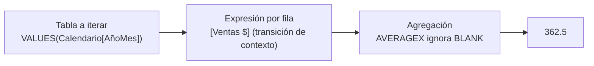

# DAX - iteradores (SUMX, AVERAGEX y demás)

Parte de: [[17-Power-BI/04 DAX/_Índice DAX|DAX]]

> [!info] Cómo avanzar
> `progreso`: **pendiente** → **viendo** (estudiando) → **visto** (contestaste la autoevaluación sin abrir las respuestas) → **dominado** (hiciste el laboratorio o lo aplicaste de verdad).

## Contenido

### Qué es
Un **iterador** (las funciones que terminan en X, más FILTER, ADDCOLUMNS, RANKX y similares) recorre una tabla fila por fila, evalúa una expresión en el **contexto de fila** de cada una y combina los resultados: los suma (`SUMX`), promedia (`AVERAGEX`), toma el mínimo o máximo (`MINX`, `MAXX`), cuenta (`COUNTX`), concatena (`CONCATENATEX`) o rankea (`RANKX`).

### Cómo funciona
Firma general: `SUMX(<tabla a iterar>, <expresión por fila>)`.
1. Se evalúa la tabla del primer argumento en el contexto de filtro actual (por ejemplo, las ventas de 2024).
2. Para cada fila se crea un contexto de fila y se evalúa la expresión.
3. Se agregan los resultados; los BLANK se ignoran en promedios, mínimos y máximos.

**La tabla que iteras define la granularidad del resultado**:
- `AVERAGEX(Ventas, importe)` promedia **por línea de venta**.
- `AVERAGEX(VALUES(Calendario[AñoMes]), [Ventas $])` promedia **por mes**: cada iteración es un mes y la medida, por transición de contexto, calcula las ventas de ese mes.
- `SUM(col)` es simplemente un atajo de `SUMX(tabla, col)`; la diferencia aparece cuando necesitas combinar columnas o medidas.



### Ejemplo
> [!example] Modelo de ejemplo de esta sección
> - `Productos`: P1 Café (Bebidas, Negro), P2 Molino (Equipo, Rojo), P3 Galletas (Alimentos, Café).
> - `Ventas` (Cantidad × PrecioUnitario, CostoUnitario): 1) 2024-01-15 P1 2×100 (60); 2) 2024-02-10 P2 1×250 (150); 3) 2024-02-20 P1 3×100 (60); 4) 2025-01-05 P3 5×40 (25); 5) 2025-02-14 P2 2×250 (150).
> - `Calendario` (Fecha, Año, NumMes, Mes, AñoMes, Trimestre) relacionado 1:* con `Ventas[Fecha]`; `Productos` 1:* con `Ventas[IdProducto]`.
> - Medida base: `Ventas $ = SUMX(Ventas, Ventas[Cantidad] * Ventas[PrecioUnitario])` → total **1 450**; Bebidas 500, Equipo 750, Alimentos 200; 2024 = 750, 2025 = 700.

```dax
-- Promedio del importe por línea
Ticket promedio = AVERAGEX(Ventas, Ventas[Cantidad] * Ventas[PrecioUnitario])
-- (200 + 250 + 300 + 200 + 500) / 5 = 290

-- Importe máximo de una línea
Venta maxima = MAXX(Ventas, Ventas[Cantidad] * Ventas[PrecioUnitario])   -- 500

-- Promedio mensual: total de cada mes, promediado
Promedio mensual = AVERAGEX(VALUES(Calendario[AñoMes]), [Ventas $])
-- Meses con venta: 200, 550, 200, 500 → 1 450 / 4 = 362.5
-- Si el calendario cubre 2024-2025, los 20 meses sin venta dan BLANK y AVERAGEX los ignora

-- Precio promedio ponderado (no es lo mismo que promediar precios)
Precio promedio = DIVIDE([Ventas $], SUM(Ventas[Cantidad]))   -- 1 450 / 13 = 111.54
Promedio simple de precio = AVERAGE(Ventas[PrecioUnitario])   -- 740 / 5 = 148
```

Las dos últimas medidas muestran por qué hay que pensar qué se promedia: el promedio ponderado por unidades (111.54) y el promedio simple de precios por línea (148) responden preguntas distintas.

Si quisieras contar los meses sin venta como cero, iterarías con `AVERAGEX(VALUES(Calendario[AñoMes]), [Ventas $] + 0)`; ten cuidado, porque eso incluye meses futuros del calendario.

### Cuándo usarlo y cuándo no
- Cuando el cálculo por fila combina columnas (cantidad × precio), aplica condiciones o necesita una medida **por grupo** (por cliente, por mes, por producto).
- Itera la tabla **más pequeña que dé el resultado correcto**: una columna de dimensión antes que la tabla de hechos.
- Si solo sumas una columna, `SUM` es igual de eficiente y más legible.
- Para rankings y "primeros N", ver [[DAX - RANKX y TOPN]]; para listas de texto, `CONCATENATEX` en [[DAX - VALUES y DISTINCT]].

### Errores comunes
- **Iterar Ventas y llamar una medida dentro** (`SUMX(Ventas, [Ventas $])`): transición de contexto por cada línea; lento y riesgoso con filas duplicadas ([[DAX - transición de contexto]]).
- **Promediar promedios**: `AVERAGEX(VALUES(Productos[Categoria]), [% Margen])` no es el margen total.
- **Olvidar que AVERAGEX ignora BLANK** y luego comparar contra un promedio que sí cuenta ceros.
- **Iterar `Calendario` completo** cuando solo querías meses con ventas, o al revés.

### Para profundizar
- [Función SUMX](https://learn.microsoft.com/en-us/dax/sumx-function-dax)
- [Función AVERAGEX](https://learn.microsoft.com/en-us/dax/averagex-function-dax)
- [Row context y filter context (SQLBI)](https://www.sqlbi.com/articles/row-context-and-filter-context-in-dax/)

## Ejercicios

Resuélvelos en papel o en la herramienta; la solución está plegada.

> [!question]- Datos de ejemplo (para los ejercicios con resultado numérico): Productos P1 Café (Bebidas), P2 Molino (Equipo), P3 Galletas (Alimentos). Ventas: 1) 2024-01-15 P1 2×100; 2) 2024-02-10 P2 1×250; 3) 2024-02-20 P1 3×100; 4) 2025-01-05 P3 5×40; 5) 2025-02-14 P2 2×250. Medida base: `Ventas $ = SUMX(Ventas, Ventas[Cantidad] * Ventas[PrecioUnitario])` → total 1 450. Medida `Ticket promedio` (promedio del importe por línea). ¿Cuánto da?
> ```dax
> Ticket promedio = AVERAGEX(Ventas, Ventas[Cantidad] * Ventas[PrecioUnitario])
> ```
> 1 450 / 5 = 290.

> [!question]- Medida `Venta máxima por línea`.
> ```dax
> Venta máxima = MAXX(Ventas, Ventas[Cantidad] * Ventas[PrecioUnitario])
> ```
> = 500.

> [!question]- Medida `Promedio mensual` (promedio de las ventas totales por mes con venta).
> ```dax
> Promedio mensual = AVERAGEX(VALUES(Calendario[AñoMes]), [Ventas $])
> ```
> Ojo: VALUES(Calendario[AñoMes]) incluye meses sin venta (blank); AVERAGEX ignora blanks, así que da 1 450 / 4 = 362.5.

## Autoevaluación

Contesta primero en voz alta o en papel; luego despliega la respuesta.

> [!question]- ¿Qué hace un iterador X?
> Recorre una tabla fila por fila, evalúa una expresión en contexto de fila y agrega los resultados (SUMX, AVERAGEX, MINX, MAXX, COUNTX, CONCATENATEX, RANKX).

> [!question]- ¿`SUM(Ventas[Importe])` y `SUMX(Ventas, Ventas[Importe])` son distintos?
> No: SUM es atajo de SUMX sobre una columna. La diferencia aparece cuando la expresión combina columnas o medidas.

> [!question]- ¿Qué diferencia hay entre `AVERAGEX(Ventas, ...)` y `AVERAGEX(VALUES(Calendario[Mes]), [Ventas $])`?
> El primero promedia por línea de venta; el segundo promedia el total de cada mes (promedio mensual). Lo que iteras define la granularidad del promedio.

