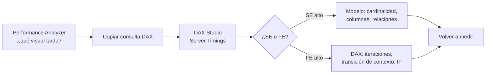

# DAX - optimización

Parte de: [[17-Power-BI/04 DAX/_Índice DAX|DAX]]

> [!info] Cómo avanzar
> `progreso`: **pendiente** → **viendo** (estudiando) → **visto** (contestaste la autoevaluación sin abrir las respuestas) → **dominado** (hiciste el laboratorio o lo aplicaste de verdad).

## Contenido

### Qué es
Optimizar DAX es lograr que las medidas respondan rápido sin cambiar su resultado. En Power BI casi todo el tiempo de un visual lento se reparte entre el **motor de almacenamiento** (*Storage Engine*, SE: lee columnas comprimidas de VertiPaq, muy rápido y en paralelo) y el **motor de fórmulas** (*Formula Engine*, FE: ejecuta la lógica que el SE no puede, en un solo hilo). Una medida eficiente empuja el trabajo al SE y evita que el FE itere millones de filas.

### Cómo funciona
**Primero se mide, después se cambia.** El flujo recomendado:



1. En Desktop: *Optimizar → Analizador de rendimiento*, graba y actualiza visuales; identifica el visual lento y copia su consulta.
2. Pega la consulta en [[DAX Studio]], activa *Server Timings* y *Clear cache then run*; mira el tiempo total, el reparto SE/FE y el número de consultas al SE.
3. Cambia **una cosa a la vez** y vuelve a medir con caché fría.

**Buenas prácticas de DAX**
- Filtra **columnas**, no tablas: `CALCULATE([Ventas $], Productos[Color] = "Rojo")` en vez de `FILTER(Ventas, RELATED(...))`.
- Usa **variables** para no repetir cálculos ([[DAX - variables (VAR y RETURN)]]).
- Evita iterar la tabla de hechos con **transición de contexto** (`SUMX(Ventas, [Medida])`); itera columnas de dimensión.
- Cuidado con `IF` y `SWITCH` que obligan a evaluar celda por celda ramas costosas; a veces conviene calcular ambas ramas con filtros.
- Prefiere `DIVIDE`, `SELECTEDVALUE`, `COUNTROWS` y funciones nativas a construcciones manuales.
- Devuelve **BLANK** en lugar de 0 cuando no hay datos, para no forzar combinaciones vacías.

**Buenas prácticas de modelo** (suelen pesar más que el DAX)
- Modelo **estrella**: hechos delgados y dimensiones; relaciones 1:* con filtro simple.
- **Menos cardinalidad**: separa fecha y hora, redondea decimales innecesarios, quita columnas que nadie usa (sobre todo IDs de texto únicos en la tabla de hechos).
- Evita relaciones **bidireccionales** y muchos a muchos sin necesidad.
- Desactiva *Fecha/hora automática*.
- Revisa el tamaño por columna con *View Metrics* (VertiPaq Analyzer).

### Ejemplo
> [!example] Modelo de ejemplo de esta sección
> - `Productos`: P1 Café (Bebidas, Negro), P2 Molino (Equipo, Rojo), P3 Galletas (Alimentos, Café).
> - `Ventas` (Cantidad × PrecioUnitario, CostoUnitario): 1) 2024-01-15 P1 2×100 (60); 2) 2024-02-10 P2 1×250 (150); 3) 2024-02-20 P1 3×100 (60); 4) 2025-01-05 P3 5×40 (25); 5) 2025-02-14 P2 2×250 (150).
> - `Calendario` (Fecha, Año, NumMes, Mes, AñoMes, Trimestre) relacionado 1:* con `Ventas[Fecha]`; `Productos` 1:* con `Ventas[IdProducto]`.
> - Medida base: `Ventas $ = SUMX(Ventas, Ventas[Cantidad] * Ventas[PrecioUnitario])` → total **1 450**; Bebidas 500, Equipo 750, Alimentos 200; 2024 = 750, 2025 = 700.

```dax
-- Lenta en tablas grandes: itera Ventas y busca el color fila por fila (FE)
Ventas rojo lenta =
SUMX(FILTER(Ventas, RELATED(Productos[Color]) = "Rojo"),
     Ventas[Cantidad] * Ventas[PrecioUnitario])

-- Rápida: el filtro se aplica a la dimensión y lo resuelve el SE
Ventas rojo = CALCULATE([Ventas $], Productos[Color] = "Rojo")
-- Ambas dan 750 (Molino)

-- Repite el cálculo del año anterior dos veces
Var % repetida =
DIVIDE([Ventas $] - CALCULATE([Ventas $], SAMEPERIODLASTYEAR(Calendario[Fecha])),
       CALCULATE([Ventas $], SAMEPERIODLASTYEAR(Calendario[Fecha])))

-- Con variable: se calcula una vez
Var % =
VAR AA = CALCULATE([Ventas $], SAMEPERIODLASTYEAR(Calendario[Fecha]))
RETURN DIVIDE([Ventas $] - AA, AA)
```

Con 5 filas no notarás diferencia; con 50 millones, la versión con FILTER sobre Ventas puede pasar de milisegundos a segundos. Por eso se mide con datos reales.

### Cuándo usarlo y cuándo no
- Optimiza cuando un visual tarda más de lo aceptable para el usuario (y lo mediste), no "por si acaso".
- Si el SE domina el tiempo, ataca el **modelo**: un DAX perfecto sobre una tabla plana enorme, con columnas de alta cardinalidad y relaciones ambiguas, sigue siendo lento.
- Si el FE domina, ataca el **DAX**: iteraciones, transiciones, condicionales.
- Para modelos muy grandes considera agregaciones, Direct Lake o mover cálculos al origen.

### Errores comunes
- **Optimizar sin medir** o medir con caché caliente (resultados engañosos).
- **Culpar al DAX** de problemas de modelo (o de un origen DirectQuery lento).
- **Columnas calculadas para "acelerar"** medidas: inflan memoria y tiempos de actualización.
- **Cambiar varias cosas a la vez**: no sabes cuál ayudó.

### Para profundizar
- [Analizador de rendimiento en Power BI Desktop](https://learn.microsoft.com/en-us/power-bi/create-reports/desktop-performance-analyzer)
- [Evitar FILTER como argumento de filtro](https://learn.microsoft.com/en-us/dax/best-practices/dax-avoid-avoid-filter-as-filter-argument)
- [DAX Studio](https://daxstudio.org/)

## Autoevaluación

Contesta primero en voz alta o en papel; luego despliega la respuesta.

> [!question]- Primer paso para optimizar una medida lenta.
> Medir: Performance Analyzer para identificar el visual y copiar la consulta; luego DAX Studio con Server Timings para ver tiempo en SE vs FE.

> [!question]- Tres buenas prácticas de rendimiento.
> Filtrar columnas en vez de tablas, usar variables para no repetir cálculos, evitar iterar la tabla de hechos con transición de contexto, reducir cardinalidad del modelo, evitar IF que fuerzan cálculo celda por celda.

> [!question]- ¿Por qué un modelo mal diseñado no se arregla con DAX?
> La mayor parte del rendimiento depende del modelo (estrella, cardinalidad, relaciones). Un DAX "perfecto" sobre un modelo plano y enorme sigue siendo lento.

