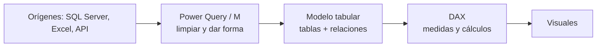

# DAX - qué es y para qué sirve

Parte de: [[17-Power-BI/04 DAX/_Índice DAX|DAX]]

> [!info] Cómo avanzar
> `progreso`: **pendiente** → **viendo** (estudiando) → **visto** (contestaste la autoevaluación sin abrir las respuestas) → **dominado** (hiciste el laboratorio o lo aplicaste de verdad).

## Contenido

### Qué es
DAX (*Data Analysis Expressions*) es el lenguaje de fórmulas del motor tabular que usan Power BI, Analysis Services y Power Pivot en Excel. Con él defines **cálculos sobre un modelo ya cargado**: medidas (totales, porcentajes, comparativos contra el año anterior), columnas calculadas y tablas calculadas. También es un lenguaje de **consulta**: cada visual de Power BI, por dentro, manda una consulta DAX al modelo.

Piensa en DAX como la capa de "reglas de negocio analíticas" de tu informe: *qué es una venta*, *cómo se calcula el margen*, *qué significa "mismo periodo del año anterior"*. Escribes la regla una vez y el motor la reevalúa en cada celda, fila o barra según los filtros que el usuario tenga activos.

### Cómo funciona
El flujo de trabajo en Power BI separa responsabilidades:



1. **Power Query (M)** extrae y transforma: quita columnas, corrige tipos, combina archivos. Eso se ejecuta al *actualizar* los datos.
2. **El modelo** guarda las tablas comprimidas (motor VertiPaq) y las relaciones entre ellas (modelo estrella).
3. **DAX** se evalúa al *consultar*: cuando un visual pide "Ventas por categoría", el motor aplica los filtros de esa celda y calcula la medida.

Dos ideas sostienen todo DAX y tienen nota propia: el [[DAX - contexto de fila]] (la fila que se está recorriendo) y el [[DAX - contexto de filtro]] (los filtros activos en la celda). La función que manipula ese contexto es [[DAX - CALCULATE]].

### Ejemplo
> [!example] Modelo de ejemplo de esta sección
> - `Productos`: P1 Café (Bebidas, Negro), P2 Molino (Equipo, Rojo), P3 Galletas (Alimentos, Café).
> - `Ventas` (Cantidad × PrecioUnitario, CostoUnitario): 1) 2024-01-15 P1 2×100 (60); 2) 2024-02-10 P2 1×250 (150); 3) 2024-02-20 P1 3×100 (60); 4) 2025-01-05 P3 5×40 (25); 5) 2025-02-14 P2 2×250 (150).
> - `Calendario` (Fecha, Año, NumMes, Mes, AñoMes, Trimestre) relacionado 1:* con `Ventas[Fecha]`; `Productos` 1:* con `Ventas[IdProducto]`.
> - Medida base: `Ventas $ = SUMX(Ventas, Ventas[Cantidad] * Ventas[PrecioUnitario])` → total **1 450**; Bebidas 500, Equipo 750, Alimentos 200; 2024 = 750, 2025 = 700.

```dax
-- Medida base: se reevalúa en cada celda según los filtros
Ventas $ = SUMX(Ventas, Ventas[Cantidad] * Ventas[PrecioUnitario])

-- Medida que reutiliza otra medida
Costo $ = SUMX(Ventas, Ventas[Cantidad] * Ventas[CostoUnitario])
% Margen = DIVIDE([Ventas $] - [Costo $], [Ventas $])
```

En una tarjeta sin filtros `Ventas $` vale 1 450; en una matriz por categoría, la misma fórmula da 500, 750 y 200 sin que escribas nada más. `% Margen` total es (1 450 − 875) / 1 450 ≈ 39.66 %.

¿Se parece a Excel? En lo superficial sí: muchas funciones se llaman igual (`SUM`, `IF`, `ROUND`, `LEFT`) y se escribe con `=`. La diferencia de fondo es que **Excel trabaja con celdas y rangos** (A1:B10) y **DAX trabaja con tablas y columnas** filtradas por el contexto. No existe "la celda de arriba"; existe "las filas de Ventas visibles en este momento". Por eso un analista que domina Excel suele tropezar al principio con los totales o con CALCULATE.

### Cuándo usarlo y cuándo no
- **Úsalo** para lógica que depende de lo que el usuario filtra: totales, ratios, rankings, inteligencia de tiempo, seguridad dinámica (RLS) y formato condicional.
- **No lo uses para limpiar datos.** Recortar espacios, separar columnas, cambiar tipos, quitar duplicados o combinar archivos es trabajo de Power Query o de la base de datos (una vista o un procedimiento en SQL Server). DAX puede hacer columnas calculadas, pero se calculan al actualizar, ocupan memoria y no se pliegan al origen. Regla útil: *transforma lo más arriba posible, calcula lo más abajo posible* (en medidas).
- Para cálculos muy específicos de un solo visual también existen los [[Cálculos visuales (visual calculations)]].

### Errores comunes
- **Tratar DAX como SQL o Excel.** No hay `GROUP BY` explícito en una medida: el visual agrupa y la medida se evalúa por grupo.
- **Crear columnas calculadas para todo.** Inflan el modelo; la mayoría de los cálculos deben ser medidas.
- **Usar columnas "sueltas" en un visual (medidas implícitas)** en vez de medidas explícitas: luego no puedes reutilizarlas, formatearlas ni usarlas en grupos de cálculo.
- **Ignorar el modelo.** Sin modelo estrella y tabla de calendario, el DAX se vuelve complicado y lento.

### Para profundizar
- [Referencia de DAX (Microsoft Learn)](https://learn.microsoft.com/en-us/dax/)
- [Aprender los conceptos básicos de DAX en Power BI Desktop](https://learn.microsoft.com/en-us/power-bi/transform-model/desktop-quickstart-learn-dax-basics)
- [DAX Guide (referencia de funciones de SQLBI)](https://dax.guide/)

## Autoevaluación

Contesta primero en voz alta o en papel; luego despliega la respuesta.

> [!question]- ¿Qué es DAX?
> Data Analysis Expressions: el lenguaje de fórmulas del modelo tabular (Power BI, Analysis Services, Power Pivot) para medidas, columnas y tablas calculadas, RLS y consultas.

> [!question]- ¿Se parece a las fórmulas de Excel?
> En la sintaxis (funciones como SUM, IF), pero trabaja con tablas y columnas, no con celdas, y su resultado depende del contexto de filtro.

> [!question]- ¿DAX sirve para limpiar datos?
> Puede, pero no es su papel: la limpieza va en el origen o Power Query. DAX se centra en cálculos analíticos.

