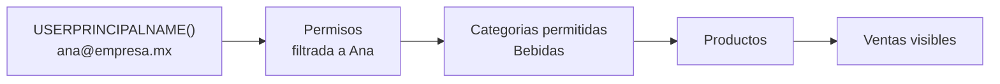

# DAX - seguridad dinámica con USERPRINCIPALNAME

Parte de: [[17-Power-BI/04 DAX/_Índice DAX|DAX]]

> [!info] Cómo avanzar
> `progreso`: **pendiente** → **viendo** (estudiando) → **visto** (contestaste la autoevaluación sin abrir las respuestas) → **dominado** (hiciste el laboratorio o lo aplicaste de verdad).

## Contenido

### Qué es
La **seguridad dinámica a nivel de fila** (RLS dinámica) usa un solo rol para todos los usuarios y decide qué filas ve cada uno según **quién es**, leyendo su identidad con `USERPRINCIPALNAME()`. En lugar de crear un rol por región o categoría, mantienes una **tabla de permisos** (Correo → lo que puede ver) y el rol filtra con una expresión DAX. La base de roles está en [[Seguridad a nivel de fila (RLS)]].

### Cómo funciona
1. **Tabla de permisos**: `Permisos(Correo, Categoria)`, una fila por cada combinación usuario–categoría permitida. Puede venir de SQL Server (por ejemplo, de la misma base que usa Itzamna.Dionisio) para administrarla sin tocar el informe.
2. **Relación** de Permisos con la dimensión que quieres proteger (Categorías o Productos).
3. **Rol** con una expresión de filtro DAX (*Modelado → Administrar roles*) que devuelve TRUE para las filas permitidas.
4. El filtro del rol se propaga por las relaciones igual que cualquier filtro: si filtras la dimensión Categorías, se filtran Productos y Ventas.
5. En el Service asignas personas o **grupos** de Microsoft Entra ID al rol.

**USERPRINCIPALNAME vs USERNAME**: en el Service ambas devuelven el UPN del usuario (normalmente su correo corporativo). En Desktop, `USERNAME()` devuelve el formato `DOMINIO\usuario`, mientras que `USERPRINCIPALNAME()` devuelve el UPN de la cuenta con la que iniciaste sesión. Usar USERPRINCIPALNAME hace que las pruebas en Desktop y la operación en el Service coincidan con una tabla de permisos basada en correos.



**Dirección del filtro**: si Permisos está relacionada *:1 con Categorías, el filtro natural va de Categorías a Permisos, no al revés. Dos opciones: (a) filtrar Permisos y hacer la relación bidireccional con *Aplicar filtro de seguridad en ambas direcciones*, o (b) —más simple y predecible— poner el filtro directamente en la dimensión con una subconsulta a Permisos.

### Ejemplo
> [!example] Modelo de ejemplo de esta sección
> - `Productos`: P1 Café (Bebidas, Negro), P2 Molino (Equipo, Rojo), P3 Galletas (Alimentos, Café).
> - `Ventas` (Cantidad × PrecioUnitario, CostoUnitario): 1) 2024-01-15 P1 2×100 (60); 2) 2024-02-10 P2 1×250 (150); 3) 2024-02-20 P1 3×100 (60); 4) 2025-01-05 P3 5×40 (25); 5) 2025-02-14 P2 2×250 (150).
> - `Calendario` (Fecha, Año, NumMes, Mes, AñoMes, Trimestre) relacionado 1:* con `Ventas[Fecha]`; `Productos` 1:* con `Ventas[IdProducto]`.
> - Medida base: `Ventas $ = SUMX(Ventas, Ventas[Cantidad] * Ventas[PrecioUnitario])` → total **1 450**; Bebidas 500, Equipo 750, Alimentos 200; 2024 = 750, 2025 = 700.

Permisos: `ana@empresa.mx` → Bebidas; `luis@empresa.mx` → Equipo y Alimentos; `dir@empresa.mx` con `EsGerente = TRUE` en una tabla `Usuarios(Correo, EsGerente)`.

```dax
-- Opción (b): filtro del rol en la dimensión Productos
[Categoria]
    IN CALCULATETABLE(
        VALUES(Permisos[Categoria]),
        Permisos[Correo] = USERPRINCIPALNAME()
    )

-- Gerente ve todo, los demás solo lo suyo (filtro en Productos)
VAR Yo = USERPRINCIPALNAME()
VAR EsGerente = LOOKUPVALUE(Usuarios[EsGerente], Usuarios[Correo], Yo)
RETURN
    EsGerente = TRUE()
        || [Categoria] IN CALCULATETABLE(VALUES(Permisos[Categoria]), Permisos[Correo] = Yo)

-- Medida para mostrar con qué usuario se ve el informe (útil al probar)
Usuario actual = USERPRINCIPALNAME()
```

Con los datos de ejemplo, Ana vería Ventas $ = 500; Luis, 750 + 200 = 950; el gerente, 1 450.

Para probar: en Desktop, *Modelado → Ver como* y elige el rol y *Otro usuario* (escribe el correo); en el Service, *Seguridad* del modelo semántico → *Probar como rol*. Coloca la tarjeta `Usuario actual` en una página de diagnóstico.

### Cuándo usarlo y cuándo no
- Cuando muchos usuarios ven **subconjuntos distintos** y la asignación cambia seguido: un rol dinámico + una tabla administrable escala mejor que decenas de roles.
- Combínala con grupos de Entra ID para dar de alta al rol, no persona por persona.
- No es para ocultar **columnas o tablas** completas; para eso existe OLS ([[Seguridad a nivel de objeto (OLS)]]).
- RLS solo aplica a usuarios con permiso de **lectura**; quienes son Administrador, Miembro o Colaborador del área de trabajo no quedan restringidos.

### Errores comunes
- **Correos con mayúsculas o espacios distintos** entre la tabla y el UPN: la comparación de texto en DAX no distingue mayúsculas, pero los espacios sí rompen la igualdad; limpia en Power Query.
- **LOOKUPVALUE con varias filas por correo**: si el mismo correo tiene valores distintos de EsGerente, da error; mantén una tabla de usuarios única.
- **Relaciones bidireccionales sin la opción de seguridad**: el filtro del rol no llega a la dimensión.
- **Probar solo como propietario** del área de trabajo: ves todo y crees que el rol no funciona (o que funciona).

### Para profundizar
- [Función USERPRINCIPALNAME](https://learn.microsoft.com/en-us/dax/userprincipalname-function-dax)
- [Guía de seguridad a nivel de fila (RLS)](https://learn.microsoft.com/en-us/power-bi/guidance/rls-guidance)
- [Función LOOKUPVALUE](https://learn.microsoft.com/en-us/dax/lookupvalue-function-dax)

## Ejercicios

Resuélvelos en papel o en la herramienta; la solución está plegada.

> [!question]- Tabla `Permisos`(Correo, Categoria) relacionada *:1 con una dimensión `Categorias`. Escribe el filtro del rol.
> En la tabla Permisos:
> ```dax
> [Correo] = USERPRINCIPALNAME()
> ```
> Y la relación Categorías ↔ Permisos debe permitir que el filtro llegue a Categorías (bidireccional con *Aplicar filtro de seguridad en ambas direcciones*) o hacerlo en la dimensión:
> ```dax
> [Categoria] IN CALCULATETABLE(VALUES(Permisos[Categoria]), Permisos[Correo] = USERPRINCIPALNAME())
> ```

> [!question]- Rol para que un gerente vea todo y los demás solo lo suyo (tabla Permisos con columna EsGerente).
> En la dimensión Productos:
> ```dax
> VAR Yo = USERPRINCIPALNAME()
> VAR Ger = LOOKUPVALUE(Permisos[EsGerente], Permisos[Correo], Yo)
> RETURN Ger = TRUE() || [Categoria] IN CALCULATETABLE(VALUES(Permisos[Categoria]), Permisos[Correo] = Yo)
> ```
> (Si un correo tiene varias filas, LOOKUPVALUE con valores distintos da error: mantener EsGerente en una tabla de usuarios única.)

> [!question]- Medida para mostrar en el informe con qué usuario se está viendo (útil al probar RLS).
> ```dax
> Usuario actual = USERPRINCIPALNAME()
> ```

## Autoevaluación

Contesta primero en voz alta o en papel; luego despliega la respuesta.

> [!question]- ¿Qué devuelve USERPRINCIPALNAME() en el Service?
> El UPN del usuario (normalmente su correo corporativo). En Desktop devuelve el usuario con que iniciaste sesión o el dominio\usuario según el caso.

> [!question]- ¿Por qué preferir USERPRINCIPALNAME a USERNAME?
> USERNAME en Desktop devuelve DOMINIO\usuario y en el Service el UPN; USERPRINCIPALNAME es consistente.

> [!question]- ¿Qué estructura de tablas se usa para RLS dinámica?
> Una tabla de permisos (Correo, Region o Categoria) relacionada con la dimensión a filtrar; el rol filtra la tabla de permisos por `USERPRINCIPALNAME()`.

## Práctica

- [[Lab 5 - Seguridad a nivel de fila (RLS) en Power BI]]

