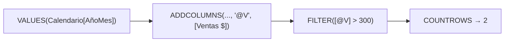

# DAX - tablas virtuales

Parte de: [[17-Power-BI/04 DAX/_Índice DAX|DAX]]

> [!info] Cómo avanzar
> `progreso`: **pendiente** → **viendo** (estudiando) → **visto** (contestaste la autoevaluación sin abrir las respuestas) → **dominado** (hiciste el laboratorio o lo aplicaste de verdad).

## Contenido

### Qué es
Una **tabla virtual** es una tabla que construyes *dentro* de una expresión DAX con funciones como `FILTER`, `VALUES`, `ALL`, `SUMMARIZE`, `ADDCOLUMNS`, `TOPN`, `UNION` o `EXCEPT`. No se guarda en el modelo: existe mientras se evalúa la medida y sirve para **iterar** o para **filtrar**. Son la clave de los cálculos "por grupo" (meses que superan una meta, mejor mes, productos sobre el promedio).

### Cómo funciona
1. Construyes la tabla en el contexto de filtro actual: `VALUES(Calendario[AñoMes])` son los meses visibles.
2. Opcionalmente le agregas columnas calculadas con `ADDCOLUMNS` (cada columna se evalúa por fila, con transición de contexto si usas medidas).
3. La usas en un agregador (`COUNTROWS`, `SUMX`, `MAXX`, `AVERAGEX`) o como filtro en `CALCULATE`.
4. **Una medida siempre debe devolver un escalar**: la tabla virtual termina agregada o aplicada como filtro. Las tablas calculadas del modelo y las consultas con EVALUATE sí devuelven tablas.



Convención útil: nombra las columnas agregadas con `@` (`"@V"`) para distinguirlas de columnas del modelo y referirte a ellas como `[@V]`.

### Ejemplo
> [!example] Modelo de ejemplo de esta sección
> - `Productos`: P1 Café (Bebidas, Negro), P2 Molino (Equipo, Rojo), P3 Galletas (Alimentos, Café).
> - `Ventas` (Cantidad × PrecioUnitario, CostoUnitario): 1) 2024-01-15 P1 2×100 (60); 2) 2024-02-10 P2 1×250 (150); 3) 2024-02-20 P1 3×100 (60); 4) 2025-01-05 P3 5×40 (25); 5) 2025-02-14 P2 2×250 (150).
> - `Calendario` (Fecha, Año, NumMes, Mes, AñoMes, Trimestre) relacionado 1:* con `Ventas[Fecha]`; `Productos` 1:* con `Ventas[IdProducto]`.
> - Medida base: `Ventas $ = SUMX(Ventas, Ventas[Cantidad] * Ventas[PrecioUnitario])` → total **1 450**; Bebidas 500, Equipo 750, Alimentos 200; 2024 = 750, 2025 = 700.

```dax
Meses > 300 =
COUNTROWS(FILTER(VALUES(Calendario[AñoMes]), [Ventas $] > 300))
-- Meses: ene-24 200, feb-24 550, ene-25 200, feb-25 500 → 2

Mejor mes = MAXX(VALUES(Calendario[AñoMes]), [Ventas $])
-- Total: 550; en 2025: 500

Productos sobre promedio =
VAR T = ADDCOLUMNS(VALUES(Productos[IdProducto]), "@V", [Ventas $])
VAR Prom = AVERAGEX(T, [@V])
RETURN COUNTROWS(FILTER(T, [@V] > Prom))
-- Promedio (500 + 750 + 200) / 3 = 483.33 → Café y Molino → 2
```

La variable `T` se calcula una vez y se reutiliza dos veces (promedio y filtro): más rápido y más claro que repetir la expresión.

**Depurar** una tabla virtual: cópiala a la [[Vista de consultas DAX (DAX query view)]] o a [[DAX Studio]] y ejecútala con EVALUATE.

```dax
EVALUATE
ADDCOLUMNS(VALUES(Calendario[AñoMes]), "@V", [Ventas $])
ORDER BY [@V] DESC
```

Otra opción es crearla temporalmente como tabla calculada (*Modelado → Nueva tabla*) y revisar sus filas en la vista de datos; bórrala al terminar.

### Cuándo usarlo y cuándo no
- Cuando la pregunta tiene la forma "**cuántos / cuál / suma de los** grupos que cumplen X": meses sobre la meta, clientes con más de N compras, mejor día.
- Para filtrar con una lista calculada (`TOPN`, `EXCEPT`) en CALCULATE.
- Construye la tabla con la **menor granularidad necesaria**: `VALUES(Calendario[AñoMes])` (24 filas) en vez de `Calendario` (730 filas) o `Ventas` (millones).
- Si la tabla se usa en muchas medidas y no depende de filtros, quizá conviene una tabla física o una columna.

### Errores comunes
- **Intentar que una medida devuelva la tabla**: error; hay que agregarla.
- **Usar `SUMMARIZE` para agregar columnas calculadas**: puede dar resultados inesperados; usa `ADDCOLUMNS(SUMMARIZE(...))` o `SUMMARIZECOLUMNS` ([[DAX - SUMMARIZE, SUMMARIZECOLUMNS y ADDCOLUMNS]]).
- **Iterar la tabla de hechos completa** cuando bastaba una columna de dimensión.
- **No considerar meses sin venta**: `VALUES(Calendario[AñoMes])` incluye meses con BLANK; FILTER con `> 300` los descarta, pero un `COUNTROWS` sin filtro los contaría.

### Para profundizar
- [Función ADDCOLUMNS](https://learn.microsoft.com/en-us/dax/addcolumns-function-dax)
- [Función FILTER](https://learn.microsoft.com/en-us/dax/filter-function-dax)
- [Consultas DAX (EVALUATE)](https://learn.microsoft.com/en-us/dax/dax-queries)

## Ejercicios

Resuélvelos en papel o en la herramienta; la solución está plegada.

> [!question]- Datos de ejemplo (para los ejercicios con resultado numérico): Productos P1 Café (Bebidas), P2 Molino (Equipo), P3 Galletas (Alimentos). Ventas: 1) 2024-01-15 P1 2×100; 2) 2024-02-10 P2 1×250; 3) 2024-02-20 P1 3×100; 4) 2025-01-05 P3 5×40; 5) 2025-02-14 P2 2×250. Medida base: `Ventas $ = SUMX(Ventas, Ventas[Cantidad] * Ventas[PrecioUnitario])` → total 1 450. Medida: número de meses en que las ventas superaron 300. ¿Total?
> ```dax
> Meses > 300 =
> COUNTROWS(FILTER(VALUES(Calendario[AñoMes]), [Ventas $] > 300))
> ```
> Meses con venta: 2024-01 200, 2024-02 550, 2025-01 200, 2025-02 500 → 2.

> [!question]- Medida: ventas del mejor mes del contexto.
> ```dax
> Mejor mes = MAXX(VALUES(Calendario[AñoMes]), [Ventas $])
> ```
> Total → 550.

> [!question]- Datos de ejemplo (para los ejercicios con resultado numérico): Productos P1 Café (Bebidas), P2 Molino (Equipo), P3 Galletas (Alimentos). Ventas: 1) 2024-01-15 P1 2×100; 2) 2024-02-10 P2 1×250; 3) 2024-02-20 P1 3×100; 4) 2025-01-05 P3 5×40; 5) 2025-02-14 P2 2×250. Medida base: `Ventas $ = SUMX(Ventas, Ventas[Cantidad] * Ventas[PrecioUnitario])` → total 1 450. Medida: número de productos cuya venta supera el promedio de ventas por producto. ¿Resultado?
> ```dax
> Productos sobre promedio =
> VAR T = ADDCOLUMNS(VALUES(Productos[IdProducto]), "@V", [Ventas $])
> VAR Prom = AVERAGEX(T, [@V])
> RETURN COUNTROWS(FILTER(T, [@V] > Prom))
> ```
> Promedio 483.33 → Café 500 y Molino 750 → 2.

## Autoevaluación

Contesta primero en voz alta o en papel; luego despliega la respuesta.

> [!question]- ¿Qué es una tabla virtual?
> Una tabla calculada dentro de una medida (FILTER, VALUES, SUMMARIZE, ADDCOLUMNS...) que se usa para iterar o filtrar y no se guarda en el modelo.

> [!question]- ¿Puede una medida devolver una tabla?
> No; una medida devuelve un escalar. La tabla virtual debe terminar agregada (COUNTROWS, SUMX, MAXX) o usada como filtro.

> [!question]- ¿Cómo depurar una tabla virtual?
> Probándola con EVALUATE en la vista de consultas DAX o DAX Studio, o creándola temporalmente como tabla calculada.

