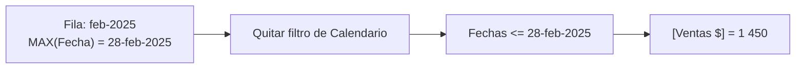

# DAX - totales acumulados

Parte de: [[17-Power-BI/04 DAX/_Índice DAX|DAX]]

> [!info] Cómo avanzar
> `progreso`: **pendiente** → **viendo** (estudiando) → **visto** (contestaste la autoevaluación sin abrir las respuestas) → **dominado** (hiciste el laboratorio o lo aplicaste de verdad).

## Contenido

### Qué es
Un **total acumulado** (*running total*) suma todo lo ocurrido desde el inicio hasta el periodo actual: ventas acumuladas mes a mes, saldo de clientes, avance contra una meta. También existe la variante que **se reinicia** cada año (equivale a YTD) y la variante por **ranking** (acumulado de categorías ordenadas de mayor a menor, base del Pareto).

### Cómo funciona
**Patrón clásico sobre el calendario**:
1. Guarda la última fecha visible del contexto: `VAR UltFecha = MAX(Calendario[Fecha])`.
2. Quita el filtro de fechas que puso el visual (`REMOVEFILTERS(Calendario)` o `ALL(Calendario[Fecha])`).
3. Filtra todas las fechas ≤ `UltFecha`.
4. Evalúa la medida.



¿Por qué `MAX(Calendario[Fecha])` y no `TODAY()`? Porque el acumulado debe depender **del periodo de la fila**: en enero de 2024 debe sumar hasta enero de 2024, no hasta hoy. `TODAY()` daría el mismo número en todas las filas.

**Variante por ranking (Pareto)**: en lugar de fechas, se suman los elementos cuyo valor es mayor o igual al del elemento actual.

**Alternativas modernas**: los [[Cálculos visuales (visual calculations)]] con `RUNNINGSUM([Ventas $])` y la función de ventana `WINDOW`, que define un rango de filas relativo (desde la primera hasta la actual) sobre una tabla ordenada.

### Ejemplo
> [!example] Modelo de ejemplo de esta sección
> - `Productos`: P1 Café (Bebidas, Negro), P2 Molino (Equipo, Rojo), P3 Galletas (Alimentos, Café).
> - `Ventas` (Cantidad × PrecioUnitario, CostoUnitario): 1) 2024-01-15 P1 2×100 (60); 2) 2024-02-10 P2 1×250 (150); 3) 2024-02-20 P1 3×100 (60); 4) 2025-01-05 P3 5×40 (25); 5) 2025-02-14 P2 2×250 (150).
> - `Calendario` (Fecha, Año, NumMes, Mes, AñoMes, Trimestre) relacionado 1:* con `Ventas[Fecha]`; `Productos` 1:* con `Ventas[IdProducto]`.
> - Medida base: `Ventas $ = SUMX(Ventas, Ventas[Cantidad] * Ventas[PrecioUnitario])` → total **1 450**; Bebidas 500, Equipo 750, Alimentos 200; 2024 = 750, 2025 = 700.

```dax
Ventas acumuladas =
VAR UltFecha = MAX(Calendario[Fecha])
RETURN
    CALCULATE([Ventas $], Calendario[Fecha] <= UltFecha, REMOVEFILTERS(Calendario))
-- ene-24 200; feb-24 750; ene-25 950; feb-25 1 450

Acum anual = CALCULATE([Ventas $], DATESYTD(Calendario[Fecha]))
-- ene-24 200; feb-24 750; ene-25 200; feb-25 700

Acum categoria =
VAR V = [Ventas $]
RETURN
    SUMX(
        FILTER(ALLSELECTED(Productos[Categoria]), [Ventas $] >= V),
        [Ventas $]
    )
-- Equipo 750; Bebidas 1 250; Alimentos 1 450

-- Misma idea con WINDOW (desde la primera fila hasta la actual, orden descendente por ventas)
Acum categoria WINDOW =
SUMX(
    WINDOW(1, ABS, 0, REL, ALLSELECTED(Productos[Categoria]), ORDERBY([Ventas $], DESC)),
    [Ventas $]
)
```

Tabla de comprobación del acumulado por mes (meses sin venta muestran el mismo acumulado que el mes anterior si el visual los incluye):

| Mes | Ventas $ | Acumulado | Acum anual |
|---|---|---|---|
| ene-24 | 200 | 200 | 200 |
| feb-24 | 550 | 750 | 750 |
| ene-25 | 200 | 950 | 200 |
| feb-25 | 500 | 1 450 | 700 |

Para evitar que el acumulado se dibuje en meses futuros (el calendario suele llegar a diciembre), agrega una condición: `IF(MIN(Calendario[Fecha]) <= CALCULATE(MAX(Ventas[Fecha]), REMOVEFILTERS()), <acumulado>)`.

### Cuándo usarlo y cuándo no
- **Patrón clásico** cuando el acumulado debe ser una medida reutilizable en cualquier visual y respetar segmentaciones de otras dimensiones.
- **DATESYTD/TOTALYTD** si se reinicia cada año (o año fiscal).
- **RUNNINGSUM** en un cálculo visual cuando solo lo necesitas en un gráfico concreto y quieres simplicidad.
- **Acumulado por ranking** para Pareto y clasificación ABC ([[DAX - patrones comunes (ABC, Pareto y cohortes)]]).

### Errores comunes
- **Usar `TODAY()`** en lugar de la última fecha del contexto.
- **No quitar el filtro de otras columnas del calendario**: si el visual filtra `Calendario[Mes]` y solo quitas el filtro de `Calendario[Fecha]`, el filtro de mes sigue activo y el acumulado se queda en el mes. Por eso se usa `REMOVEFILTERS(Calendario)` (o el calendario marcado como tabla de fechas, que hace ese ajuste automáticamente al filtrar la columna de fecha).
- **Usar la fecha de la tabla de hechos** en la condición.
- **Empates en el acumulado por ranking**: dos categorías con el mismo valor se suman juntas; desempata con un criterio secundario si importa.

### Para profundizar
- [Cumulative total (DAX Patterns)](https://www.daxpatterns.com/cumulative-total/)
- [Función WINDOW](https://learn.microsoft.com/en-us/dax/window-function-dax)
- [Función DATESYTD](https://learn.microsoft.com/en-us/dax/datesytd-function-dax)

## Ejercicios

Resuélvelos en papel o en la herramienta; la solución está plegada.

> [!question]- Datos de ejemplo (para los ejercicios con resultado numérico): Productos P1 Café (Bebidas), P2 Molino (Equipo), P3 Galletas (Alimentos). Ventas: 1) 2024-01-15 P1 2×100; 2) 2024-02-10 P2 1×250; 3) 2024-02-20 P1 3×100; 4) 2025-01-05 P3 5×40; 5) 2025-02-14 P2 2×250. Medida base: `Ventas $ = SUMX(Ventas, Ventas[Cantidad] * Ventas[PrecioUnitario])` → total 1 450. Medida `Ventas acumuladas`. Valores por mes (con venta).
> ```dax
> Ventas acumuladas =
> VAR UltFecha = MAX(Calendario[Fecha])
> RETURN CALCULATE([Ventas $], Calendario[Fecha] <= UltFecha, REMOVEFILTERS(Calendario))
> ```
> 2024-01 200; 2024-02 750; 2025-01 950; 2025-02 1 450.

> [!question]- Acumulado que se reinicia cada año (equivale a YTD).
> ```dax
> Acum anual = CALCULATE([Ventas $], DATESYTD(Calendario[Fecha]))
> ```
> 2025-01 200; 2025-02 700.

> [!question]- Acumulado por categoría ordenado de mayor a menor (para Pareto), con la ventana `WINDOW`/alternativa clásica.
> Clásica:
> ```dax
> Acum categoría =
> VAR V = [Ventas $]
> RETURN SUMX(FILTER(ALLSELECTED(Productos[Categoria]), [Ventas $] >= V), [Ventas $])
> ```
> Equipo 750; Bebidas 1 250; Alimentos 1 450.

## Autoevaluación

Contesta primero en voz alta o en papel; luego despliega la respuesta.

> [!question]- ¿Cuál es el patrón clásico de acumulado?
> Quitar el filtro de fechas y filtrar todas las fechas ≤ la última fecha visible: `CALCULATE([Ventas $], FILTER(ALL(Calendario[Fecha]), Calendario[Fecha] <= MAX(Calendario[Fecha])))`.

> [!question]- ¿Por qué se usa MAX(Calendario[Fecha]) y no TODAY()?
> Para que el acumulado dependa del periodo en la fila del visual.

> [!question]- ¿Qué otra opción existe para acumulados en el visual?
> Cálculos visuales con `RUNNINGSUM`, o funciones de ventana (WINDOW). Ver [[Cálculos visuales (visual calculations)]].

## Práctica

- [[Lab 6 - Medidas con CALCULATE y comparativos de tiempo en Power BI]]

