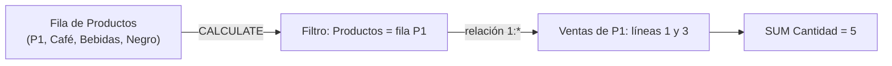

# DAX - transición de contexto

Parte de: [[17-Power-BI/04 DAX/_Índice DAX|DAX]]

> [!info] Cómo avanzar
> `progreso`: **pendiente** → **viendo** (estudiando) → **visto** (contestaste la autoevaluación sin abrir las respuestas) → **dominado** (hiciste el laboratorio o lo aplicaste de verdad).

## Contenido

### Qué es
La **transición de contexto** es la conversión automática de un contexto de fila en un contexto de filtro equivalente. La provoca `CALCULATE` (y `CALCULATETABLE`) cuando se ejecuta dentro de una fila, y también **cualquier referencia a una medida**, porque toda medida lleva un `CALCULATE` implícito. Es el puente entre los dos contextos de DAX.

### Cómo funciona
1. Estás en una fila (columna calculada o iterador). Ejemplo: la fila de Productos con IdProducto = P1, Producto = Café, Categoria = Bebidas, Color = Negro.
2. CALCULATE toma **todas las columnas de esa fila** y las convierte en filtros: `Productos[IdProducto] = "P1"`, `Productos[Producto] = "Café"`, etc.
3. Ese filtro se propaga por las relaciones a Ventas.
4. La expresión se evalúa solo con las ventas de Café.



Sin transición, el contexto de fila no filtra nada: `SUM` ve toda la tabla visible.

### Ejemplo
> [!example] Modelo de ejemplo de esta sección
> - `Productos`: P1 Café (Bebidas, Negro), P2 Molino (Equipo, Rojo), P3 Galletas (Alimentos, Café).
> - `Ventas` (Cantidad × PrecioUnitario, CostoUnitario): 1) 2024-01-15 P1 2×100 (60); 2) 2024-02-10 P2 1×250 (150); 3) 2024-02-20 P1 3×100 (60); 4) 2025-01-05 P3 5×40 (25); 5) 2025-02-14 P2 2×250 (150).
> - `Calendario` (Fecha, Año, NumMes, Mes, AñoMes, Trimestre) relacionado 1:* con `Ventas[Fecha]`; `Productos` 1:* con `Ventas[IdProducto]`.
> - Medida base: `Ventas $ = SUMX(Ventas, Ventas[Cantidad] * Ventas[PrecioUnitario])` → total **1 450**; Bebidas 500, Equipo 750, Alimentos 200; 2024 = 750, 2025 = 700.

Columnas calculadas en **Productos**:

```dax
Unidades sin CALCULATE = SUM(Ventas[Cantidad])
-- 13 en todas las filas: la fila no filtra

Unidades con CALCULATE = CALCULATE(SUM(Ventas[Cantidad]))
-- Café 5, Molino 3, Galletas 5

Total vendido = [Ventas $]
-- La medida hace transición implícita: Café 500, Molino 750, Galletas 200

Vendio mas de 400 = IF([Ventas $] > 400, "Sí", "No")
-- Café Sí, Molino Sí, Galletas No
```

Medida que promedia el total de cada producto:

```dax
Promedio por producto = AVERAGEX(VALUES(Productos[IdProducto]), [Ventas $])
-- (500 + 750 + 200) / 3 = 483.33
```

Aquí AVERAGEX crea un contexto de fila por producto y `[Ventas $]`, al ser medida, transforma cada fila en filtro. Si escribieras la expresión sin medida ni CALCULATE (`SUMX(Ventas, ...)` directamente dentro), cada iteración vería todas las ventas y el promedio sería 1 450.

### Cuándo usarlo y cuándo no
- Es lo que hace funcionar los patrones "por cliente", "por mes", "por producto": `SUMX(VALUES(Dim[Clave]), [Medida])`, `MAXX(VALUES(Calendario[AñoMes]), [Ventas $])`, rankings con RANKX.
- Úsala iterando **tablas pequeñas o columnas de dimensión**, no la tabla de hechos completa.
- En columnas calculadas de dimensiones (Productos, Clientes) es razonable: pocas filas.

### Errores comunes
- **Iterar la tabla de hechos llamando una medida**: `SUMX(Ventas, [Ventas $])`. Cada fila de Ventas se convierte en filtro sobre **todas** sus columnas; es lento y, si hay filas duplicadas (mismos valores en todas las columnas), el filtro selecciona varias filas a la vez y el resultado sale **multiplicado**. Itera columnas o claves únicas.
- **No darse cuenta de que una medida hace transición**: `[Ventas $]` y `SUMX(Ventas, ...)` escritos "en línea" no son equivalentes dentro de un iterador.
- **Columnas calculadas con CALCULATE en tablas de hechos grandes**: actualizaciones lentas y riesgo de dependencias circulares entre columnas.
- **Confundir con ALL**: la transición agrega filtros; no quita los existentes del visual.

### Para profundizar
- [Understanding context transition in DAX (SQLBI)](https://www.sqlbi.com/articles/understanding-context-transition-in-dax/)
- [Context transition explained visually (SQLBI)](https://www.sqlbi.com/articles/context-transition-in-dax-explained-visually/)
- [Función CALCULATE](https://learn.microsoft.com/en-us/dax/calculate-function-dax)

## Ejercicios

Resuélvelos en papel o en la herramienta; la solución está plegada.

> [!question]- Modelo de práctica: `Ventas`(IdVenta, Fecha, FechaEnvio, IdProducto, Cantidad, PrecioUnitario, CostoUnitario), `Productos`(IdProducto, Producto, Categoria, Color) y `Calendario`(Fecha, Año, NumMes, Mes, Trimestre). Relaciones activas Ventas[Fecha] → Calendario[Fecha] y Ventas[IdProducto] → Productos[IdProducto] (1:*, filtro simple). Columna calculada en Productos con el total vendido de cada producto.
> ```dax
> Ventas del producto = [Ventas $]
> ```
> (la medida implica CALCULATE y hace la transición). Equivalente: `CALCULATE(SUMX(Ventas, Ventas[Cantidad] * Ventas[PrecioUnitario]))`.

> [!question]- Medida: promedio de ventas por producto (promediar el total de cada producto).
> ```dax
> Promedio por producto = AVERAGEX(VALUES(Productos[IdProducto]), [Ventas $])
> ```
> Con los datos de ejemplo: (500 + 750 + 200) / 3 ≈ 483.33.

> [!question]- Columna calculada en Productos: "Sí" si el producto vendió más de 400, si no "No". ¿Resultado?
> ```dax
> Vende mucho = IF([Ventas $] > 400, "Sí", "No")
> ```
> Café 500 → Sí; Molino 750 → Sí; Galletas 200 → No.

## Autoevaluación

Contesta primero en voz alta o en papel; luego despliega la respuesta.

> [!question]- ¿Qué es la transición de contexto?
> Cuando CALCULATE se ejecuta dentro de un contexto de fila, convierte esa fila en un filtro equivalente. Toda referencia a una **medida** lleva un CALCULATE implícito.

> [!question]- En una columna calculada de Productos, ¿qué diferencia hay entre `SUM(Ventas[Cantidad])` y `CALCULATE(SUM(Ventas[Cantidad]))`?
> La primera da el total de todas las ventas en cada fila; la segunda filtra por el producto de la fila y da sus ventas.

> [!question]- Riesgo de la transición de contexto al iterar la tabla de hechos.
> Si la tabla tiene filas duplicadas, la fila convertida en filtro coincide con todas las duplicadas y se cuentan de más; además, iterar millones de filas con transición es lento.

