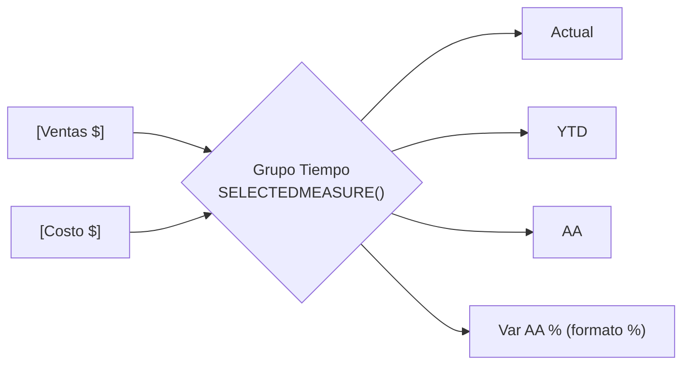

# Grupos de cálculo

Parte de: [[17-Power-BI/04 DAX/_Índice DAX|DAX]]

> [!info] Cómo avanzar
> `progreso`: **pendiente** → **viendo** (estudiando) → **visto** (contestaste la autoevaluación sin abrir las respuestas) → **dominado** (hiciste el laboratorio o lo aplicaste de verdad).

## Contenido

### Qué es
Un **grupo de cálculo** es una tabla especial del modelo cuyas filas, llamadas **elementos de cálculo**, son expresiones DAX que se aplican **a cualquier medida** que esté en el visual. Resuelven la *explosión de medidas*: en lugar de escribir Ventas YTD, Costo YTD, Margen YTD, Ventas AA, Costo AA... (medidas × variantes), escribes la variante una sola vez (YTD, AA, Var %) y la combinas con todas las medidas.

### Cómo funciona
1. El grupo tiene una columna (por ejemplo, `Tiempo[Calculo]`) con los elementos: Actual, YTD, AA, Var AA %.
2. Cada elemento usa `SELECTEDMEASURE()`, que representa "la medida que esté en el visual".
3. Cuando pones `Tiempo[Calculo]` en columnas de una matriz y `[Ventas $]` en valores, cada columna evalúa la medida reemplazada por la expresión del elemento.
4. **Cadena de formato dinámica**: cada elemento puede definir su propio formato con una expresión (`"0.00 %"` para Var %, o `SELECTEDMEASUREFORMATSTRING()` para respetar el formato original de la medida).
5. **Precedencia**: si hay varios grupos de cálculo, la propiedad *Precedence* define cuál se aplica primero (por ejemplo, tiempo y luego conversión de moneda).

Requisito importante: los grupos de cálculo solo funcionan con **medidas explícitas**. Al crear el primero, Power BI activa *Desalentar medidas implícitas*: ya no puedes arrastrar una columna numérica para que se sume sola.

**Dónde se crean**: en Power BI Desktop, desde la vista **Modelo** (*Explorador de modelos → Grupos de cálculo → Nuevo grupo de cálculo*, o el botón *Grupo de cálculo* de la cinta); también con [[Tabular Editor]] o editando TMDL en proyectos PBIP.



### Ejemplo
> [!example] Modelo de ejemplo de esta sección
> - `Productos`: P1 Café (Bebidas, Negro), P2 Molino (Equipo, Rojo), P3 Galletas (Alimentos, Café).
> - `Ventas` (Cantidad × PrecioUnitario, CostoUnitario): 1) 2024-01-15 P1 2×100 (60); 2) 2024-02-10 P2 1×250 (150); 3) 2024-02-20 P1 3×100 (60); 4) 2025-01-05 P3 5×40 (25); 5) 2025-02-14 P2 2×250 (150).
> - `Calendario` (Fecha, Año, NumMes, Mes, AñoMes, Trimestre) relacionado 1:* con `Ventas[Fecha]`; `Productos` 1:* con `Ventas[IdProducto]`.
> - Medida base: `Ventas $ = SUMX(Ventas, Ventas[Cantidad] * Ventas[PrecioUnitario])` → total **1 450**; Bebidas 500, Equipo 750, Alimentos 200; 2024 = 750, 2025 = 700.

Elementos del grupo `Tiempo`, columna `Calculo`:

```dax
-- Actual
SELECTEDMEASURE()

-- YTD
CALCULATE(SELECTEDMEASURE(), DATESYTD(Calendario[Fecha]))

-- AA
CALCULATE(SELECTEDMEASURE(), SAMEPERIODLASTYEAR(Calendario[Fecha]))

-- Var AA %
VAR Actual = SELECTEDMEASURE()
VAR AA = CALCULATE(SELECTEDMEASURE(), SAMEPERIODLASTYEAR(Calendario[Fecha]))
RETURN DIVIDE(Actual - AA, AA)

-- Expresión de cadena de formato del elemento "Var AA %"
"0.00 %"
-- (en los demás elementos: SELECTEDMEASUREFORMATSTRING())
```

Matriz con Mes en filas, `Tiempo[Calculo]` en columnas y `[Ventas $]` en valores, fila **febrero 2025**: Actual 500; YTD 700; AA 550; Var AA % −9.09 %. Si cambias la medida a `[Costo $]`, la misma matriz muestra Actual 300, YTD 425, AA 330 y Var AA % −9.09 % sin escribir medidas nuevas (costos de feb-25: 2×150; ene-25: 5×25; feb-24: 150 + 3×60).

Para usar un elemento dentro de otra medida: `CALCULATE([Ventas $], Tiempo[Calculo] = "YTD")`.

### Cuándo usarlo y cuándo no
- **Úsalos** cuando tienes varias medidas base y las mismas variantes de tiempo, escenarios o conversión de moneda.
- También para **formato dinámico** (mostrar miles o millones según el nivel) y para cambiar la medida mostrada.
- **No los uses** si solo tienes una o dos medidas con una variante: una medida normal es más fácil de entender.
- Para que el usuario elija qué medida o dimensión ve, existen también los [[Parámetros de campo]]; se pueden combinar.

### Errores comunes
- **Esperar que funcionen con medidas implícitas**: solo con medidas explícitas.
- **Elementos que se aplican a medidas que no deberían** (por ejemplo, Var % aplicado a una medida de porcentaje): filtra con `ISSELECTEDMEASURE([Ventas $], [Costo $])` o con `SELECTEDMEASURENAME()`.
- **Olvidar el formato** del elemento de porcentaje: verás −0.09 en lugar de −9.09 %.
- **Varios grupos sin definir precedencia**: el orden de aplicación cambia los resultados.

### Para profundizar
- [Crear grupos de cálculo en Power BI Desktop](https://learn.microsoft.com/en-us/power-bi/transform-model/calculation-groups)
- [Grupos de cálculo en modelos tabulares (Analysis Services)](https://learn.microsoft.com/en-us/analysis-services/tabular-models/calculation-groups)
- [Introducing calculation groups (SQLBI)](https://www.sqlbi.com/articles/introducing-calculation-groups/)

## Autoevaluación

Contesta primero en voz alta o en papel; luego despliega la respuesta.

> [!question]- ¿Qué problema resuelven?
> La explosión de medidas: en vez de crear Ventas YTD, Costo YTD, Margen YTD..., se crea un elemento de cálculo "YTD" que se aplica a cualquier medida con `SELECTEDMEASURE()`.

> [!question]- Escribe el elemento de cálculo YTD.
> ```dax
> CALCULATE(SELECTEDMEASURE(), DATESYTD(Calendario[Fecha]))
> ```

> [!question]- ¿Dónde se crean?
> En la vista Modelo de Power BI Desktop (en versiones recientes) o con Tabular Editor. Al crearlos, el modelo exige medidas explícitas (no se pueden arrastrar columnas numéricas para sumarlas implícitamente).

> [!question]- ¿Qué es la cadena de formato dinámica en un grupo de cálculo?
> Una expresión que define el formato según el elemento (p. ej. porcentaje para "Var %"), con `SELECTEDMEASUREFORMATSTRING()`.

