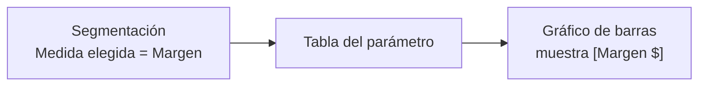

# Parámetros de campo

Parte de: [[17-Power-BI/04 DAX/_Índice DAX|DAX]]

> [!info] Cómo avanzar
> `progreso`: **pendiente** → **viendo** (estudiando) → **visto** (contestaste la autoevaluación sin abrir las respuestas) → **dominado** (hiciste el laboratorio o lo aplicaste de verdad).

## Contenido

### Qué es
Un **parámetro de campo** (*field parameter*) permite que el usuario elija, con una segmentación, **qué medida o qué columna** muestra un visual: el mismo gráfico puede mostrar Ventas $, Costo $ o Margen $, o agrupar por Categoría, Producto o Color, sin duplicar visuales ni usar marcadores. Técnicamente es una **tabla calculada** que Power BI crea con una lista de campos.

### Cómo funciona
1. En Power BI Desktop: *Modelado → Nuevo parámetro → Campos*.
2. Le das un nombre y eliges los campos (medidas, columnas o ambos); puedes reordenarlos y cambiar el nombre que verá el usuario.
3. Power BI crea una tabla calculada con tres valores por campo: nombre para mostrar, referencia al campo con `NAMEOF` y un número de orden. Si dejas marcada la opción, agrega una segmentación al lienzo.
4. Pones la columna del parámetro en el eje o en los valores del visual; la segmentación decide qué campo(s) se muestran.

El DAX generado se ve así (puedes editarlo; cada tupla debe tener exactamente tres valores):

```dax
Medida elegida = {
    ("Ventas", NAMEOF([Ventas $]), 0),
    ("Costo",  NAMEOF([Costo $]),  1),
    ("Margen", NAMEOF([Margen $]), 2)
}
```



**Diferencia con un parámetro de hipótesis (what-if)**: *Nuevo parámetro → Intervalo numérico* genera una tabla con una **serie de números** (por ejemplo, descuento de 0 % a 30 % en pasos de 5 %) y una medida con el valor elegido (`SELECTEDVALUE`), que usas dentro de tus cálculos ("¿cuánto venderíamos con 10 % de descuento?"). El de campos no cambia números: cambia **qué campo** se muestra.

### Ejemplo
> [!example] Modelo de ejemplo de esta sección
> - `Productos`: P1 Café (Bebidas, Negro), P2 Molino (Equipo, Rojo), P3 Galletas (Alimentos, Café).
> - `Ventas` (Cantidad × PrecioUnitario, CostoUnitario): 1) 2024-01-15 P1 2×100 (60); 2) 2024-02-10 P2 1×250 (150); 3) 2024-02-20 P1 3×100 (60); 4) 2025-01-05 P3 5×40 (25); 5) 2025-02-14 P2 2×250 (150).
> - `Calendario` (Fecha, Año, NumMes, Mes, AñoMes, Trimestre) relacionado 1:* con `Ventas[Fecha]`; `Productos` 1:* con `Ventas[IdProducto]`.
> - Medida base: `Ventas $ = SUMX(Ventas, Ventas[Cantidad] * Ventas[PrecioUnitario])` → total **1 450**; Bebidas 500, Equipo 750, Alimentos 200; 2024 = 750, 2025 = 700.

Supón `Costo $ = SUMX(Ventas, Ventas[Cantidad] * Ventas[CostoUnitario])` y `Margen $ = [Ventas $] - [Costo $]`.

- Parámetro **Medida elegida** con Ventas, Costo y Margen; parámetro **Agrupar por** con `Productos[Categoria]`, `Productos[Producto]` y `Productos[Color]`.
- Un gráfico de barras con *Agrupar por* en el eje y *Medida elegida* en valores.
- Con "Margen" y "Categoría" elegidos, el gráfico muestra Equipo 300 (750 − 450), Bebidas 200 (500 − 300) y Alimentos 75 (200 − 125); al cambiar a "Color" muestra Rojo 300, Negro 200 y Café 75.

Título dinámico del visual:

```dax
Titulo parametro =
SELECTEDVALUE('Medida elegida'[Medida elegida], "Varias medidas") & " por " &
SELECTEDVALUE('Agrupar por'[Agrupar por], "varios campos")
```

Y un parámetro what-if para comparar:

```dax
-- Creado con Nuevo parámetro → Intervalo numérico (0 a 0.3, incremento 0.05)
Ventas con descuento = [Ventas $] * (1 - [Descuento Valor])
-- Con 10 %: 1 450 × 0.9 = 1 305
```

### Cuándo usarlo y cuándo no
- **Úsalo** para tableros compactos donde el usuario explora varias medidas o dimensiones en el mismo espacio.
- **Combínalo** con grupos de cálculo (variantes de tiempo) y títulos dinámicos.
- **No lo uses** si el usuario necesita ver varias medidas a la vez de forma comparativa fija; una matriz con todas puede ser más clara.
- Si necesitas "ninguno" como opción, no existe: no seleccionar nada equivale a seleccionar todo.

### Errores comunes
- **Agregar columnas extra a las tuplas** del DAX generado: no está soportado y causa resultados inesperados.
- **Usar columnas sueltas como medidas implícitas**: el parámetro requiere medidas explícitas para valores agregados.
- **Esperar jerarquía de fechas automática** al incluir una columna de fecha: se pierde la asociación con la jerarquía; usa columnas explícitas de año, trimestre y mes.
- **Usarlo como campo de obtención de detalles o información sobre herramientas**: no se admite como campo vinculado; vincula los campos individuales.

### Para profundizar
- [Parámetros de campo (Microsoft Learn)](https://learn.microsoft.com/en-us/power-bi/create-reports/power-bi-field-parameters)
- [Parámetros de hipótesis (what-if)](https://learn.microsoft.com/en-us/power-bi/transform-model/desktop-what-if)
- [Función NAMEOF](https://learn.microsoft.com/en-us/dax/nameof-function-dax)

## Autoevaluación

Contesta primero en voz alta o en papel; luego despliega la respuesta.

> [!question]- ¿Para qué sirven los parámetros de campo?
> Para que el usuario elija con una segmentación qué medida o qué columna (dimensión) muestra un visual.

> [!question]- ¿Cómo se crean?
> *Modelado → Nuevo parámetro → Campos*: genera una tabla calculada con `NAMEOF` de cada campo, orden y una segmentación.

> [!question]- Diferencia con un parámetro de hipótesis (what-if).
> El de hipótesis genera una serie de valores numéricos (p. ej. % de descuento) para usar en medidas; el de campos cambia qué campo se muestra.

