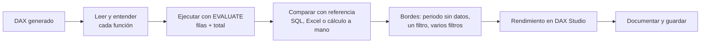

# Cuándo confiar en Copilot y cómo validar lo que genera

Parte de: [[17-Power-BI/05 Ayudas para crear DAX más rápido/_Índice Ayudas para crear DAX más rápido|Ayudas para crear DAX más rápido]]

> [!info] Cómo avanzar
> `progreso`: **pendiente** → **viendo** (estudiando) → **visto** (contestaste la autoevaluación sin abrir las respuestas) → **dominado** (hiciste el laboratorio o lo aplicaste de verdad).

## Contenido

### Qué es
Una guía práctica para decidir **cuánto confiar** en el DAX que genera Copilot (o cualquier asistente de IA) y **cómo validarlo** antes de que llegue a un informe. Copilot trabaja con los metadatos del modelo y patrones aprendidos; puede producir fórmulas que compilan y dan números plausibles pero equivocados. La responsabilidad del resultado sigue siendo tuya.

### Cómo funciona
**Cuándo es razonable apoyarse en Copilot**
- Cálculos **estándar** con patrones conocidos: sumas filtradas, porcentajes del total, YTD, comparativos simples, rankings.
- Consultas **exploratorias** para conocer un modelo ajeno o recordar sintaxis.
- **Explicar** DAX heredado (como primer resumen, no como verdad).
- Cuando **tú puedes verificar** el resultado: conoces los datos o tienes un valor de referencia.

**Cuándo desconfiar más**
- Lógica con **transición de contexto**, totales no aditivos, semiaditivos, relaciones inactivas o calendarios fiscales.
- Modelos con nombres ambiguos o sin descripciones.
- Funciones **recientes** que Copilot podría no conocer.
- Cálculos regulatorios o financieros donde un error cuesta caro.

**Proceso de validación**



Formas concretas de validar:
1. **Leerlo**: si no puedes explicar cada línea, no lo guardes.
2. **Ejecutarlo** en la [[Vista de consultas DAX (DAX query view)]] por varias agrupaciones y con `EVALUATE { [Medida] }` para el total.
3. **Comparar con una fuente independiente**: una consulta SQL sobre la base (por ejemplo, el procedimiento que ya usa tu API), una tabla dinámica de Excel o un cálculo a mano con datos pequeños.
4. **Casos borde**: periodo sin ventas, una sola categoría, segmentaciones combinadas, primer año (sin año anterior), meses incompletos.
5. **Rendimiento**: medir en [[DAX Studio]] con *Server Timings* si va a usarse en visuales grandes.
6. **Revisión de estilo**: formatear con [[DAX Formatter y guías de estilo]], nombres y descripción.

### Ejemplo
> [!example] Modelo de ejemplo de esta sección
> - `Productos`: P1 Café (Bebidas, Negro), P2 Molino (Equipo, Rojo), P3 Galletas (Alimentos, Café).
> - `Ventas` (Cantidad × PrecioUnitario, CostoUnitario): 1) 2024-01-15 P1 2×100 (60); 2) 2024-02-10 P2 1×250 (150); 3) 2024-02-20 P1 3×100 (60); 4) 2025-01-05 P3 5×40 (25); 5) 2025-02-14 P2 2×250 (150).
> - `Calendario` (Fecha, Año, NumMes, Mes, AñoMes, Trimestre) relacionado 1:* con `Ventas[Fecha]`; `Productos` 1:* con `Ventas[IdProducto]`.
> - Medida base: `Ventas $ = SUMX(Ventas, Ventas[Cantidad] * Ventas[PrecioUnitario])` → total **1 450**; Bebidas 500, Equipo 750, Alimentos 200; 2024 = 750, 2025 = 700.

Pides "ventas acumuladas" y Copilot genera:

```dax
Ventas acumuladas =
CALCULATE([Ventas $], FILTER(ALL(Ventas[Fecha]), Ventas[Fecha] <= MAX(Ventas[Fecha])))
```

En el **total** da 1 450 (correcto), pero **por mes** se ve raro: los meses del calendario sin ventas muestran blank, y si el visual filtra por `Calendario[Mes]` el acumulado no avanza como debería, porque el filtro del calendario sigue activo y se quitó el de la columna equivocada. Sospechas: usa la **fecha de la tabla de hechos** en lugar del calendario y quita un filtro que no es el del visual. Es el síntoma típico de "total correcto, detalle raro": problema de **contexto de filtro** (columna equivocada, ALL vs ALLSELECTED, falta de REMOVEFILTERS sobre la tabla de fechas) o de una medida no aditiva.

Versión corregida y verificada contra la tabla de valores esperados:

```dax
Ventas acumuladas =
VAR UltFecha = MAX(Calendario[Fecha])
RETURN CALCULATE([Ventas $], Calendario[Fecha] <= UltFecha, REMOVEFILTERS(Calendario))
-- ene-24 200; feb-24 750; ene-25 950; feb-25 1 450  ✔
```

### Cuándo usarlo y cuándo no
- Úsalo como **acelerador**, no como autor: borrador → validación → tu versión final.
- En equipos, exige el mismo proceso de revisión que para código C#: la medida va al repositorio (proyecto PBIP en Azure DevOps) y se revisa en un *pull request*.
- No lo uses para decidir la **definición de negocio** ("¿qué es un cliente activo?"): eso lo define el negocio y lo documentas tú.

### Errores comunes
- **Validar solo el total**: muchos errores aparecen solo en el detalle (o al revés).
- **Validar con los mismos supuestos** que usó Copilot (por ejemplo, otra medida generada por IA).
- **No probar con filtros combinados** ni periodos sin datos.
- **Guardar sin descripción**: dentro de seis meses nadie sabrá qué hace ni por qué.

### Para profundizar
- [Usar Copilot para escribir y explicar consultas DAX (limitaciones)](https://learn.microsoft.com/en-us/power-bi/transform-model/dax-query-copilot-create)
- [Copilot para DAX](https://learn.microsoft.com/en-us/dax/dax-copilot)
- [Filter context en DAX (SQLBI)](https://www.sqlbi.com/articles/filter-context-in-dax/)

## Autoevaluación

Contesta primero en voz alta o en papel; luego despliega la respuesta.

> [!question]- ¿Cuándo es razonable apoyarse en Copilot?
> Para borradores, explicar código existente, recordar sintaxis o generar descripciones; siempre con alguien que entienda DAX y valide.

> [!question]- Menciona tres formas de validar una medida generada.
> 1) Comparar con un total conocido del origen (SQL/Excel). 2) Probar en una matriz con varios niveles y revisar totales. 3) Probar casos borde: periodo sin datos, un solo producto, filtros cruzados.

> [!question]- Caso: Copilot genera una medida que da el número correcto en el total pero raro por mes. ¿Qué sospechas?
> Problema de contexto: quitó filtros de fecha (ALL) o usó una columna de fecha de la tabla de hechos en vez del Calendario.

