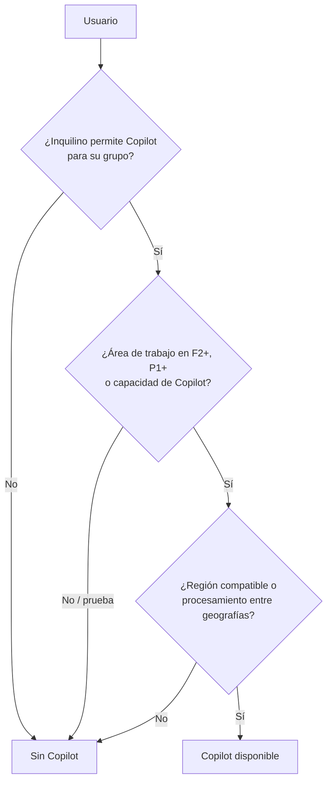

# Requisitos y licencias para usar Copilot en Power BI

Parte de: [[17-Power-BI/05 Ayudas para crear DAX más rápido/_Índice Ayudas para crear DAX más rápido|Ayudas para crear DAX más rápido]]

> [!info] Cómo avanzar
> `progreso`: **pendiente** → **viendo** (estudiando) → **visto** (contestaste la autoevaluación sin abrir las respuestas) → **dominado** (hiciste el laboratorio o lo aplicaste de verdad).

## Contenido

### Qué es
Copilot en Power BI (en el Service y en Desktop, incluida la [[Copilot en la vista de consultas DAX (escribir y explicar consultas)|vista de consultas DAX]]) no depende solo de que tengas una licencia de usuario: depende sobre todo de la **capacidad** donde vive el contenido, de la **configuración del inquilino** que controla el administrador y de la **región**. Por eso no se puede prometer que "todos" lo tendrán.

### Cómo funciona
Requisitos según la página *Habilitar Copilot de Fabric para Power BI* de Microsoft Learn (consultada en noviembre de 2026):

1. **Capacidad**: el área de trabajo debe estar en una capacidad **Power BI Premium (P1 o superior)**, una capacidad **Fabric de pago (F2 o superior)** o asociada a una **capacidad de Copilot de Fabric** (que factura solo el consumo de Copilot; las consultas al modelo se cobran a la capacidad del modelo).
2. **No compatibles**: SKU y capacidades de **prueba** (*trial*), entornos con Private Link o redes cerradas.
3. **Configuración del inquilino** (portal de administración de Fabric): *Los usuarios pueden usar Copilot y otras características con tecnología de Azure OpenAI*. Viene habilitada por omisión, pero el administrador puede desactivarla o limitarla a grupos. La experiencia independiente de Copilot requiere habilitarla a nivel de inquilino.
4. **Región**: la capacidad debe estar en una región compatible con Fabric. Si Azure OpenAI no está disponible en tu geografía, el administrador debe permitir que los datos se procesen **fuera de la región** (configuración de procesamiento entre geografías), con las implicaciones de cumplimiento que eso tiene.
5. **Power BI Desktop**: si no tienes capacidad de Copilot de Fabric, necesitas rol de **Administrador, Miembro o Colaborador** en al menos un área de trabajo con Copilot habilitado en F2+ o P1+; la primera vez eliges ese espacio de trabajo y luego puedes cambiarlo en la configuración. Con rol de Visor no basta.

La página no menciona **Pro** ni **Premium por usuario (PPU)** como suficientes por sí solas; una guía de terceros (DataBear, abril de 2026) afirma que los espacios PPU no son compatibles (Pendiente de confirmar con Microsoft para tu inquilino). Las capacidades P están en retiro gradual en favor de las F (fechas y condiciones: Pendiente de confirmar con tu representante de Microsoft). El costo de una capacidad F depende de la región y del esquema (pago por uso o reservado): Pendiente de confirmar en la página de precios de Fabric.

### Ejemplo
Escenario: el equipo de Itzamna quiere usar Copilot para escribir DAX en el informe de ventas que hoy está en un área de trabajo **Pro** compartida.

- Con Pro solamente: Copilot no aparece. El desarrollador puede seguir usando la vista de consultas DAX, DAX Studio y Tabular Editor 2, todos sin costo adicional.
- Opción A: la organización compra una capacidad **F2** o superior en una región compatible, asigna el área de trabajo de desarrollo a esa capacidad y el administrador habilita Copilot para el grupo "BI-Desarrollo".
- Opción B: si ya existe una capacidad Fabric en otra área, el administrador configura una **capacidad de Copilot de Fabric** y asigna a esos usuarios.
- En Desktop, cada desarrollador debe ser al menos **Colaborador** de un área de trabajo compatible y seleccionarla al abrir Copilot.
- Se documenta en el repositorio (Azure DevOps) qué datos ve Copilot (metadatos del modelo) y la aprobación del área de seguridad si hay procesamiento fuera de la región.

### Cuándo usarlo y cuándo no
- Vale la pena cuando varios autores crean y mantienen modelos y el ahorro de tiempo justifica la capacidad, o cuando la organización ya paga Fabric por otras cargas.
- Para un desarrollador individual que aprende DAX, las herramientas gratuitas (vista de consultas DAX, DAX Studio, Tabular Editor 2, DAX Guide) cubren casi todo sin depender de licencias.
- Antes de diseñar un proceso que dependa de Copilot, confirma requisitos con el administrador de Fabric: cambian con frecuencia.

### Errores comunes
- **Probar con una capacidad de prueba** y concluir que Copilot "no funciona": las pruebas no están soportadas.
- **Suponer que la licencia Pro basta**.
- **Olvidar la región** y el consentimiento para procesar datos fuera de ella.
- **Tener rol de Visor** en el área de trabajo y esperar Copilot en Desktop.
- **Prometer disponibilidad a todos** sin revisar la configuración del inquilino ni la capacidad de cada área de trabajo.

### Para profundizar
- [Habilitar Copilot de Fabric para Power BI](https://learn.microsoft.com/en-us/power-bi/create-reports/copilot-enable-power-bi)
- [Preguntas frecuentes de Copilot en Fabric](https://learn.microsoft.com/en-us/fabric/fundamentals/copilot-faq-fabric)
- [Disponibilidad de Fabric por región](https://learn.microsoft.com/en-us/fabric/admin/region-availability)

## Autoevaluación

Contesta primero en voz alta o en papel; luego despliega la respuesta.

> [!question]- ¿Qué tipo de requisitos suele tener Copilot en Power BI?
> Que el contenido esté en una capacidad de pago compatible, que el administrador habilite la configuración del inquilino y requisitos de región/datos. Los detalles cambian: (verificar en la página oficial).

> [!question]- ¿Por qué no prometer que Copilot estará disponible para todos?
> Porque depende de licencias, de la capacidad del workspace y de decisiones del administrador; puede estar desactivado por políticas de la organización.

