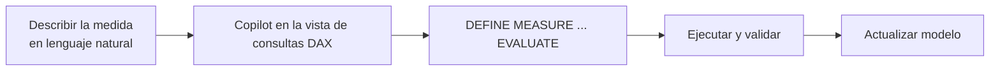

# Sugerencias de medidas rápidas con Copilot

Parte de: [[17-Power-BI/05 Ayudas para crear DAX más rápido/_Índice Ayudas para crear DAX más rápido|Ayudas para crear DAX más rápido]]

> [!info] Cómo avanzar
> `progreso`: **pendiente** → **viendo** (estudiando) → **visto** (contestaste la autoevaluación sin abrir las respuestas) → **dominado** (hiciste el laboratorio o lo aplicaste de verdad).

## Contenido

### Qué es
"Sugerencias de medidas rápidas con Copilot" (*quick measure suggestions*) fue una función en versión preliminar de Power BI Desktop: dentro del panel de **medidas rápidas** escribías en lenguaje natural la medida que querías ("ventas del año anterior por categoría") y Copilot proponía una o varias fórmulas DAX que podías revisar y agregar al modelo. Hoy esa experiencia **se reemplazó** por Copilot en la vista de consultas DAX.

### Cómo funciona
Estado verificado (noviembre de 2026):
- La página de Microsoft Learn de la función indica que requiere Power BI Desktop de **octubre de 2024 o posterior** y remite a **Copilot de Microsoft Fabric en la vista de consultas DAX**, donde describes la medida, Copilot sugiere el DAX y la agregas al modelo cuando estés listo.
- Según el blog de SumProduct (diciembre de 2024), la versión preliminar dejó de estar disponible: la configuración de inquilino de la función dejó de existir a partir de octubre de 2024, el cuadro de diálogo de sugerencias desapareció, y en versiones antiguas de Desktop con la opción activada aparece deshabilitada. Las **medidas rápidas** clásicas (plantillas) siguen existiendo ([[Medidas rápidas (quick measures)]]).

El flujo actual equivalente:



### Ejemplo
> [!example] Modelo de ejemplo de esta sección
> - `Productos`: P1 Café (Bebidas, Negro), P2 Molino (Equipo, Rojo), P3 Galletas (Alimentos, Café).
> - `Ventas` (Cantidad × PrecioUnitario, CostoUnitario): 1) 2024-01-15 P1 2×100 (60); 2) 2024-02-10 P2 1×250 (150); 3) 2024-02-20 P1 3×100 (60); 4) 2025-01-05 P3 5×40 (25); 5) 2025-02-14 P2 2×250 (150).
> - `Calendario` (Fecha, Año, NumMes, Mes, AñoMes, Trimestre) relacionado 1:* con `Ventas[Fecha]`; `Productos` 1:* con `Ventas[IdProducto]`.
> - Medida base: `Ventas $ = SUMX(Ventas, Ventas[Cantidad] * Ventas[PrecioUnitario])` → total **1 450**; Bebidas 500, Equipo 750, Alimentos 200; 2024 = 750, 2025 = 700.

Indicación: "Crea una medida con las ventas del mismo periodo del año anterior y muéstrala por mes."

Una sugerencia razonable:

```dax
DEFINE
    MEASURE Ventas[Ventas AA] =
        CALCULATE([Ventas $], SAMEPERIODLASTYEAR(Calendario[Fecha]))
EVALUATE
SUMMARIZECOLUMNS(Calendario[AñoMes], "Ventas", [Ventas $], "Ventas AA", [Ventas AA])
ORDER BY Calendario[AñoMes]
-- 2025-01: 200 vs 200; 2025-02: 500 vs 550
```

Y una sugerencia **incorrecta** que podría aparecer y que hay que detectar:

```dax
Ventas AA = CALCULATE([Ventas $], SAMEPERIODLASTYEAR(Ventas[Fecha]))
-- Usa la fecha de la tabla de hechos: con huecos y sin quitar el filtro del calendario
```

**El riesgo de aceptar sin revisar**: la fórmula compila y muestra números, así que parece correcta. Pero puede usar la columna equivocada, ignorar filtros (ALL en lugar de ALLSELECTED), usar `/` en lugar de DIVIDE, o funcionar en las filas y fallar en el total. Un error así llega al informe ejecutivo sin que nadie lo note. Revisa siempre con la lista de [[Cuándo confiar en Copilot y cómo validar lo que genera]].

### Cuándo usarlo y cuándo no
- Si tu Desktop todavía muestra la opción, trátala como obsoleta: usa Copilot en la vista de consultas DAX, que además deja probar la medida antes de guardarla.
- Si no tienes capacidad Fabric o Premium, usa las **medidas rápidas** clásicas, que no requieren Copilot, o escribe la medida tú.
- Para variantes repetidas (YTD, AA, Var %) sobre muchas medidas, mejor [[Grupos de cálculo]] que generar medidas una por una con IA.

### Errores comunes
- **Buscar la función en el panel de medidas rápidas** de una versión reciente y pensar que Copilot no funciona: la experiencia se movió.
- **Aceptar la primera sugerencia** sin compararla contra valores conocidos.
- **Indicaciones vagas** ("ventas pasadas"): especifica periodo, agrupación y comparación.
- **No renombrar ni documentar** la medida generada.

### Para profundizar
- [Sugerencias de medidas rápidas con Copilot (Microsoft Learn)](https://learn.microsoft.com/en-us/power-bi/transform-model/quick-measure-suggestions)
- [Usar Copilot para escribir y explicar consultas DAX](https://learn.microsoft.com/en-us/power-bi/transform-model/dax-query-copilot-create)
- [Quick Measures Update (SumProduct)](https://www.sumproduct.com/blog/article/power-bi-tips/quick-measures-update)

## Autoevaluación

Contesta primero en voz alta o en papel; luego despliega la respuesta.

> [!question]- ¿En qué consiste?
> Describir en lenguaje natural la medida que necesitas en el cuadro de medidas rápidas y que Copilot proponga el DAX. Disponibilidad: (verificar en la página oficial).

> [!question]- ¿Qué riesgo hay en aceptarla sin revisar?
> Puede usar la columna equivocada (fecha de envío en vez de fecha de venta), ignorar filtros o calcular algo distinto a lo pedido aunque el nombre suene bien.

