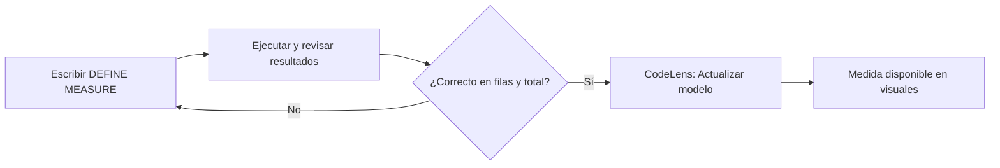

# Vista de consultas DAX (DAX query view)

Parte de: [[17-Power-BI/05 Ayudas para crear DAX más rápido/_Índice Ayudas para crear DAX más rápido|Ayudas para crear DAX más rápido]]

> [!info] Cómo avanzar
> `progreso`: **pendiente** → **viendo** (estudiando) → **visto** (contestaste la autoevaluación sin abrir las respuestas) → **dominado** (hiciste el laboratorio o lo aplicaste de verdad).

## Contenido

### Qué es
La **vista de consultas DAX** (*DAX query view*) es la cuarta vista de Power BI Desktop (junto a Informe, Tabla y Modelo). Ahí escribes y ejecutas **consultas DAX** (`EVALUATE`) contra tu modelo y ves el resultado en una cuadrícula, sin crear visuales. También existe en el Power BI Service para modelos publicados (*Escribir consultas DAX* desde el menú del modelo semántico). Es la herramienta integrada para probar, depurar y documentar medidas; la sintaxis de las consultas está en [[Consultas DAX (EVALUATE, DEFINE y MEASURE)]].

### Cómo funciona
- **Abrir**: icono de la vista de consultas DAX en la barra izquierda de Desktop. Cada consulta vive en una pestaña; las pestañas se guardan con el archivo.
- **Ejecutar**: botón *Ejecutar* de la barra de comandos; si seleccionas solo unas líneas, se ejecuta la selección.
- **Consultas rápidas** (clic derecho en el panel Datos):
  - En una tabla: *Mostrar las 100 primeras filas*, *Mostrar estadísticas de columnas*, *Definir todas las medidas de esta tabla*.
  - En una columna: *Mostrar vista previa de datos* (valores distintos).
  - En una medida: *Evaluar*, *Definir y evaluar*, *Definir con referencias y evaluar* (trae también las medidas de las que depende).
- **Actualizar el modelo desde la consulta**: las medidas que escribes en `DEFINE MEASURE` son temporales. Encima de cada una aparece un **CodeLens** *Actualizar modelo: Agregar nueva medida* (o *Sobrescribir medida* si ya existe y la fórmula cambió). El botón *Actualizar modelo con cambios* aplica todo a la vez. Los comentarios `///` encima de la medida se guardan como su descripción.
- **Edición**: formato con Mayús+Alt+F, comentar con Ctrl+/, buscar y reemplazar, paleta de comandos con Ctrl+Alt+P.
- **Copilot**: con los requisitos de capacidad, Ctrl+I abre Copilot para escribir o explicar consultas ([[Copilot en la vista de consultas DAX (escribir y explicar consultas)]]).
- **Límites documentados**: resultados de hasta 15 MB y 1 000 000 de valores por consulta; en la web, hasta 99 999 filas.

**Obtener la consulta de un visual**: en la vista Informe, *Optimizar → Analizador de rendimiento → Iniciar grabación → Actualizar objetos visuales*; expande el visual y elige *Ejecutar en la vista de consultas DAX* (o copia la consulta). Verás el `SUMMARIZECOLUMNS` que el visual manda al motor, con todos sus filtros.



### Ejemplo
> [!example] Modelo de ejemplo de esta sección
> - `Productos`: P1 Café (Bebidas, Negro), P2 Molino (Equipo, Rojo), P3 Galletas (Alimentos, Café).
> - `Ventas` (Cantidad × PrecioUnitario, CostoUnitario): 1) 2024-01-15 P1 2×100 (60); 2) 2024-02-10 P2 1×250 (150); 3) 2024-02-20 P1 3×100 (60); 4) 2025-01-05 P3 5×40 (25); 5) 2025-02-14 P2 2×250 (150).
> - `Calendario` (Fecha, Año, NumMes, Mes, AñoMes, Trimestre) relacionado 1:* con `Ventas[Fecha]`; `Productos` 1:* con `Ventas[IdProducto]`.
> - Medida base: `Ventas $ = SUMX(Ventas, Ventas[Cantidad] * Ventas[PrecioUnitario])` → total **1 450**; Bebidas 500, Equipo 750, Alimentos 200; 2024 = 750, 2025 = 700.

```dax
DEFINE
    /// Margen bruto entre ventas. Blank si no hay ventas.
    MEASURE Ventas[% Margen] =
        VAR V = [Ventas $]
        VAR C = SUMX(Ventas, Ventas[Cantidad] * Ventas[CostoUnitario])
        RETURN DIVIDE(V - C, V)
EVALUATE
SUMMARIZECOLUMNS(
    Productos[Categoria],
    "Ventas", [Ventas $],
    "Margen %", [% Margen]
)
ORDER BY [Ventas] DESC
-- Equipo 750 / 40 %; Bebidas 500 / 40 %; Alimentos 200 / 37.5 %

EVALUATE { [% Margen] }     -- total: 39.66 %
```

Con dos EVALUATE pruebas a la vez el detalle y el total. Si todo cuadra, das clic en *Actualizar modelo: Agregar nueva medida* y la medida queda en la tabla Ventas con su descripción.

### Cuándo usarlo y cuándo no
- **Ventaja frente a crear la medida directamente**: iteras rápido sin "ensuciar" el modelo, ves varias combinaciones y el total en una sola pantalla, pruebas cambios sobre medidas existentes (redefinirlas en DEFINE) y puedes guardar consultas de verificación junto al archivo.
- Ideal para depurar tablas virtuales, revisar datos de columnas y documentar medidas.
- Para análisis de **rendimiento** detallado (tiempos del motor de almacenamiento, planes de consulta) usa [[DAX Studio]]; la vista de consultas no muestra Server Timings.
- Para editar muchas propiedades del modelo a la vez, [[Tabular Editor]] es más cómodo.

### Errores comunes
- **Creer que DEFINE MEASURE ya guardó la medida**: falta el CodeLens o *Actualizar modelo con cambios*.
- **Sobrescribir sin querer** una medida del modelo al usar el mismo nombre y aceptar *Sobrescribir*.
- **Comparar con el visual sin los mismos filtros**: el visual puede tener filtros de página o informe que tu consulta no tiene; copia la consulta del visual para comparar.
- **Consultas enormes**: devolver millones de filas topa con los límites; agrega filtros o `TOPN`.

### Para profundizar
- [Vista de consultas DAX (Microsoft Learn)](https://learn.microsoft.com/en-us/power-bi/transform-model/dax-query-view)
- [Consultas DAX](https://learn.microsoft.com/en-us/dax/dax-queries)
- [Analizador de rendimiento](https://learn.microsoft.com/en-us/power-bi/create-reports/desktop-performance-analyzer)

## Autoevaluación

Contesta primero en voz alta o en papel; luego despliega la respuesta.

> [!question]- ¿Para qué sirve la vista de consultas DAX en Desktop?
> Escribir y ejecutar consultas EVALUATE contra el modelo, probar medidas con DEFINE MEASURE y, si te convence, actualizar el modelo con la medida (*Actualizar modelo con cambios*).

> [!question]- ¿Qué ventaja tiene frente a crear la medida directamente?
> Ves el resultado en forma de tabla para varios contextos a la vez (p. ej. por categoría y año) y comparas versiones de una medida sin tocar el modelo.

> [!question]- ¿Cómo obtienes la consulta que genera un visual?
> En el menú del visual o desde Performance Analyzer: *Ejecutar en la vista de consultas DAX* / *Copiar consulta*.

## Práctica

- [[Lab 7 - Consultas DAX con la vista de consultas y DAX Studio]]

