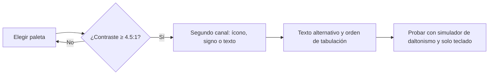

# Colores y accesibilidad en informes

Parte de: [[17-Power-BI/06 Visualización/_Índice Visualización|Visualización]]

> [!info] Cómo avanzar
> `progreso`: **pendiente** → **viendo** (estudiando) → **visto** (contestaste la autoevaluación sin abrir las respuestas) → **dominado** (hiciste el laboratorio o lo aplicaste de verdad).

## Contenido

### Qué es
La accesibilidad en un informe de Power BI significa que **cualquier persona pueda leerlo y usarlo**: quien tiene daltonismo, baja visión, usa lector de pantalla o navega solo con teclado. El color es la herramienta visual más poderosa de un informe y también la que más fácil excluye a la gente. Diseñar con accesibilidad no es un extra: un informe que solo entiende la mitad del equipo es un informe roto.

### Cómo funciona
Hay tres frentes que se trabajan juntos:

1. **Color con intención.** Usa pocos colores y cada uno con significado: un color neutro (gris) para el contexto y un color de acento para lo que importa. Cerca de 1 de cada 12 hombres tiene alguna forma de daltonismo, y la más común confunde **rojo y verde**. Por eso nunca codifiques información *solo* con color: acompáñalo de un segundo canal (ícono ▲▼, signo +/–, etiqueta de texto, posición o patrón).
2. **Contraste.** La guía WCAG 2.x pide un contraste mínimo de **4.5:1** para texto normal y **3:1** para texto grande (aprox. 18 pt, o 14 pt en negritas) y para elementos gráficos como líneas o bordes. Texto gris claro sobre fondo blanco, o blanco sobre amarillo, casi nunca pasa.
3. **Herramientas de Power BI Desktop:**
   - **Texto alternativo** (*Formato del visual → General → Texto alternativo*): lo lee el lector de pantalla. Puede ser dinámico con una medida (formato condicional del texto alternativo).
   - **Orden de tabulación** en el panel **Selección**: define en qué orden se recorre la página con Tab y permite ocultar al teclado elementos decorativos.
   - **Navegación por teclado**: Ctrl+F6 para moverse entre secciones, Tab entre visuales, Enter para entrar a un visual; Alt+Mayús+F11 muestra la tabla de datos del visual, muy útil para lectores de pantalla.
   - **Títulos y etiquetas de datos** claros: el lector de pantalla los anuncia.
   - **Temas de alto contraste** y temas propios con paleta accesible (ver [[Temas y archivos JSON de tema]]).
   - **Ver datos / Mostrar como tabla**: cualquier visual se puede consultar como tabla.



### Ejemplo
En el informe de ventas de Itzamna.Dionisio tienes una matriz con la variación contra el año anterior. En vez de pintar la celda verde o roja únicamente, combina color **y** símbolo con una medida:

```dax
Var AA etiqueta =
VAR v = [Var vs AA %]
RETURN
    IF ( ISBLANK ( v ), BLANK (),
        IF ( v >= 0, "▲ ", "▼ " ) & FORMAT ( v, "0.0%" ) )
```

Y como color de fuente usa una paleta segura para daltonismo: azul `#1F77B4` para positivo y naranja `#D55E00` para negativo (en lugar del clásico verde/rojo). Agrega texto alternativo dinámico al gráfico de líneas:

```dax
Alt ventas =
"Ventas del periodo: " & FORMAT ( [Ventas $], "$#,0" ) &
". Variación contra año anterior: " & FORMAT ( [Var vs AA %], "0.0%" )
```

Revisa el contraste con una herramienta como el *Colour Contrast Analyser* (gratuito) o el verificador de contraste de WebAIM antes de publicar.

### Cuándo usarlo y cuándo no
- **Siempre**: títulos legibles, contraste suficiente, texto alternativo en visuales con información y orden de tabulación lógico. No hay escenario donde estorbe.
- Paletas "de marca" muy saturadas o con tonos pastel: úsalas solo como acento y valida contraste; si la marca no da contraste, gana la legibilidad.
- El semáforo rojo/amarillo/verde puede seguir usándose si añades un segundo canal (ícono o texto) y eliges tonos distinguibles.

### Errores comunes
1. **Rojo/verde como único código.** Pasa por costumbre de Excel. Solución: añade ícono o signo y usa azul/naranja.
2. **Arcoíris de colores**: un color distinto por categoría sin significado. Confunde y no se puede memorizar. Usa gris + un acento.
3. **Texto alternativo vacío** o que repite el título. Debe describir qué muestra y la conclusión.
4. **Orden de tabulación por defecto**, que sigue el orden en que creaste los visuales y salta de un lado a otro. Ajústalo en el panel Selección.
5. **Fuentes diminutas** (8 pt) para que "quepa todo". Si no cabe, sobran visuales.

### Para profundizar
- [Diseño de informes accesibles en Power BI (Microsoft Learn)](https://learn.microsoft.com/en-us/power-bi/create-reports/desktop-accessibility-overview)
- [Crear informes accesibles en Power BI](https://learn.microsoft.com/en-us/power-bi/create-reports/desktop-accessibility-creating-reports)
- [WCAG 2.2 – Contraste mínimo (W3C)](https://www.w3.org/WAI/WCAG22/Understanding/contrast-minimum.html)

## Autoevaluación

Contesta primero en voz alta o en papel; luego despliega la respuesta.

> [!question]- ¿Por qué no codificar información solo con color rojo/verde?
> Muchas personas con daltonismo no los distinguen. Agrega íconos, etiquetas o forma, y usa paletas aptas.

> [!question]- ¿Qué herramientas de accesibilidad tiene Power BI?
> Texto alternativo en visuales, orden de tabulación, temas de alto contraste, navegación por teclado y lector de pantalla.

> [!question]- ¿Qué contraste mínimo de texto se recomienda?
> Las pautas WCAG piden 4.5:1 para texto normal (3:1 para texto grande).

