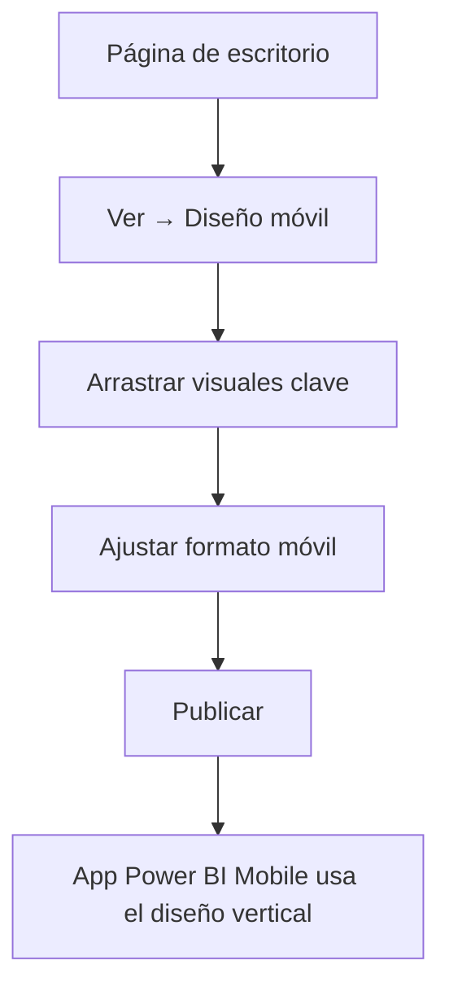

# Diseño para móvil

Parte de: [[17-Power-BI/06 Visualización/_Índice Visualización|Visualización]]

> [!info] Cómo avanzar
> `progreso`: **pendiente** → **viendo** (estudiando) → **visto** (contestaste la autoevaluación sin abrir las respuestas) → **dominado** (hiciste el laboratorio o lo aplicaste de verdad).

## Contenido

### Qué es
El **diseño para móvil** es una vista alterna de cada página del informe pensada para teléfonos en orientación vertical. Se arma en Power BI Desktop con la vista **Diseño móvil** y la usa automáticamente la app **Power BI Mobile** (iOS/Android) cuando alguien abre el informe en un teléfono. No es un informe distinto: reutiliza los mismos visuales, filtros y modelo, solo cambia su acomodo y, opcionalmente, su formato.

### Cómo funciona
1. En Desktop, abre la página y entra a **Ver → Diseño móvil**. Aparece un lienzo con forma de teléfono y el panel **Visuales de página** con todos los visuales de esa página.
2. **Arrastra** al lienzo solo los visuales que tengan sentido en pantalla chica. Se acomodan en una cuadrícula y puedes cambiarles tamaño.
3. Puedes aplicar **formato específico para móvil** (tamaño de fuente, etiquetas, título) sin afectar la vista de escritorio; los cambios hechos en el diseño móvil se marcan para que sepas qué difiere.
4. Publica. Si una página **no** tiene diseño móvil, la app muestra la versión de escritorio reducida (incómoda de usar) o en horizontal.
5. En el Service puedes ver cómo queda con la vista de teléfono, y en la app se puede alternar entre vista móvil y de escritorio.

Cada página tiene su propio diseño móvil; tienes que hacerlo página por página. Las segmentaciones, marcadores y botones funcionan igual que en escritorio.

### Ejemplo
Página "Resumen comercial" de Wee.Reporteria, que en escritorio tiene 8 visuales. Para el director que la consulta en su iPhone entre juntas:

- Arriba: **tarjetas** de Ventas $, Margen % y Var vs AA (lo que se lee en 3 segundos).
- En medio: **una segmentación** de periodo en estilo de botones o lista desplegable (fácil de tocar con el dedo).
- Abajo: **un gráfico de líneas** de la tendencia mensual y un **gráfico de barras** del top 5 de sucursales.
- Fuera: la matriz detallada de 20 columnas y el mapa; quien los necesite puede ir a la vista de escritorio o a una página de detalle con drill through.

En formato móvil sube el tamaño de las etiquetas de datos y oculta los títulos de ejes que roban espacio.

### Cuándo usarlo y cuándo no
- **Úsalo** en informes que consultan directivos, vendedores en campo o supervisores fuera de su escritorio, y en paneles de seguimiento diario (KPI).
- **No vale la pena** en informes de análisis profundo con matrices grandes y muchas segmentaciones: en el teléfono no se analiza, se consulta. Mejor una página móvil de resumen y el análisis en escritorio.
- Si el público principal es móvil, diseña primero el resumen pensando en el teléfono y luego amplía para escritorio.

### Errores comunes
1. **Meter todos los visuales** de la página al diseño móvil. Termina siendo un scroll infinito. Elige 3–5.
2. **Matrices y tablas anchas**: en vertical son ilegibles. Sustitúyelas por tarjetas o barras.
3. **Segmentaciones de lista larga** que ocupan media pantalla. Usa desplegable o mueve el filtro a otra página.
4. **Olvidar páginas**: el diseño móvil es por página; las que no lo tengan se ven mal.
5. **No probar en un teléfono real**. Lo que se ve bien en el lienzo de Desktop puede quedar con textos chicos en la app; revisa en tu iPhone antes de compartir.

### Para profundizar
- [Crear informes optimizados para móviles (Microsoft Learn)](https://learn.microsoft.com/en-us/power-bi/create-reports/power-bi-create-mobile-optimized-report-about)
- [Aplicaciones de Power BI Mobile](https://learn.microsoft.com/en-us/power-bi/consumer/mobile/mobile-apps-for-mobile-devices)

## Autoevaluación

Contesta primero en voz alta o en papel; luego despliega la respuesta.

> [!question]- ¿Cómo se crea la vista móvil?
> *Ver → Diseño móvil*: se arrastran los visuales existentes a un lienzo vertical; los cambios de formato pueden ajustarse solo para móvil.

> [!question]- ¿Qué conviene incluir en la vista móvil?
> Pocos KPIs y visuales clave, más grandes; evitar tablas anchas y muchas segmentaciones.

