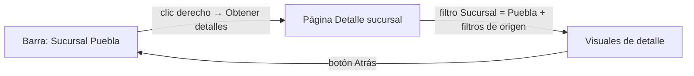

# Drill down y drill through

Parte de: [[17-Power-BI/06 Visualización/_Índice Visualización|Visualización]]

> [!info] Cómo avanzar
> `progreso`: **pendiente** → **viendo** (estudiando) → **visto** (contestaste la autoevaluación sin abrir las respuestas) → **dominado** (hiciste el laboratorio o lo aplicaste de verdad).

## Contenido

### Qué es
Son dos formas de **pasar de un resumen al detalle**:

- **Drill down (rastrear agrupando)**: ocurre *dentro del mismo visual*. Si el eje tiene una jerarquía (Año → Trimestre → Mes, o Categoría → Subcategoría → Producto), bajas un nivel y el visual se redibuja con más detalle.
- **Drill through (obtener detalles)**: te lleva a *otra página* del informe, ya filtrada por el elemento en el que hiciste clic derecho. Por ejemplo, de una barra "Sucursal Puebla" a una página "Detalle de sucursal" que muestra solo Puebla.

### Cómo funciona
**Drill down**
1. Pon varios campos en el eje (o una [[Jerarquías|jerarquía]]).
2. En el encabezado del visual aparecen flechas: **Ir al siguiente nivel** (todos los elementos bajan un nivel), **Expandir todo un nivel** (muestra los dos niveles combinados), **Activar rastreo** (modo "clic para bajar" en un elemento concreto) y **Subir** un nivel.
3. Los filtros de la página siguen aplicando; el drill down solo cambia la granularidad del visual.

**Drill through**
1. Crea la página destino (p. ej., "Detalle cliente").
2. En el panel **Visualizaciones → Obtener detalles**, arrastra el campo (o campos) por el que se va a filtrar, por ejemplo `Cliente[Nombre]`. Ese es el requisito: **la página destino necesita al menos un campo en el área de Obtener detalles**.
3. Power BI agrega automáticamente un **botón Atrás** a la página destino.
4. En cualquier visual que use ese campo, clic derecho → **Obtener detalles → Detalle cliente**.
5. La opción **Mantener todos los filtros** (activa por defecto) hace que la página destino reciba *todos* los filtros que tenía el visual de origen (segmentaciones de fecha, región, etc.), no solo el campo de drill through. Si la apagas, solo pasa el valor del campo de drill through.
6. Opciones extra: **drill through entre informes** (a otra página de otro informe del mismo workspace, si se habilita en ambos) y usar un **botón** con acción *Obtener detalles* que se activa al seleccionar un punto.



### Ejemplo
Informe de cartera de Pochteca.Nomisma:

- Página **Resumen**: gráfico de columnas de saldo vencido por `Calendario[Año] → [Trimestre] → [Mes]` (drill down para ver qué mes se disparó) y barras por cliente.
- Página **Detalle cliente** (oculta en la navegación): `Cliente[Nombre]` en *Obtener detalles*; tarjetas de saldo, días promedio de pago, tabla de facturas abiertas y un título dinámico:

```dax
Titulo detalle = "Detalle de " & SELECTEDVALUE ( Cliente[Nombre], "varios clientes" )
```

Con *Mantener todos los filtros* activo, si en Resumen estaba filtrado 2026 y región Bajío, el detalle llega igual filtrado.

### Cuándo usarlo y cuándo no
- **Drill down**: cuando el análisis sigue una jerarquía natural (tiempo, geografía, catálogo) y quieres conservar el mismo tipo de gráfico.
- **Drill through**: cuando el detalle necesita *otros* visuales (tabla de transacciones, ficha del cliente) o mucho espacio. Mantiene el resumen limpio.
- Alternativa: [[Información sobre herramientas (tooltips)]] de página para un vistazo rápido sin cambiar de página.

### Errores comunes
1. **Nadie sabe que existe el drill through**: no es descubrible. Agrega un texto ("clic derecho en una barra para ver detalle") o un botón de *Obtener detalles*.
2. **La página destino no oculta**: los usuarios llegan a ella desde la navegación sin filtro y ven todo mezclado. Ocúltala o pon un título dinámico que lo aclare.
3. **Campo distinto en origen y destino**: si el visual usa `Ventas[ClienteId]` y la página espera `Cliente[Nombre]`, la opción no aparece. Usa campos de la dimensión.
4. **Confundir drill down con filtrar**: bajar de nivel no filtra los demás visuales; seleccionar un punto sí (ver [[Interacciones entre visuales]]).
5. **Olvidar Mantener todos los filtros** al revisar resultados raros: si está apagado, el detalle ignora tus segmentaciones.

### Para profundizar
- [Configurar drill through en Power BI (Microsoft Learn)](https://learn.microsoft.com/en-us/power-bi/create-reports/desktop-drillthrough)
- [Modo de rastreo (drill) en un visual](https://learn.microsoft.com/en-us/power-bi/consumer/end-user-drill)
- [Drill through entre informes](https://learn.microsoft.com/en-us/power-bi/create-reports/desktop-cross-report-drill-through)

## Autoevaluación

Contesta primero en voz alta o en papel; luego despliega la respuesta.

> [!question]- ¿Diferencia entre drill down y drill through?
> Drill down baja niveles de una jerarquía dentro del mismo visual (Año → Mes). Drill through navega a otra página de detalle filtrada por el elemento elegido.

> [!question]- ¿Qué necesita una página para ser destino de drill through?
> Agregar el campo (p. ej. Productos[Producto]) a *Obtener detalles* en la página destino; Power BI agrega un botón para volver.

> [!question]- ¿Qué es *Mantener todos los filtros* en drill through?
> Que se pasen al destino todos los filtros del visual origen, no solo el campo de obtención de detalles.

## Práctica

- [[Lab 8 - Informe interactivo con marcadores, drill through y tooltips]]

