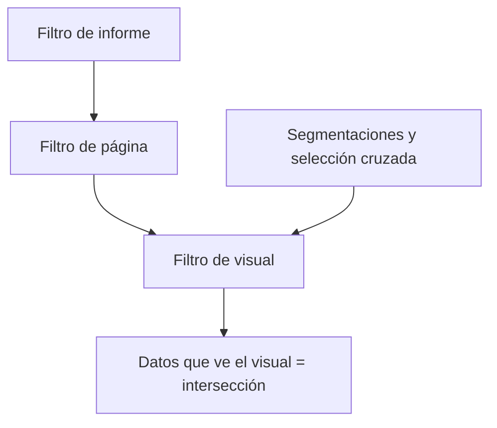

# Filtros de visual, página e informe

Parte de: [[17-Power-BI/06 Visualización/_Índice Visualización|Visualización]]

> [!info] Cómo avanzar
> `progreso`: **pendiente** → **viendo** (estudiando) → **visto** (contestaste la autoevaluación sin abrir las respuestas) → **dominado** (hiciste el laboratorio o lo aplicaste de verdad).

## Contenido

### Qué es
El **panel de filtros** de Power BI permite restringir los datos en tres niveles de alcance, más un cuarto implícito:

| Nivel | Afecta a | Ejemplo |
|---|---|---|
| **Filtro de visual** | Solo ese visual | Top 10 productos en una barra |
| **Filtro de página** | Todos los visuales de la página | Solo región Norte en la página "Norte" |
| **Filtro de informe** (todas las páginas) | Todo el informe | Excluir la sucursal de pruebas |
| **Filtro de drill through** | La página destino de [[Drill down y drill through]] | Cliente seleccionado |

Además de estos, las [[Segmentaciones de datos (slicers)]] y la selección en otros visuales también filtran, pero son elementos del lienzo, no del panel.

### Cómo funciona
- Los filtros se **combinan con AND**: un visual ve la intersección de los filtros de informe, página, visual, segmentaciones y selecciones cruzadas.
- Tipos de filtro: **básico** (casillas), **avanzado** (contiene, empieza con, mayor que, es/no es en blanco), **Top N** y **fecha relativa** ("últimos 3 meses", "este año").
- El **filtro Top N** se define en un visual: eliges "Superior" o "Inferior", el número N y **por valor** (una medida). Ejemplo: mostrar los 10 productos con más `[Ventas $]`. Se evalúa *dentro del contexto del visual*, así que respeta las demás segmentaciones.
- También puedes filtrar un visual por una **medida** (p. ej., `[Ventas $] > 0`), algo que solo se puede a nivel visual.
- Como autor puedes **bloquear** un filtro (el usuario lo ve pero no lo cambia), **ocultarlo** (no aparece en el panel) y renombrar su tarjeta. El panel se puede formatear o esconder completo.
- Los filtros se guardan con el informe; lo que el lector cambia se conserva para él (persistencia) hasta que use **Restablecer valores predeterminados**.

### ¿Y la seguridad?
Los filtros **no son seguridad**. Un filtro oculto sigue estando en el informe: cualquiera con permiso de compilación puede crear otro informe sobre el mismo modelo, exportar datos subyacentes o usar Analizar en Excel y ver todo. Para que un vendedor solo vea sus clientes se usa [[Seguridad a nivel de fila (RLS)]], que filtra en el modelo según la identidad del usuario.

### Ejemplo
Informe de operación de Ocelotl.Hermes:

- **Informe**: `Sucursal[EsPrueba] = FALSO`, bloqueado y oculto, para que nadie vea la sucursal de QA.
- **Página "Último trimestre"**: filtro de fecha relativa *en los últimos 3 meses calendario*.
- **Visual de barras "Top clientes"**: Top N = 10 por `[Ventas $]` sobre `Cliente[Nombre]`.
- **Visual de tabla de incidencias**: filtro por medida `[Incidencias abiertas] > 0`.

Si el usuario selecciona la región Centro en una segmentación, el Top 10 se recalcula para Centro.

### Cuándo usarlo y cuándo no
- **Panel de filtros**: reglas fijas del autor (exclusiones, Top N, periodos) o filtros secundarios que no merecen espacio en el lienzo.
- **Segmentaciones**: filtros que el usuario usa a cada rato y debe ver siempre.
- **RLS**: cuando el requisito es de seguridad o confidencialidad, nunca un filtro.
- **Medidas con CALCULATE**: cuando el "filtro" es parte de la definición del cálculo (ventas de contado), mejor en la medida que en el visual.

### Errores comunes
1. **Usar filtros ocultos como seguridad.** Ya visto: usa RLS.
2. **Filtros olvidados**: un filtro de página oculto que excluye datos y nadie entiende por qué no cuadra el total. Documenta o muéstralo bloqueado.
3. **Top N sin desempate**: si hay empates en el valor N, aparecen más de N elementos. Normal; si molesta, usa una medida de ranking con desempate.
4. **Fecha relativa y zona horaria**: "hoy" se evalúa en UTC en el Service, lo que puede mover un día los resultados nocturnos en México.
5. **Filtro de informe que choca con drill through**: si el destino tiene un filtro de página fijo que contradice el origen, sale vacío.

### Para profundizar
- [Tipos de filtros en informes de Power BI (Microsoft Learn)](https://learn.microsoft.com/en-us/power-bi/create-reports/power-bi-report-filter-types)
- [Agregar un filtro a un informe](https://learn.microsoft.com/en-us/power-bi/create-reports/power-bi-report-add-filter)
- [Formato de filtros en informes](https://learn.microsoft.com/en-us/power-bi/create-reports/power-bi-report-filter)

## Autoevaluación

Contesta primero en voz alta o en papel; luego despliega la respuesta.

> [!question]- ¿Cuál es el alcance de cada nivel de filtro?
> Visual: solo ese visual. Página: todos los visuales de la página. Informe: todas las páginas.

> [!question]- ¿Qué es un filtro Top N de visual?
> Muestra solo los N elementos con mayor/menor valor de una medida en ese visual.

> [!question]- ¿Los filtros reemplazan a RLS?
> No. Los filtros del informe los puede cambiar el usuario o no aplican al analizar en Excel; la seguridad debe ir en RLS.

