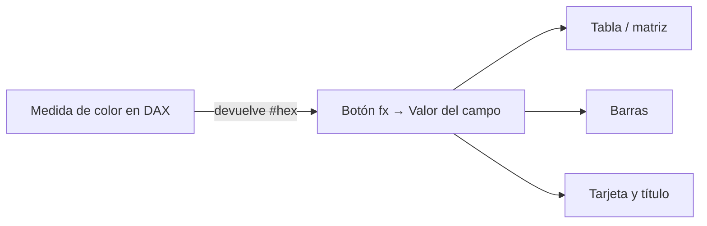

# Formato condicional

Parte de: [[17-Power-BI/06 Visualización/_Índice Visualización|Visualización]]

> [!info] Cómo avanzar
> `progreso`: **pendiente** → **viendo** (estudiando) → **visto** (contestaste la autoevaluación sin abrir las respuestas) → **dominado** (hiciste el laboratorio o lo aplicaste de verdad).

## Contenido

### Qué es
El **formato condicional** cambia la apariencia de un visual según los datos: el color de fondo de una celda, el color del texto, barras dentro de la celda, íconos o incluso un vínculo web. Sirve para que el ojo encuentre en un segundo lo que importa (lo que va mal, lo que superó la meta) sin leer cada número.

### Cómo funciona
En **tablas y matrices**, en el panel de formato → *Elementos de celda*, eliges la columna y activas alguno de estos tipos:

1. **Color de fondo**.
2. **Color de fuente**.
3. **Barras de datos** (una barra horizontal proporcional al valor dentro de la celda).
4. **Íconos** (flechas, semáforos, banderas).
5. **Dirección URL web** (convierte el valor en un vínculo).

Cada uno tiene un **estilo de formato**:
- **Escala de degradado**: colores de mínimo a máximo (con punto medio opcional).
- **Reglas**: rangos explícitos ("si es ≥ 0.9 y < 1 → amarillo").
- **Valor del campo**: el color lo **devuelve una medida o columna** como texto (`"#2E7D32"`, `"red"`). Es el más flexible porque la lógica está en DAX y se reutiliza en varios visuales.

Fuera de tablas también existe: color de barras y columnas, color de título, fondo de tarjetas, texto alternativo, visibilidad de botones; casi cualquier propiedad con el botón **fx** acepta formato condicional, normalmente por *valor del campo*.



### Ejemplo
Medida de color para la variación contra el año anterior, reutilizable en matriz, barras y tarjeta:

```dax
Color Var AA =
VAR v = [Var vs AA %]
RETURN
    SWITCH (
        TRUE (),
        ISBLANK ( v ), BLANK (),
        v >= 0, "#2E7D32",   -- verde: igual o mejor que el año anterior
        "#C62828"            -- rojo: peor que el año anterior
    )
```

Pasos: en la matriz de ventas por sucursal → *Elementos de celda* → columna `Var vs AA %` → **Color de fuente** → *Estilo de formato: Valor del campo* → *Basado en el campo: Color Var AA*. Para no depender solo del color, añade también **íconos** con reglas (▲ si ≥ 0, ▼ si < 0) — ver [[Colores y accesibilidad en informes]].

Otro ejemplo: barras de datos en la columna `Ventas $` para leer de un vistazo qué sucursal pesa más, con mínimo fijado en 0 para que la proporción no engañe.

### Cuándo usarlo y cuándo no
- **Úsalo** para resaltar excepciones (vencido, bajo meta), escalas de intensidad (mapa de calor en una matriz Mes × Sucursal) y estados.
- **Valor del campo** cuando la regla es de negocio y se repite en varios lugares, o depende de varias medidas (meta por sucursal).
- **No lo uses** en todas las columnas a la vez: si todo está coloreado, nada resalta.
- Si necesitas micrográficos más ricos que una barra (progreso, sparkline), mira [[SVG dentro de medidas DAX]].

### Errores comunes
1. **Degradado con mínimo automático**: si el mínimo es 950 y el máximo 1,000, la diferencia se ve enorme. Fija mínimo en 0 o usa reglas.
2. **Reglas con huecos**: "0 a 0.9" y "0.9 a 1" con límites mal puestos dejan valores sin formato. Revisa "≥" vs ">".
3. **La medida de color devuelve algo en el total** que no tiene sentido; usa `ISINSCOPE` para controlar totales.
4. **Rojo/verde como único canal.** Combina con íconos.
5. **Formato aplicado a "valores" en lugar de "totales"**: en matrices hay opciones separadas para valores, totales y subtotales.

### Para profundizar
- [Formato condicional en tablas y matrices (Microsoft Learn)](https://learn.microsoft.com/en-us/power-bi/create-reports/desktop-conditional-table-formatting)
- [Formato condicional en visuales (botón fx)](https://learn.microsoft.com/en-us/power-bi/visuals/power-bi-visualization-tables)

## Autoevaluación

Contesta primero en voz alta o en papel; luego despliega la respuesta.

> [!question]- ¿Qué tipos de formato condicional hay en tablas y matrices?
> Color de fondo, color de fuente, barras de datos, íconos y URL web; por escala, reglas o valor de campo.

> [!question]- ¿Qué es formato por *valor del campo*?
> Una medida que devuelve un color ("#2E7D32" o "Green"); la regla toma el color de ella. Permite lógica compleja en DAX.

> [!question]- Escribe una medida de color: verde si Var vs AA ≥ 0, rojo si < 0.
> ```dax
> Color Var = IF([Var vs AA %] >= 0, "#2E7D32", "#C62828")
> ```

