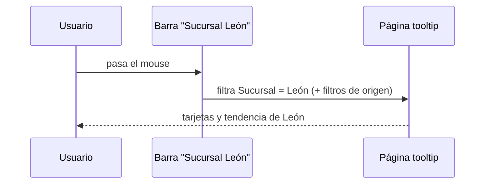

# Información sobre herramientas (tooltips)

Parte de: [[17-Power-BI/06 Visualización/_Índice Visualización|Visualización]]

> [!info] Cómo avanzar
> `progreso`: **pendiente** → **viendo** (estudiando) → **visto** (contestaste la autoevaluación sin abrir las respuestas) → **dominado** (hiciste el laboratorio o lo aplicaste de verdad).

## Contenido

### Qué es
La **información sobre herramientas** (tooltip) es el recuadro que aparece al pasar el mouse sobre un punto, barra o celda. Power BI tiene tres variantes:

1. **Tooltip predeterminado**: muestra los campos del visual (categoría y valor).
2. **Tooltip con campos extra**: agregas medidas al área **Información sobre herramientas** del visual para que aparezcan sin estar en el eje.
3. **Tooltip de página de informe**: una página completa, pequeña, con sus propios visuales, que se muestra como tooltip y viene **filtrada por el punto** sobre el que está el cursor.
(Existe también un tooltip "moderno" que agrega acciones de *Obtener detalles* y *Rastrear* dentro del recuadro.)

### Cómo funciona
**Medida extra en el tooltip normal**
- Selecciona el visual → en *Compilar visual* arrastra la medida al área **Información sobre herramientas**. Ejemplo: en un gráfico de barras de ventas por sucursal, agregar `[Margen %]` y `[Tickets]`.

**Tooltip de página**
1. Crea una página nueva.
2. En *Formato de página → Información de la página* activa **Permitir uso como información sobre herramientas**.
3. En *Lienzo → Tipo*, elige el tamaño **Información sobre herramientas** (320 × 240 px por defecto) o un tamaño personalizado pequeño.
4. Diseña dentro unos pocos visuales (tarjeta, minigráfico de líneas).
5. Opcional: en el área de campos de *Información sobre herramientas* de esa página arrastra un campo para que solo se active con visuales que lo usen; si no, se activa con cualquier campo.
6. En el visual de origen: *Formato → General → Información sobre herramientas → Tipo: Página de informe → Página: (la tuya)*.
7. Oculta la página para que no aparezca en la navegación.

### Ejemplo
Informe de Itzamna.Clio sobre pedidos: el gráfico de barras muestra ventas por sucursal. Creas la página "TT Sucursal" de 320 × 240 con:
- Tarjeta de `[Ventas $]` y `[Var vs AA %]`.
- Gráfico de líneas pequeño de ventas de los últimos 12 meses (sin ejes ni títulos).
- Un texto con el gerente: `Gerente = SELECTEDVALUE ( Sucursal[Gerente] )`.

Al pasar el mouse por "León" ves su tendencia sin cambiar de página. Diferencia con [[Drill down y drill through]]: el tooltip es un vistazo efímero; el drill through es un análisis a fondo.

### Cuándo usarlo y cuándo no
- **Medidas extra**: siempre que haya un dato de contexto que no merece eje propio.
- **Tooltip de página**: cuando el contexto es visual (tendencia, distribución) y quieres mantener limpia la página principal.
- **No** en móviles: en pantalla táctil el tooltip se abre con toque largo y es poco usado; pon lo importante en el lienzo.
- **No** para información crítica: si el usuario debe verla, no la escondas en un hover.

### Errores comunes
1. **Página tooltip demasiado grande o cargada**: tapa el visual de origen y tarda. Máximo 3–4 visuales ligeros.
2. **Olvidar ocultar la página**: aparece como pestaña y confunde.
3. **Filtros de la página tooltip** que contradicen el origen y la dejan vacía.
4. **Medidas sin formato** en el tooltip (0.153728 en lugar de 15.4 %). El formato se define en la medida.
5. **Tooltip activado por campo que el visual no usa**: si configuraste campos en la página tooltip, solo aparece en visuales con ese campo.

### Para profundizar
- [Crear tooltips basados en páginas de informe (Microsoft Learn)](https://learn.microsoft.com/en-us/power-bi/create-reports/desktop-tooltips)
- [Personalizar tooltips en visuales](https://learn.microsoft.com/en-us/power-bi/create-reports/desktop-custom-tooltips)
- [Tooltips modernos](https://learn.microsoft.com/en-us/power-bi/create-reports/desktop-visual-tooltips)

## Autoevaluación

Contesta primero en voz alta o en papel; luego despliega la respuesta.

> [!question]- ¿Qué es un tooltip de página de informe?
> Una página pequeña configurada como *Información sobre herramientas* que aparece al pasar el cursor sobre un visual, filtrada por el punto señalado.

> [!question]- ¿Cómo agregas una medida extra al tooltip normal?
> Arrastrándola al pozo *Información sobre herramientas* del visual.

> [!question]- ¿Qué tamaño y tipo de página se configura?
> Tipo de página *Información sobre herramientas* (tamaño predefinido) y en *Información de página*, permitir usar como tooltip.

## Práctica

- [[Lab 8 - Informe interactivo con marcadores, drill through y tooltips]]

