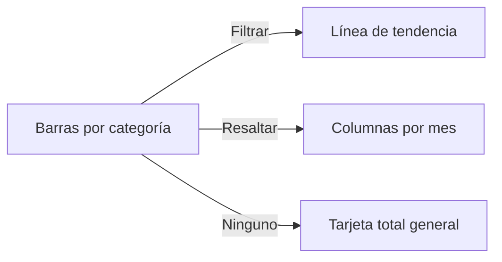

# Interacciones entre visuales

Parte de: [[17-Power-BI/06 Visualización/_Índice Visualización|Visualización]]

> [!info] Cómo avanzar
> `progreso`: **pendiente** → **viendo** (estudiando) → **visto** (contestaste la autoevaluación sin abrir las respuestas) → **dominado** (hiciste el laboratorio o lo aplicaste de verdad).

## Contenido

### Qué es
En Power BI, cuando seleccionas un elemento en un visual (una barra, un punto, una fila), **los demás visuales de la página reaccionan**. A eso se le llama interacción o filtrado cruzado. El autor decide, visual por visual, cómo reacciona cada uno: si se filtra, si se resalta o si se queda igual.

### Cómo funciona
Tipos de interacción que puedes asignar a cada par *origen → destino*:

1. **Filtrar**: el destino muestra solo los datos del elemento seleccionado (las demás barras desaparecen o el total cambia).
2. **Resaltar** (predeterminado en muchos gráficos): el destino conserva todos los datos, pero colorea con intensidad la parte que corresponde a la selección y deja tenue el resto. Muy útil para ver "qué parte del total es esto".
3. **Ninguno**: el destino ignora la selección.

Algunos visuales solo admiten filtrar y ninguno (tarjetas, segmentaciones, tablas). Para configurarlo:

- Selecciona el **visual de origen**.
- Ve a **Formato → Editar interacciones** (en la cinta).
- Sobre cada visual destino aparecen íconos pequeños (embudo = filtrar, gráfico = resaltar, círculo tachado = ninguno). Elige el que quieras.
- Repite para cada visual de origen; la configuración es **dirigida** (A→B es independiente de B→A).

Otras piezas relacionadas:
- **Selección múltiple** con Ctrl+clic.
- *Opciones → Configuración del informe*: puedes cambiar el comportamiento predeterminado a "filtrar" en lugar de "resaltar" para todo el informe.
- Las [[Segmentaciones de datos (slicers)]] también participan: con *Editar interacciones* puedes hacer que una segmentación no afecte a cierto visual.
- Las interacciones viven en la página; no cruzan páginas (para eso están las segmentaciones sincronizadas y el [[Drill down y drill through|drill through]]).

### Ejemplo
Caso típico: página de ventas con una **tarjeta "Total general de la empresa"**, un gráfico de barras por categoría y una línea mensual. Al hacer clic en la barra "Electrónica", la tarjeta pasa de $12.4 M a $3.1 M, y el director se confunde porque esa tarjeta debía ser fija.

Solución:
1. Selecciona el gráfico de barras.
2. **Formato → Editar interacciones**.
3. En la tarjeta, elige **Ninguno**.
4. Haz lo mismo desde cualquier otro visual que no deba moverla (segmentaciones incluidas, si aplica).

Si lo que quieres es que la tarjeta ignore *cualquier* filtro (incluidos segmentaciones y filtros de página), la interacción no basta: usa una medida que quite filtros, por ejemplo `CALCULATE ( [Ventas $], REMOVEFILTERS () )` (ver [[DAX - FILTER, ALL, ALLEXCEPT y REMOVEFILTERS]]).

### Cuándo usarlo y cuándo no
- **Resaltar**: cuando el contexto del total importa (proporción de la selección).
- **Filtrar**: cuando el destino es una tabla de detalle o una tendencia que solo tiene sentido para lo seleccionado.
- **Ninguno**: KPIs de referencia, totales generales, visuales de "otra historia" en la misma página.
- Si la página tiene muchas interacciones complicadas, quizá son dos páginas distintas.

### Errores comunes
1. **Dejar todo en el comportamiento por defecto** y no revisar qué pasa al hacer clic en cada visual. Prueba cada visual como origen antes de publicar.
2. **Resaltar en visuales con medidas no aditivas** (porcentajes, promedios): el resaltado puede verse raro o no aplicar. Cambia a filtrar.
3. **Pensar que "Ninguno" aísla de las segmentaciones**: solo aplica al origen configurado; cada segmentación es otro origen.
4. **Confundir con interacciones entre páginas**: no existen; usa sincronización de segmentaciones o drill through.
5. **Usuarios que no saben limpiar la selección**: clic en un espacio vacío del visual, o pon un botón de marcador para "restablecer".

### Para profundizar
- [Cambiar cómo interactúan los visuales en un informe (Microsoft Learn)](https://learn.microsoft.com/en-us/power-bi/create-reports/service-reports-visual-interactions)
- [Filtrado cruzado y resaltado para usuarios](https://learn.microsoft.com/en-us/power-bi/consumer/end-user-interactions)

## Autoevaluación

Contesta primero en voz alta o en papel; luego despliega la respuesta.

> [!question]- ¿Qué tipos de interacción hay?
> Filtrar, resaltar (highlight) o ninguna; se configuran en *Formato → Editar interacciones*.

> [!question]- Caso: al hacer clic en una barra, la tarjeta del total general cambia y no debería.
> Editar interacciones y poner "Ninguna" en la tarjeta respecto a esa gráfica.

## Práctica

- [[Lab 8 - Informe interactivo con marcadores, drill through y tooltips]]

