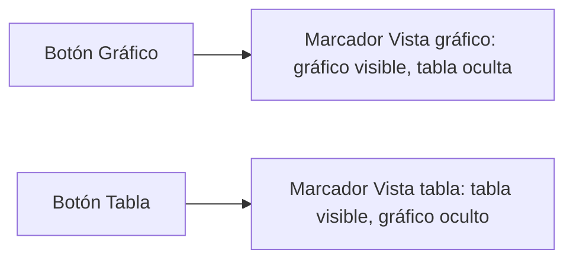

# Marcadores y botones

Parte de: [[17-Power-BI/06 Visualización/_Índice Visualización|Visualización]]

> [!info] Cómo avanzar
> `progreso`: **pendiente** → **viendo** (estudiando) → **visto** (contestaste la autoevaluación sin abrir las respuestas) → **dominado** (hiciste el laboratorio o lo aplicaste de verdad).

## Contenido

### Qué es
Un **marcador** (bookmark) guarda una "fotografía" del estado de una página del informe para volver a ella con un clic. Un **botón** es un elemento del lienzo que ejecuta una acción: ir a un marcador, navegar a otra página, hacer drill through, abrir una URL, atrás, preguntas y respuestas, etc. Juntos permiten construir informes que se sienten como una aplicación: menús, pestañas, paneles que se abren y cierran, alternar vistas.

### Cómo funciona
**Qué guarda un marcador** (configurable con los tres puntos del marcador):
- **Datos**: filtros, segmentaciones, selección en visuales, orden y nivel de drill.
- **Mostrar**: qué visuales están visibles u ocultos (estado del panel **Selección**) y si están en modo foco/spotlight.
- **Página actual**: si al activarlo te lleva a esa página.
- **Todos los visuales** o solo los **visuales seleccionados** (para que el marcador afecte solo a un grupo).

Pasos generales:
1. Abre **Ver → Marcadores** y **Ver → Selección**.
2. Acomoda la página como quieres (oculta/muestra visuales con el ojo del panel Selección).
3. En Marcadores, **Agregar**, y renómbralo.
4. Inserta un **botón** (Insertar → Botones), y en *Acción* elige **Tipo: Marcador** y el marcador.
5. En Desktop pruébalo con **Ctrl+clic**; en el Service basta clic.

Los marcadores pueden agruparse y presentarse como **presentación** (Ver → Marcadores → Ver). Además del botón, el **navegador de marcadores** y el **navegador de páginas** se generan solos a partir de tus marcadores y páginas. Los lectores pueden crear **marcadores personales** en el Service.

### Ejemplo
Alternar entre gráfico y tabla en el mismo lugar (informe de Wee.Reporteria):
1. Coloca el gráfico de columnas y la tabla **exactamente en la misma posición y tamaño**.
2. En Selección, oculta la tabla. Crea el marcador **"Vista gráfico"** y desactiva *Datos* en sus opciones (para no pisar los filtros que el usuario tenga), y marca *Visuales seleccionados* con solo los dos visuales seleccionados.
3. Muestra la tabla y oculta el gráfico. Crea **"Vista tabla"** con las mismas opciones.
4. Agrega dos botones (íconos de gráfico y tabla) o un **navegador de marcadores** con ambos; acción Marcador → cada uno.
5. Opcional: agrúpalos en el panel Marcadores como "Alternar vista".

Así, si el usuario filtró "Región Norte" y cambia a la tabla, el filtro se conserva.

### Cuándo usarlo y cuándo no
- **Úsalos** para menús de navegación, paneles de filtros desplegables, alternar vistas, contar una historia paso a paso ([[Narrativa con datos (storytelling)]]) y botones de "restablecer filtros".
- Para **elegir qué medida o eje** mostrar, a menudo es mejor un [[Parámetros de campo|parámetro de campo]]: menos marcadores que mantener.
- Para navegar entre páginas basta la acción **Navegación de página** del botón o el navegador de páginas; no necesitas marcador.

### Errores comunes
1. **Marcador que guarda Datos cuando no debía**: al hacer clic, borra los filtros que el usuario había puesto. Es el error más común. Desactiva *Datos* en marcadores de "mostrar/ocultar".
2. **Actualizar un visual y olvidar el marcador**: si agregas un visual nuevo, los marcadores existentes no saben de él y puede aparecer o desaparecer sin control. Revisa y usa **Actualizar** en cada marcador.
3. **Visuales encimados mal alineados**: el cambio "brinca". Usa las mismas coordenadas en el panel de formato (*General → Propiedades → Posición*).
4. **Demasiados marcadores** con nombres "Marcador 7": imposible de mantener. Nombra y agrupa.
5. **No probar en el Service**: en Desktop los botones requieren Ctrl+clic y es fácil creer que no funcionan.

### Para profundizar
- [Crear marcadores en Power BI Desktop (Microsoft Learn)](https://learn.microsoft.com/en-us/power-bi/create-reports/desktop-bookmarks)
- [Crear botones en informes](https://learn.microsoft.com/en-us/power-bi/create-reports/desktop-buttons)
- [Navegadores de página y de marcadores](https://learn.microsoft.com/en-us/power-bi/create-reports/button-navigators)

## Autoevaluación

Contesta primero en voz alta o en papel; luego despliega la respuesta.

> [!question]- ¿Qué guarda un marcador?
> El estado de la página: filtros, segmentaciones, visibilidad de visuales (panel Selección), drill y orden. Puedes elegir qué guarda (datos, visualización, página actual).

> [!question]- Caso: alternar entre gráfico y tabla en el mismo lugar.
> Dos marcadores, cada uno con un visual oculto/visible (panel Selección), sin guardar *Datos*; dos botones con acción Marcador o un navegador de marcadores.

> [!question]- Error común con marcadores.
> Dejar marcada la opción *Datos*: al pulsar el botón se reinician las segmentaciones del usuario.

## Práctica

- [[Lab 8 - Informe interactivo con marcadores, drill through y tooltips]]

