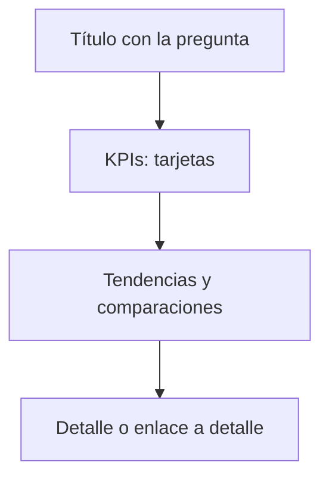

# Principios de diseño de informes

Parte de: [[17-Power-BI/06 Visualización/_Índice Visualización|Visualización]]

> [!info] Cómo avanzar
> `progreso`: **pendiente** → **viendo** (estudiando) → **visto** (contestaste la autoevaluación sin abrir las respuestas) → **dominado** (hiciste el laboratorio o lo aplicaste de verdad).

## Contenido

### Qué es
Son las reglas que hacen que una página de Power BI se **entienda en segundos**: jerarquía, alineación, poco ruido y un propósito por página. Vienen de la percepción visual (cómo lee el ojo) y de la experiencia de autores como Stephen Few y Edward Tufte. Un informe bien diseñado no es "bonito": es rápido de leer y difícil de malinterpretar.

### Cómo funciona
**1. Organización visual de la página**
- **Un propósito por página** ("¿cómo vamos contra la meta?"), con un título que lo diga.
- **Lectura en Z / F**: el ojo empieza arriba a la izquierda. Ahí van los **KPI** (tarjetas), luego las tendencias y comparaciones, y al final el detalle (tablas).
- **De lo general a lo particular**: resumen arriba, desglose abajo, detalle en otra página ([[Drill down y drill through]]).
- **Cuadrícula y alineación**: usa *Ver → Líneas de cuadrícula / Ajustar a la cuadrícula* y espacios iguales entre visuales. El desorden se percibe como error.
- **Segmentaciones juntas** en una franja (arriba o a la izquierda) y siempre en el mismo lugar en todas las páginas.
- **Lienzo**: 16:9 (1280 × 720) por defecto; si necesitas más espacio, quizá necesitas otra página.

**2. Relación datos-tinta (data-ink ratio)**
Concepto de Tufte: de toda la "tinta" (píxeles) de un gráfico, la mayor proporción posible debe representar **datos**. Lo que no aporta (bordes, sombras, fondos con degradado, líneas de cuadrícula gruesas, efectos 3D, leyendas redundantes, decimales innecesarios) se quita. En Power BI eso significa: quitar bordes y sombras, cuadrícula tenue o ausente, etiquetas de datos en lugar de eje cuando son pocas barras, unidades en miles o millones.

**3. Consistencia**
Mismos colores para lo mismo en todas las páginas (Ventas siempre azul), mismos formatos de número, un [[Temas y archivos JSON de tema|tema]] corporativo y la misma posición de logotipo y filtros.

### Ejemplo
Rediseño de una página del tablero comercial de Itzamna.Clio que tenía **20 visuales**:

| Antes | Después |
|---|---|
| 20 visuales, 6 segmentaciones | 6 visuales, 3 segmentaciones en franja superior |
| Pasteles, medidores, mapa 3D | Tarjetas, línea, barras, matriz |
| Cada gráfico de un color | Gris + un azul de acento |
| Etiquetas con 4 decimales | Formato `$#,0.0,,"M"` |
| Tarda 9 s en cargar | Tarda 2 s |

Los otros 14 visuales se repartieron en dos páginas de detalle accesibles por drill through y en tooltips. Además del diseño, mejoró el rendimiento: cada visual dispara al menos una consulta al modelo (ver [[Rendimiento - Performance Analyzer y VertiPaq Analyzer]]).

### Cuándo usarlo y cuándo no
Siempre. Lo único que cambia es el grado: un informe operativo para un analista puede ser más denso que uno ejecutivo, pero sigue necesitando jerarquía y alineación. Si tu organización tiene una guía de estilo, síguela; si no, crea una plantilla `.pbit` con tema, encabezado y franja de filtros.

### Errores comunes
1. **El tablero de 20 visuales**: nadie sabe dónde mirar, la página es lenta y cada visual compite por atención. Una pregunta por página; lo demás va a otras páginas o tooltips.
2. **Decoración** (imágenes de fondo con fotos, sombras, 3D): baja la relación datos-tinta.
3. **Pasteles y medidores** por defecto: ocupan mucho para poca información (ver [[Tipos de gráficos y cuándo usar cada uno]]).
4. **Ejes que no empiezan en cero en barras**, exagerando diferencias.
5. **Copiar el diseño de Excel** (tablas enormes): Power BI brilla en lo visual e interactivo.

### Para profundizar
- [Sugerencias para diseñar informes atractivos (Microsoft Learn)](https://learn.microsoft.com/en-us/power-bi/create-reports/desktop-tips-and-tricks-for-creating-reports)
- [Procedimientos recomendados para diseñar paneles e informes](https://learn.microsoft.com/en-us/power-bi/create-reports/service-dashboards-design-tips)
- [Perceptual Edge (Stephen Few)](https://www.perceptualedge.com/)

## Autoevaluación

Contesta primero en voz alta o en papel; luego despliega la respuesta.

> [!question]- ¿Cómo se organiza visualmente una página de informe?
> Lo más importante arriba a la izquierda (KPIs), luego tendencias y detalle; alineación en cuadrícula, pocos visuales por página (rendimiento y claridad).

> [!question]- ¿Qué es la relación datos-tinta?
> Maximizar lo que comunica datos y quitar lo decorativo: bordes, sombras, fondos, etiquetas redundantes, 3D.

> [!question]- Error común: un tablero con 20 visuales.
> Cansa, es lento (cada visual es una consulta) y no responde una pregunta clara. Dividir por audiencia/pregunta y usar drill through para detalle.

## Práctica

- [[Lab 8 - Informe interactivo con marcadores, drill through y tooltips]]

