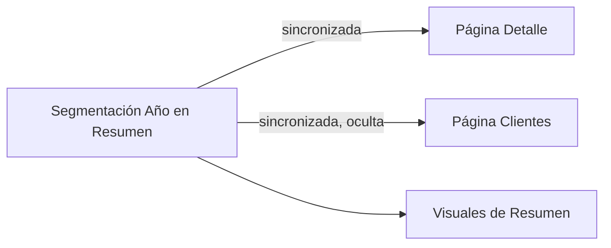

# Segmentaciones de datos (slicers)

Parte de: [[17-Power-BI/06 Visualización/_Índice Visualización|Visualización]]

> [!info] Cómo avanzar
> `progreso`: **pendiente** → **viendo** (estudiando) → **visto** (contestaste la autoevaluación sin abrir las respuestas) → **dominado** (hiciste el laboratorio o lo aplicaste de verdad).

## Contenido

### Qué es
Una **segmentación de datos** (slicer) es un visual que vive en el lienzo y sirve para **filtrar** los demás visuales de la página: lista, desplegable, botones, rango de fechas o de números. A diferencia del panel de filtros, está siempre a la vista, es parte del diseño y los usuarios la entienden de inmediato.

### Cómo funciona
**Tipos y estilos**
- **Segmentación clásica**: lista vertical, desplegable, mosaico, entre (rango), antes/después, fecha relativa.
- **Segmentación de botones** (button slicer) y **segmentación de lista** nuevas, con más opciones de formato (imágenes, diseño en cuadrícula).
- **Selección única** o **múltiple**, opción **Seleccionar todo**, búsqueda en listas largas.
- **Jerarquías** en la segmentación (Año → Mes).

**Segmentación vs. filtro del panel**

| | Segmentación | Panel de filtros |
|---|---|---|
| Ubicación | En el lienzo, ocupa espacio | Panel lateral, se puede ocultar |
| Visibilidad | Siempre visible | El usuario debe abrirlo |
| Alcance | Página (o varias si se sincroniza) | Visual, página o informe |
| Top N, filtro por medida | No | Sí |
| Formato | Totalmente personalizable | Limitado |

**Sincronizar segmentaciones**
Con **Ver → Sincronizar segmentaciones** eliges en qué páginas aplica una segmentación (columna *Sincronizar*) y en cuáles es visible (columna *Visible*). Así, si el usuario elige "2026" en la página Resumen, la página Detalle también queda en 2026 aunque la segmentación esté oculta ahí. También puedes crear **grupos de sincronización** para que dos segmentaciones distintas compartan selección.

### Ejemplo
Informe de Ocelotl.Iris con tres páginas. Franja superior con:
- Segmentación de **fecha** estilo *Entre* sobre `Calendario[Fecha]` (de la [[Tabla de calendario]]), sincronizada y visible en las tres páginas.
- Segmentación de **región** en desplegable de selección múltiple, sincronizada en las tres.
- Segmentación de **canal** en botones (Tienda / Web / App), solo en la página Resumen.

Botón "Limpiar filtros" con acción **Borrar todas las segmentaciones**.

### Rendimiento
Cada segmentación es un visual que ejecuta su propia consulta (para mostrar valores) **y** agrega filtros a las consultas de todos los demás visuales. Muchas segmentaciones, sobre todo sobre columnas de alta cardinalidad (10,000 clientes) o con la opción de mostrar solo valores con datos, multiplican el trabajo del motor; en DirectQuery cada cambio dispara varias consultas al origen. Remedios:
- Máximo 3–5 segmentaciones visibles; el resto en el panel de filtros.
- Para DirectQuery, usar **botón Aplicar** (reducción de consultas en *Opciones → Reducción de consultas*), para que los cambios se envíen todos juntos.
- Segmentar sobre columnas de **dimensión** con pocos valores, no sobre la tabla de hechos.
- Desplegable en lugar de lista larga.

### Cuándo usarlo y cuándo no
- **Segmentación**: filtros que el usuario cambia seguido (periodo, región, canal) y que debe ver para entender qué está mirando.
- **Panel de filtros**: filtros secundarios, Top N, filtros por medida.
- **Parámetros de campo** cuando lo que se "segmenta" es qué medida o dimensión se muestra.

### Errores comunes
1. **Segmentaciones distintas en cada página** sin sincronizar: el usuario cree que filtró y no.
2. **Demasiadas segmentaciones** (problema de rendimiento y de espacio).
3. **Segmentar sobre la columna de la tabla de hechos** en vez de la dimensión: valores duplicados, lento y problemas con relaciones.
4. **Selección única sin valor predeterminado**: al limpiar, queda todo y la página muestra una mezcla.
5. **Olvidar que la segmentación afecta a todo** lo de la página; si algo no debe filtrarse, usa [[Interacciones entre visuales|Editar interacciones]].

### Para profundizar
- [Segmentaciones en Power BI (Microsoft Learn)](https://learn.microsoft.com/en-us/power-bi/visuals/power-bi-visualization-slicers)
- [Guía de optimización: reducción de consultas](https://learn.microsoft.com/en-us/power-bi/guidance/power-bi-optimization)

## Autoevaluación

Contesta primero en voz alta o en papel; luego despliega la respuesta.

> [!question]- ¿Diferencia entre una segmentación y un filtro del panel de filtros?
> La segmentación está en la página, visible para el usuario; el panel de filtros puede ocultarse o bloquearse. Ambas filtran visuales.

> [!question]- ¿Qué es sincronizar segmentaciones?
> *Ver → Sincronizar segmentaciones* para que una selección se aplique en varias páginas (y decidir si se ve en cada una).

> [!question]- Problema de rendimiento con muchas segmentaciones.
> Cada segmentación es una consulta y se recalcula al cambiar otras; muchas segmentaciones con valores de alta cardinalidad hacen lenta la página. Agrupar en un panel con botón "Aplicar" o usar el panel de filtros.

