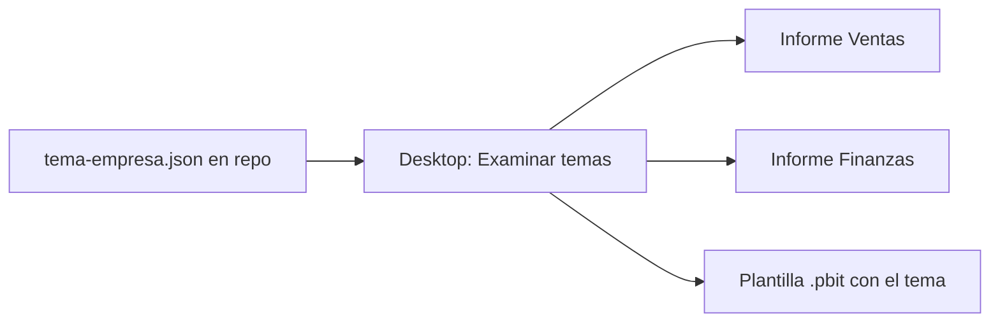

# Temas y archivos JSON de tema

Parte de: [[17-Power-BI/06 Visualización/_Índice Visualización|Visualización]]

> [!info] Cómo avanzar
> `progreso`: **pendiente** → **viendo** (estudiando) → **visto** (contestaste la autoevaluación sin abrir las respuestas) → **dominado** (hiciste el laboratorio o lo aplicaste de verdad).

## Contenido

### Qué es
Un **tema** define la apariencia global de un informe: paleta de colores de datos, colores de fondo y texto, fuentes y el formato predeterminado de cada tipo de visual. Se puede elegir uno integrado, personalizarlo desde Desktop o importar un **archivo JSON de tema**. Es la forma de aplicar identidad visual de una vez, en lugar de formatear visual por visual.

### Cómo funciona
- **Ver → Temas**: galería de temas integrados, **Personalizar tema actual** (editor visual de colores, texto, visuales, página, filtros) e **Examinar temas** para importar un `.json`. También **Guardar tema actual** exporta el JSON para reutilizarlo.
- El JSON tiene propiedades de primer nivel y una sección detallada:
  - `name` (obligatorio): nombre del tema.
  - `dataColors`: arreglo con la paleta de series en orden (la primera serie usa el primer color, etc.).
  - `background`, `foreground`, `tableAccent`: fondo, texto principal y color de acento de tablas/matrices.
  - `good`, `neutral`, `bad`: colores usados por visuales con estado (KPI, cascada).
  - `textClasses`: tamaños y fuentes por clase de texto (títulos, etiquetas, llamadas).
  - `visualStyles`: formato predeterminado por tipo de visual y propiedad, por ejemplo quitar bordes a todos los visuales o fijar el tamaño del título de las tarjetas. `"*"` aplica a todos.
- Lo que formatees **a mano** en un visual gana sobre el tema; el tema define los valores predeterminados.
- Microsoft publica el **esquema JSON** de temas en GitHub, útil para tener autocompletado en VS Code.



### Ejemplo
Tema mínimo con nombre y tres colores:

```json
{
  "name": "Itzamna Corporativo",
  "dataColors": ["#1E3A5F", "#F28C28", "#7A8B99"]
}
```

Versión más útil para el equipo, con fondo, texto y formato por defecto de visuales:

```json
{
  "name": "Itzamna Corporativo",
  "dataColors": ["#1E3A5F", "#F28C28", "#7A8B99", "#2E7D32", "#C62828"],
  "background": "#FFFFFF",
  "foreground": "#1F2933",
  "tableAccent": "#1E3A5F",
  "good": "#2E7D32",
  "neutral": "#F2C94C",
  "bad": "#C62828",
  "visualStyles": {
    "*": {
      "*": {
        "border": [{ "show": false }],
        "dropShadow": [{ "show": false }]
      }
    }
  }
}
```

Guárdalo en el repositorio de Azure DevOps del área de BI (p. ej. `bi/temas/itzamna.json`) para que todos importen el mismo.

### ¿Para qué sirve en un equipo?
- **Consistencia**: todos los informes se ven de la misma familia y el usuario reconoce los colores (Ventas siempre azul).
- **Velocidad**: nadie formatea bordes, fuentes y colores visual por visual.
- **Accesibilidad centralizada**: si la paleta pasa la revisión de contraste una vez (ver [[Colores y accesibilidad en informes]]), todos los informes la heredan.
- **Mantenimiento**: cambiar la marca es reimportar un JSON.
- Combínalo con una **plantilla .pbit** que incluya el tema, el encabezado y la franja de filtros.

### Cuándo usarlo y cuándo no
- **Siempre** que haya más de un informe o más de un autor.
- Para un informe único y rápido, un tema integrado o *Personalizar tema actual* basta.
- No intentes meter en el tema reglas que dependen de datos: eso es [[Formato condicional]].

### Errores comunes
1. **JSON inválido** (comas finales, comillas simples): Desktop rechaza el archivo. Valida con un editor que use el esquema.
2. **Formato manual que "no respeta" el tema**: lo formateado a mano tiene prioridad. Usa *Restablecer a valores predeterminados* en el visual.
3. **Paletas de 12 colores fuertes**: el orden de `dataColors` importa; pon primero los que más usarás.
4. **No versionar el tema**: cada quien tiene su copia distinta.
5. **Olvidar fuentes disponibles**: si usas una fuente que no está en el equipo del lector o no es compatible con el Service, se sustituye.

### Para profundizar
- [Usar temas de informes en Power BI Desktop (Microsoft Learn)](https://learn.microsoft.com/en-us/power-bi/create-reports/desktop-report-themes)
- [Esquema JSON de temas de informe (GitHub de Microsoft)](https://github.com/microsoft/powerbi-desktop-samples/tree/main/Report%20Theme%20JSON%20Schema)

## Autoevaluación

Contesta primero en voz alta o en papel; luego despliega la respuesta.

> [!question]- ¿Qué contiene un archivo de tema?
> Un JSON con nombre, paleta (`dataColors`), colores de fondo/primer plano, texto y opciones de formato por tipo de visual (`visualStyles`).

> [!question]- ¿Para qué sirve en un equipo?
> Aplicar identidad visual consistente en todos los informes y ahorrar formato manual.

> [!question]- Escribe un tema mínimo con nombre y tres colores.
> ```json
> {
>   "name": "Mi tema",
>   "dataColors": ["#1E88E5", "#F4511E", "#43A047"],
>   "background": "#FFFFFF",
>   "foreground": "#212121"
> }
> ```

