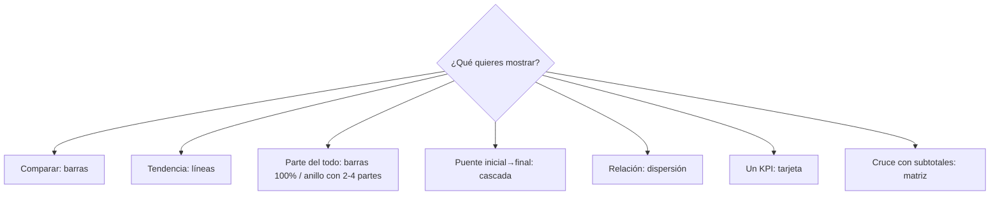

# Tipos de gráficos y cuándo usar cada uno

Parte de: [[17-Power-BI/06 Visualización/_Índice Visualización|Visualización]]

> [!info] Cómo avanzar
> `progreso`: **pendiente** → **viendo** (estudiando) → **visto** (contestaste la autoevaluación sin abrir las respuestas) → **dominado** (hiciste el laboratorio o lo aplicaste de verdad).

## Contenido

### Qué es
Cada tipo de visual responde bien a **un tipo de pregunta**. Elegir el gráfico es elegir qué relación quieres que el lector vea: comparación, tendencia, composición, distribución, relación o un valor puntual. Power BI trae decenas de visuales nativos; con una docena bien elegidos se resuelve la mayoría de los informes.

### Cómo funciona
| Pregunta | Visual recomendado | Notas |
|---|---|---|
| **Comparar categorías** (¿qué sucursal vende más?) | **Barras** (horizontales) o **columnas** | Barras horizontales cuando los nombres son largos o hay muchas categorías; ordénalas por valor |
| **Tendencia en el tiempo** | **Líneas** (o columnas si son pocos periodos) | El tiempo va en el eje X de izquierda a derecha |
| **Comparar real vs. meta** | Columnas + línea, **KPI**, viñeta (AppSource) | |
| **Composición** (parte de un total) | Barras apiladas 100 %, **treemap**, pastel/anillo con pocas partes | |
| **Cómo se llega de un valor inicial a uno final** | **Cascada** (waterfall) | Ventas año pasado → +nuevos clientes → −bajas → ventas este año |
| **Etapas de un proceso** | **Embudo** | Prospectos → cotizaciones → ventas |
| **Relación entre dos medidas** | **Dispersión** (scatter) | Precio vs. unidades; tamaño de burbuja como tercera medida |
| **Distribución geográfica** | Mapa, mapa coroplético, Azure Maps | Solo si la ubicación importa |
| **Un número clave** | **Tarjeta** (y tarjeta nueva con varios valores) | |
| **Detalle cruzado** | **Matriz** | Filas × columnas con subtotales, como tabla dinámica |
| **Lista de registros** | **Tabla** | |
| **Causas / factores** | Árbol de descomposición, influenciadores clave | Visuales de IA |

**Pastel y anillo**: son aceptables cuando hay **pocas partes (2 a 4)**, suman un 100 % significativo y la diferencia entre ellas es evidente (por ejemplo, "60 % web, 40 % tienda"). El ojo compara mal ángulos y áreas; con 8 rebanadas parecidas nadie distingue cuál es mayor. En esos casos, barras ordenadas.

**Tarjeta y matriz**: la **tarjeta** resalta un KPI que se lee en un segundo (Ventas $12.4 M); la tarjeta nueva permite varios valores y etiquetas de referencia (vs. meta). La **matriz** muestra el cruce de dos dimensiones con subtotales, permite drill down en filas y columnas y es ideal con [[Formato condicional]] para mapas de calor.

### Ejemplo
Página de resultados anuales de Pochteca.Nomisma:
- **Tarjetas**: Ingresos, Margen %, Clientes activos.
- **Líneas**: ingresos mensuales 2025 vs. 2026.
- **Barras horizontales**: ingresos por línea de producto, ordenadas de mayor a menor.
- **Cascada**: de la utilidad de 2025 a la de 2026 por concepto (precio, volumen, costo, gastos).
- **Matriz**: región × trimestre con formato condicional.
- **Anillo**: solo para canal (Web 58 % / Sucursal 42 %).

### Cuándo usarlo y cuándo no
- Pregúntate primero **qué comparación** quiere hacer el lector y elige el visual que la hace evidente.
- Evita **medidores** (gauges) en tableros con muchos KPI: ocupan mucho espacio para un número; una tarjeta con referencia comunica lo mismo.
- Evita **3D, áreas apiladas con muchas series y mapas** sin necesidad geográfica.
- Si ningún visual nativo sirve, revisa [[Visuales personalizados - panorama de opciones]].

### Errores comunes
1. **Pastel con 10 rebanadas.** Usa barras ordenadas.
2. **Líneas para categorías sin orden** (sucursales): sugieren una continuidad que no existe.
3. **Barras sin ordenar** por valor: obligan a buscar.
4. **Eje de barras que no empieza en cero**: exagera diferencias.
5. **Doble eje Y** con escalas que se pueden manipular para "mostrar" correlaciones falsas.

### Para profundizar
- [Tipos de visualización en Power BI (Microsoft Learn)](https://learn.microsoft.com/en-us/power-bi/visuals/power-bi-visualization-types-for-reports-and-q-and-a)
- [Gráficos de cascada](https://learn.microsoft.com/en-us/power-bi/visuals/power-bi-visualization-waterfall-charts)
- [Financial Times Visual Vocabulary (GitHub)](https://github.com/Financial-Times/chart-doctor/tree/main/visual-vocabulary)

## Autoevaluación

Contesta primero en voz alta o en papel; luego despliega la respuesta.

> [!question]- ¿Qué gráfico usas para comparar categorías y cuál para tendencias en el tiempo?
> Barras (horizontales si hay muchas categorías o etiquetas largas) para comparar; líneas para tendencias en el tiempo.

> [!question]- ¿Cuándo es aceptable un gráfico de pastel/anillo?
> Para mostrar partes de un todo con pocas categorías (2–4) muy distintas; si hay muchas o son parecidas, barras son más fáciles de leer.

> [!question]- ¿Para qué sirven la tarjeta y la matriz?
> Tarjeta: un KPI o número clave. Matriz: tabla con filas/columnas agrupadas y subtotales, útil para detalle y drill down.

> [!question]- ¿Qué visual muestra cómo se llega de un valor inicial a uno final?
> Cascada (waterfall).

