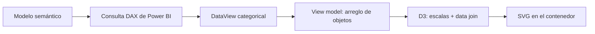

# Crear un visual propio con D3

Parte de: [[17-Power-BI/07 Gráficas propias/_Índice Gráficas propias|Gráficas propias]]

> [!info] Cómo avanzar
> `progreso`: **pendiente** → **viendo** (estudiando) → **visto** (contestaste la autoevaluación sin abrir las respuestas) → **dominado** (hiciste el laboratorio o lo aplicaste de verdad).

## Contenido

### Qué es
**D3.js** (Data-Driven Documents) es la librería de JavaScript más usada para dibujar visualizaciones a la medida con SVG. En visuales propios de Power BI es la opción común porque el SDK te da un contenedor HTML y datos, y **tú decides cómo dibujar**; D3 aporta escalas, ejes, formas, transiciones y el patrón de *data join* para enlazar datos con elementos SVG. Esta nota muestra cómo unir D3 con el [[SDK de visuales de Power BI (TypeScript y pbiviz)]].

### Cómo funciona
**Por qué D3**
- No impone tipos de gráfico: das forma con primitivas (`rect`, `path`, `circle`).
- **Escalas** (`scaleLinear`, `scaleBand`, `scaleTime`) que convierten valores a píxeles.
- **Data join** (`selection.data(...).join(...)`): actualiza solo los elementos que cambian, clave para el rendimiento en `update`.
- Es un estándar con mucha documentación y ejemplos; viene con tipos de TypeScript (`@types/d3`).

**Cómo llegan los datos del modelo a D3**
1. El usuario arrastra campos a las áreas definidas en `dataRoles` de `capabilities.json`.
2. Power BI ejecuta la consulta DAX al modelo y entrega el resultado como un **DataView** con la forma indicada en `dataViewMappings` (por ejemplo `categorical`).
3. En `update(options)` lees `options.dataViews[0].categorical.categories[0].values` y `.values[0].values`.
4. Los transformas a un arreglo de objetos (tu *view model*) y se lo das a D3.



### Ejemplo
Instala D3 en el proyecto creado con `pbiviz new`:

```bash
npm i d3
npm i -D @types/d3
```

`src/visual.ts` con barras verticales:

```typescript
"use strict";
import * as d3 from "d3";
import powerbi from "powerbi-visuals-api";
import IVisual = powerbi.extensibility.visual.IVisual;
import VisualConstructorOptions = powerbi.extensibility.visual.VisualConstructorOptions;
import VisualUpdateOptions = powerbi.extensibility.visual.VisualUpdateOptions;

interface Punto { categoria: string; valor: number; }

export class Visual implements IVisual {
    private svg: d3.Selection<SVGSVGElement, unknown, null, undefined>;
    private g: d3.Selection<SVGGElement, unknown, null, undefined>;

    constructor(options: VisualConstructorOptions) {
        // Se crea una sola vez
        this.svg = d3.select(options.element).append("svg");
        this.g = this.svg.append("g");
    }

    public update(options: VisualUpdateOptions): void {
        const { width, height } = options.viewport;
        this.svg.attr("width", width).attr("height", height);

        const cat = options.dataViews?.[0]?.categorical;
        if (!cat?.categories?.[0] || !cat.values?.[0]) {
            this.g.selectAll("*").remove();   // sin datos: limpiar
            return;
        }

        // DataView -> view model
        const datos: Punto[] = cat.categories[0].values.map((c, i) => ({
            categoria: String(c),
            valor: Number(cat.values[0].values[i] ?? 0)
        }));

        const x = d3.scaleBand<string>()
            .domain(datos.map(d => d.categoria))
            .range([0, width]).padding(0.2);
        const y = d3.scaleLinear()
            .domain([0, d3.max(datos, d => d.valor) ?? 0]).nice()
            .range([height, 0]);

        // Data join: crea, actualiza o elimina solo lo necesario
        this.g.selectAll<SVGRectElement, Punto>("rect.barra")
            .data(datos, d => d.categoria)
            .join("rect")
            .attr("class", "barra")
            .attr("x", d => x(d.categoria) ?? 0)
            .attr("width", x.bandwidth())
            .attr("y", d => y(d.valor))
            .attr("height", d => height - y(d.valor))
            .attr("fill", "#1E3A5F");
    }
}
```

Siguientes pasos típicos: ejes con `d3.axisBottom`, selección con `host.createSelectionManager()` para filtrar otros visuales, tooltips con `host.tooltipService` y propiedades de formato (color de barra) en `settings.ts`.

### Buenas prácticas de rendimiento
- **Crea la estructura en el constructor** y en `update` solo actualiza atributos con *data join*; no borres y recrees todo.
- **Limita los datos** con `dataReductionAlgorithm` en `capabilities.json` (p. ej., top 1000) y agrega en el modelo, no en el visual.
- Evita transiciones largas en cada `update` (se disparan al filtrar).
- Llama a los **eventos de renderizado** (`renderingStarted`/`renderingFinished`) para que exportaciones y certificación sepan cuándo terminó.
- No uses `innerHTML` con datos del usuario (riesgo y bloqueo de certificación).

### Cuándo usarlo y cuándo no
- **Úsalo** si ya decidiste ir por el SDK y necesitas un gráfico a la medida.
- Si el gráfico se puede describir con una gramática declarativa, [[Deneb (Vega y Vega-Lite)]] llega al mismo resultado sin proyecto TypeScript.

### Errores comunes
1. **No manejar `dataViews` vacío** (el usuario quitó un campo).
2. **Ignorar el `viewport`**: el visual no se adapta al redimensionar.
3. **Importar todo D3 sin necesidad**: aumenta el tamaño del paquete; puedes importar módulos (`d3-scale`, `d3-selection`).
4. **Mezclar versiones de D3** de ejemplos viejos (v3/v4) con la API actual (`join`).

### Para profundizar
- [Tutorial: desarrollar un visual de gráfico de barras (Microsoft Learn)](https://learn.microsoft.com/en-us/power-bi/developer/visuals/create-bar-chart)
- [Documentación de D3](https://d3js.org/)
- [Mapeo de vistas de datos (DataView)](https://learn.microsoft.com/en-us/power-bi/developer/visuals/dataview-mappings)

## Autoevaluación

Contesta primero en voz alta o en papel; luego despliega la respuesta.

> [!question]- ¿Por qué D3 es común en visuales propios?
> Facilita enlazar datos a elementos SVG, escalas, ejes y transiciones.

> [!question]- ¿Cómo llegan los datos del modelo a D3?
> Desde `options.dataViews[0]` (categorical o table) se transforman a un arreglo de objetos que D3 enlaza con `selectAll().data()`.

> [!question]- Buena práctica de rendimiento.
> Usar el patrón *join* (enter/update/exit) de D3 para actualizar en vez de borrar y redibujar todo, y respetar el límite de filas del dataView (configurable con `dataReductionAlgorithm`).

