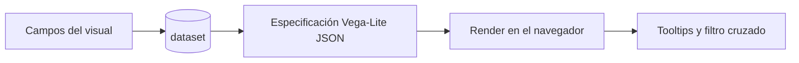

# Deneb (Vega y Vega-Lite)

Parte de: [[17-Power-BI/07 Gráficas propias/_Índice Gráficas propias|Gráficas propias]]

> [!info] Cómo avanzar
> `progreso`: **pendiente** → **viendo** (estudiando) → **visto** (contestaste la autoevaluación sin abrir las respuestas) → **dominado** (hiciste el laboratorio o lo aplicaste de verdad).

## Contenido

### Qué es
**Deneb** es un visual personalizado **gratuito y certificado** de AppSource (creado por Daniel Marsh-Patrick) que te permite construir gráficos escribiendo una especificación en **Vega-Lite** o **Vega**, dos gramáticas declarativas de visualización en JSON creadas en la Universidad de Washington. En lugar de programar un visual en TypeScript, describes: "estos datos, con barras, la categoría en Y y las ventas en X", y Deneb lo dibuja dentro de Power BI.

### Cómo funciona
1. Agregas Deneb desde AppSource al informe.
2. Arrastras columnas y medidas al área **Valores** del visual. Deneb las entrega a la especificación como un conjunto de datos llamado **`dataset`**; cada campo aparece con su nombre de visualización (por ejemplo `Categoria`, `Ventas $`).
3. Abres el editor (*…  → Editar*), eliges Vega-Lite o Vega y una plantilla o especificación vacía.
4. Escribes la especificación: `data` (siempre `{"name": "dataset"}`), `mark` (bar, line, point, text, rule…), `encoding` (x, y, color, tooltip) y, si quieres, `layer` para superponer marcas.
5. Opciones de interactividad: tooltips de Power BI, **filtrado cruzado** y **resaltado** hacia otros visuales (se activan en la configuración de Deneb), y el visual responde a segmentaciones como cualquier otro.

**Vega-Lite vs. Vega**: Vega-Lite es conciso y cubre la mayoría de gráficos; Vega es más detallado (señales, escalas y marcas explícitas) para diseños muy especiales.

**Ventajas frente a un visual de R/Python**: se renderiza en el navegador, es **interactivo** (tooltips, filtro cruzado), no necesita instalar R/Python ni runtime en el Service, funciona con licencias normales, aparece en exportaciones y suscripciones por ser certificado y es mucho más rápido.



### Ejemplo
**Barras horizontales** de `Categoria` vs `Ventas $`, ordenadas de mayor a menor:

```json
{
  "data": { "name": "dataset" },
  "mark": { "type": "bar", "color": "#1E3A5F" },
  "encoding": {
    "y": { "field": "Categoria", "type": "nominal", "sort": "-x", "title": null },
    "x": { "field": "Ventas $", "type": "quantitative", "title": "Ventas" }
  }
}
```

**Etiquetas de valor al final de cada barra** (capa de texto sobre la de barras):

```json
{
  "data": { "name": "dataset" },
  "encoding": {
    "y": { "field": "Categoria", "type": "nominal", "sort": "-x", "title": null },
    "x": { "field": "Ventas $", "type": "quantitative", "title": "Ventas" }
  },
  "layer": [
    { "mark": { "type": "bar", "color": "#1E3A5F" } },
    {
      "mark": { "type": "text", "align": "left", "dx": 4 },
      "encoding": { "text": { "field": "Ventas $", "type": "quantitative", "format": ",.0f" } }
    }
  ]
}
```

**Línea** de `AñoMes` vs `Ventas $` con puntos:

```json
{
  "data": { "name": "dataset" },
  "mark": { "type": "line", "point": true },
  "encoding": {
    "x": { "field": "AñoMes", "type": "ordinal", "title": null },
    "y": { "field": "Ventas $", "type": "quantitative", "title": "Ventas" },
    "tooltip": [
      { "field": "AñoMes" },
      { "field": "Ventas $", "format": "$,.0f" }
    ]
  }
}
```

Si `AñoMes` es texto tipo `2026-01`, `ordinal` lo ordena alfabéticamente, que coincide con el orden cronológico. Si fuera una fecha real, usa `"type": "temporal"`.

### Cuándo usarlo y cuándo no
- **Úsalo** para gráficos que no existen nativos (viñetas, lollipop, slope charts, small multiples personalizados, anotaciones) o para un diseño corporativo muy controlado.
- **No** si un visual nativo resuelve el caso: Deneb exige que quien mantenga el informe sepa leer Vega-Lite.
- Para micrográficos dentro de tablas, [[SVG dentro de medidas DAX]] es más simple.

### Errores comunes
1. **Nombre de campo distinto** al del panel (renombraste el campo en el visual): Vega-Lite no lo encuentra y el gráfico sale vacío. Revisa el visor de datos de Deneb.
2. **Tipo de codificación incorrecto** (`nominal` en un número), que produce un eje raro.
3. **Demasiadas filas**: Deneb tiene un límite configurable de filas; agrega en el modelo antes de mandar datos crudos.
4. **Olvidar activar filtro cruzado** en la configuración y pensar que no se puede.
5. **Copiar ejemplos de Vega-Lite con `"data": {"url": ...}`**: en Deneb los datos siempre vienen de `dataset`.

### Para profundizar
- [Documentación de Deneb](https://deneb-viz.github.io/)
- [Documentación de Vega-Lite](https://vega.github.io/vega-lite/docs/)
- [Galería de ejemplos de Vega-Lite](https://vega.github.io/vega-lite/examples/)

## Ejercicios

Resuélvelos en papel o en la herramienta; la solución está plegada.

> [!question]- Escribe una especificación Vega-Lite de barras horizontales de `Categoria` vs `Ventas $`.
> ```json
> {
>   "data": {"name": "dataset"},
>   "mark": {"type": "bar", "tooltip": true},
>   "encoding": {
>     "y": {"field": "Categoria", "type": "nominal", "sort": "-x"},
>     "x": {"field": "Ventas $", "type": "quantitative"}
>   }
> }
> ```

> [!question]- Agrega etiquetas de valor al final de cada barra.
> ```json
> {
>   "data": {"name": "dataset"},
>   "encoding": {
>     "y": {"field": "Categoria", "type": "nominal", "sort": "-x"},
>     "x": {"field": "Ventas $", "type": "quantitative"}
>   },
>   "layer": [
>     {"mark": "bar"},
>     {"mark": {"type": "text", "align": "left", "dx": 3},
>      "encoding": {"text": {"field": "Ventas $", "format": ",.0f"}}}
>   ]
> }
> ```

> [!question]- Cambia la especificación para un gráfico de líneas de `AñoMes` vs `Ventas $` con puntos.
> ```json
> {
>   "data": {"name": "dataset"},
>   "mark": {"type": "line", "point": true, "tooltip": true},
>   "encoding": {
>     "x": {"field": "AñoMes", "type": "ordinal"},
>     "y": {"field": "Ventas $", "type": "quantitative"}
>   }
> }
> ```

## Autoevaluación

Contesta primero en voz alta o en papel; luego despliega la respuesta.

> [!question]- ¿Qué es Deneb?
> Un visual personalizado certificado y gratuito que permite escribir especificaciones Vega o Vega-Lite (JSON) usando los campos del modelo como datos.

> [!question]- ¿Cómo se llama el conjunto de datos dentro de la especificación?
> `dataset`: `"data": {"name": "dataset"}`.

> [!question]- ¿Qué ventaja tiene sobre un visual de R/Python?
> Es interactivo (tooltips, selección cruzada con otros visuales), se ejecuta en el navegador y no requiere instalar intérpretes.

## Práctica

- [[Lab 9 - Visual propio con Deneb o SVG en Power BI]]

