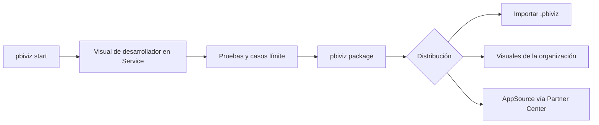

# Empaquetar, probar y publicar un visual propio

Parte de: [[17-Power-BI/07 Gráficas propias/_Índice Gráficas propias|Gráficas propias]]

> [!info] Cómo avanzar
> `progreso`: **pendiente** → **viendo** (estudiando) → **visto** (contestaste la autoevaluación sin abrir las respuestas) → **dominado** (hiciste el laboratorio o lo aplicaste de verdad).

## Contenido

### Qué es
Es la última etapa del ciclo de un visual hecho con el [[SDK de visuales de Power BI (TypeScript y pbiviz)]]: **probarlo** mientras lo desarrollas, **empaquetarlo** como archivo `.pbiviz` y **distribuirlo** a los informes de tu organización o al público mediante AppSource.

### Cómo funciona
**1. Probar durante el desarrollo**
- Ejecuta `pbiviz start`: compila en modo observación y levanta un servidor local HTTPS que sirve el visual.
- En el **Service**, activa el modo de desarrollador en la configuración de tu cuenta; en el panel de visualizaciones aparece el **visual de desarrollador** (ícono `</>`). Ponlo en un informe de prueba y se carga desde tu servidor local: cada vez que guardas, se recarga.
- En **Desktop**, activa *Desarrollar un visual* en la configuración del informe (vale solo para la sesión) para importar y depurar.
- Depura con las herramientas del navegador (F12): `console.log`, puntos de interrupción en el código TypeScript gracias a los *source maps*.
- Prueba casos límite: sin datos, un solo valor, miles de categorías, nombres largos, negativos, filtros que vacían el visual, tamaños pequeños, modo de alto contraste.
- Añade pruebas unitarias del *view model* (funciones puras que transforman el DataView) con tu framework de pruebas preferido.

**2. Empaquetar**
- Actualiza la versión en `pbiviz.json` (versionado semántico) y la descripción, autor e ícono.
- Ejecuta `pbiviz package`. Genera `dist/<nombre>.pbiviz` (un zip con el JS compilado, `capabilities.json` y metadatos).
- Si apuntas a certificación, `pbiviz package --certification-audit` revisa llamadas inseguras.

**3. Distribuir**
| Opción | Cómo | Para quién |
|---|---|---|
| **Importar archivo** | Visualizaciones → … → *Importar un objeto visual desde un archivo* | Pruebas o uso puntual; queda incrustado en ese informe |
| **Visuales de la organización** | El administrador lo sube en el portal de administración; aparece a todos en la pestaña de la organización y se actualiza centralmente | Uso interno controlado |
| **AppSource** | Publicación en **Partner Center**, revisión de Microsoft y, opcional, solicitud de **certificación** | Público general, ISV |



### Ejemplo
Flujo del visual "BarrasItzamna" en Azure DevOps:

```yaml
# azure-pipelines.yml (fragmento)
trigger:
  branches: { include: [ main ] }
pool: { vmImage: windows-latest }
steps:
  - task: NodeTool@0
    inputs: { versionSpec: '20.x' }
  - script: npm ci
    displayName: Instalar dependencias
  - script: npx pbiviz package
    displayName: Empaquetar visual
  - publish: dist
    artifact: visual
```

El artefacto `.pbiviz` lo descarga el administrador de Fabric y lo carga en **Visuales de la organización**. Cada nueva versión sube el número en `pbiviz.json`; los informes que usan el visual organizacional toman la versión nueva sin que cada autor lo reimporte. (Versión de Node en el pipeline: ajústala a la LTS que uses.)

### Cuándo usarlo y cuándo no
- **Importar archivo**: prototipos y pruebas con usuarios.
- **Visuales de la organización**: el estándar para visuales internos, porque centraliza versión y permisos.
- **AppSource**: solo si quieres que lo use cualquiera; implica soporte público, revisión y, para certificar, cumplir reglas estrictas (sin acceso a red externo, sin código minificado, etc.).

### Errores comunes
1. **No cambiar el GUID** al copiar un proyecto: dos visuales con el mismo identificador chocan en el informe.
2. **No subir la versión**: Power BI no detecta la actualización.
3. **Distribuir por correo el .pbiviz** a cada autor: terminan con versiones distintas. Usa visuales de la organización.
4. **Probar solo con datos bonitos**: el visual truena con el primer filtro vacío.
5. **Olvidar el modo de desarrollador** al día siguiente en Desktop (dura solo la sesión).

### Para profundizar
- [Empaquetar un visual de Power BI (Microsoft Learn)](https://learn.microsoft.com/en-us/power-bi/developer/visuals/package-visual)
- [Publicar visuales en Partner Center](https://learn.microsoft.com/en-us/power-bi/developer/visuals/office-store)
- [Visuales de la organización](https://learn.microsoft.com/en-us/power-bi/developer/visuals/power-bi-custom-visuals-organization)

## Autoevaluación

Contesta primero en voz alta o en papel; luego despliega la respuesta.

> [!question]- ¿Cómo pruebas un visual mientras lo desarrollas?
> `pbiviz start` levanta un servidor local y en el Service usas el *visual de desarrollador* (requiere activar el modo desarrollador).

> [!question]- ¿Cómo se empaqueta?
> `pbiviz package` genera un `.pbiviz` en `dist/`, que se importa en Desktop (*Importar un objeto visual desde un archivo*).

> [!question]- Opciones para distribuirlo.
> Como visual organizacional (lo sube el administrador) o publicado en AppSource vía Partner Center (con o sin certificación).

