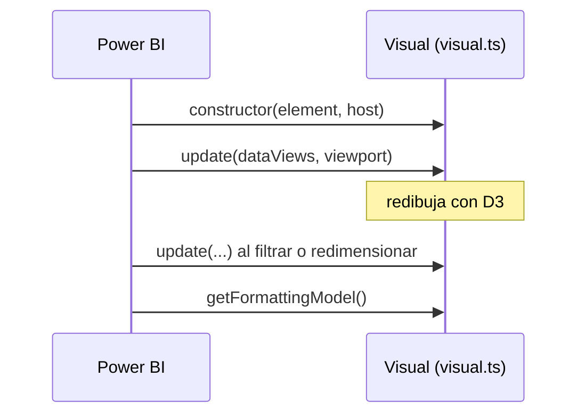

# SDK de visuales de Power BI (TypeScript y pbiviz)

Parte de: [[17-Power-BI/07 Gráficas propias/_Índice Gráficas propias|Gráficas propias]]

> [!info] Cómo avanzar
> `progreso`: **pendiente** → **viendo** (estudiando) → **visto** (contestaste la autoevaluación sin abrir las respuestas) → **dominado** (hiciste el laboratorio o lo aplicaste de verdad).

## Contenido

### Qué es
El **SDK de visuales de Power BI** es el conjunto de herramientas y APIs para programar tus propios visuales en **TypeScript** (con HTML, CSS/LESS y la librería de dibujo que quieras, típicamente D3). La herramienta de línea de comandos se llama **pbiviz** (paquete npm `powerbi-visuals-tools`) y el resultado es un archivo `.pbiviz` que se importa a cualquier informe. Es la opción con más control y más esfuerzo del [[Visuales personalizados - panorama de opciones|panorama de visuales]].

### Cómo funciona
**Qué necesitas**
- **Node.js** (versión LTS recomendada) y npm.
- Instalar la herramienta: `npm i -g powerbi-visuals-tools@latest`.
- Un editor (VS Code) y PowerShell o Terminal.
- Cuenta de **Power BI Pro o PPU** para probar en el Service.
- Para depurar: activar el **modo de desarrollador** (en el Service, en la configuración de desarrollador; en Desktop, *Opciones → Configuración del informe → Desarrollar un visual*, que dura solo la sesión).

**Archivos clave de un proyecto** (`pbiviz new MiVisual`):

| Archivo | Para qué |
|---|---|
| `pbiviz.json` | Metadatos: nombre, GUID, versión, autor, ícono, versión de API |
| `capabilities.json` | **Contrato con Power BI**: `dataRoles` (áreas de campos), `dataViewMappings` (cómo llegan los datos: categorical, table, matrix…), `objects` (propiedades de formato), privilegios como acceso web |
| `src/visual.ts` | La clase que implementa `IVisual` |
| `src/settings.ts` | Modelo de opciones de formato (API de *formatting model*) |
| `style/visual.less` | Estilos |
| `package.json`, `tsconfig.json` | Dependencias y compilación |
| `assets/icon.png` | Ícono en el panel |

**Ciclo de vida de la clase**
- `constructor(options)`: se ejecuta una vez; recibe el elemento HTML contenedor y el `host` (servicios: selección, tooltips, colores, localización). Aquí creas el SVG raíz.
- **`update(options)`**: Power BI lo llama **cada vez que algo cambia**: datos nuevos o filtrados, tamaño del visual (`options.viewport`), formato. Recibe `options.dataViews` con los datos ya mapeados según `capabilities.json`. Aquí redibujas. Debe ser idempotente y rápido.
- `getFormattingModel()`: devuelve las tarjetas de formato del panel.
- `destroy()`: limpieza opcional.



### Ejemplo
Arranque de un visual de barras para el equipo de Itzamna.Clio:

```bash
# Instala la CLI una vez
npm i -g powerbi-visuals-tools@latest
# Crea el proyecto
pbiviz new BarrasItzamna
cd BarrasItzamna
# Servidor local con recarga para probar en el Service (visual de desarrollador)
pbiviz start
```

Un `capabilities.json` mínimo con una categoría y una medida:

```json
{
  "dataRoles": [
    { "name": "categoria", "kind": "Grouping", "displayName": "Categoría" },
    { "name": "valor", "kind": "Measure", "displayName": "Valor" }
  ],
  "dataViewMappings": [
    {
      "conditions": [ { "categoria": { "max": 1 }, "valor": { "max": 1 } } ],
      "categorical": {
        "categories": { "for": { "in": "categoria" }, "dataReductionAlgorithm": { "top": { "count": 1000 } } },
        "values": { "select": [ { "bind": { "to": "valor" } } ] }
      }
    }
  ],
  "privileges": []
}
```

El código de dibujo está en [[Crear un visual propio con D3]] y el empaquetado en [[Empaquetar, probar y publicar un visual propio]].

### Cuándo usarlo y cuándo no
- **Úsalo** cuando necesitas un visual reutilizable en muchos informes, con interacciones finas (selección, tooltips, menú contextual), propiedades de formato propias o distribución por AppSource.
- **No** si [[Deneb (Vega y Vega-Lite)]] o un visual de AppSource resuelven el caso: el SDK implica proyecto, pruebas, versiones y mantenimiento ante cambios de la API.

### Errores comunes
1. **Leer datos sin validar** `options.dataViews[0]`: cuando el usuario quita campos llega vacío y el visual truena.
2. **Recrear todo el DOM en cada `update`**: lento; usa el patrón de *join* de D3.
3. **Olvidar `dataReductionAlgorithm`** y recibir solo una parte de los datos sin saberlo.
4. **Pedir privilegio de acceso web** sin necesidad: impide la certificación.
5. **Desalinear `capabilities.json` y el código** (nombres de roles distintos).

### Para profundizar
- [Configurar el entorno para desarrollar un visual (Microsoft Learn)](https://learn.microsoft.com/en-us/power-bi/developer/visuals/environment-setup)
- [Tutorial: crear un visual circle card](https://learn.microsoft.com/en-us/power-bi/developer/visuals/develop-circle-card)
- [Capacidades y propiedades de los visuales](https://learn.microsoft.com/en-us/power-bi/developer/visuals/capabilities)

## Autoevaluación

Contesta primero en voz alta o en papel; luego despliega la respuesta.

> [!question]- ¿Qué necesitas para crear un visual con el SDK?
> Node.js, la herramienta `powerbi-visuals-tools` (comando `pbiviz`), un editor (VS Code) y conocimientos de TypeScript; opcionalmente D3.

> [!question]- ¿Qué archivos clave tiene un proyecto?
> `capabilities.json` (roles de datos, mapeo y propiedades de formato), `pbiviz.json` (metadatos), `src/visual.ts` (clase con `update()`) y estilos `.less`.

> [!question]- ¿Qué hace el método `update(options)`?
> Se llama cada vez que cambian datos, tamaño o formato; ahí lees `options.dataViews` y redibujas.

