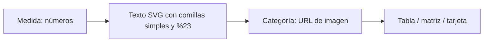

# SVG dentro de medidas DAX

Parte de: [[17-Power-BI/07 Gráficas propias/_Índice Gráficas propias|Gráficas propias]]

> [!info] Cómo avanzar
> `progreso`: **pendiente** → **viendo** (estudiando) → **visto** (contestaste la autoevaluación sin abrir las respuestas) → **dominado** (hiciste el laboratorio o lo aplicaste de verdad).

## Contenido

### Qué es
Una técnica para dibujar **micrográficos dentro de tablas, matrices y tarjetas** sin visuales externos: una medida DAX arma, como texto, una imagen **SVG** (gráficos vectoriales en XML) en forma de *data URI* (`data:image/svg+xml;utf8,<svg …>`). Marcas la medida con la categoría de datos **URL de imagen** y Power BI la dibuja como imagen en cada fila. Así obtienes barras de progreso, semáforos, sparklines, íconos o viñetas que responden a filtros como cualquier medida.

### Cómo funciona
1. **Calculas** en DAX los números del dibujo (ancho de la barra, color, coordenadas).
2. **Concatenas** el XML del SVG con `&`. Reglas de escritura:
   - Usa **comillas simples** en los atributos SVG (`width='100'`); las dobles cierran la cadena DAX.
   - Codifica `#` como **`%23`** en colores (`fill='%231E88E5'`), porque en una URL `#` inicia un fragmento y corta la imagen.
   - Incluye `xmlns='http://www.w3.org/2000/svg'`.
3. Selecciona la medida → **Herramientas de medición → Categoría de datos → URL de imagen**.
4. Ponla en una **tabla o matriz** (también en la tarjeta nueva y en algunos visuales que aceptan imágenes). Ajusta *Formato → Tamaño de imagen* para que la altura sea la adecuada.



### Ejemplo
**Barra de progreso** del porcentaje del total (ancho 100 px):

```dax
Barra SVG =
VAR P = MIN ( 1, MAX ( 0, [% del total] ) )   -- recorta entre 0 y 1
VAR W = ROUND ( P * 100, 0 )
RETURN
    "data:image/svg+xml;utf8,<svg xmlns='http://www.w3.org/2000/svg' width='100' height='12'>"
        & "<rect width='100' height='12' fill='%23E0E0E0'/>"
        & "<rect width='" & W & "' height='12' fill='%231E88E5'/></svg>"
```

Si `[% del total]` vale 0.5172, `W = ROUND(51.72, 0) = 52`, así que el segundo rectángulo queda de 52 px de ancho.

**Semáforo** con círculo verde o rojo:

```dax
Semaforo SVG =
VAR C = IF ( [Var vs AA %] >= 0, "%232E7D32", "%23C62828" )
RETURN
    "data:image/svg+xml;utf8,<svg xmlns='http://www.w3.org/2000/svg' width='12' height='12'>"
        & "<circle cx='6' cy='6' r='5' fill='" & C & "'/></svg>"
```

**Sparkline** (idea): con `CONCATENATEX` sobre los meses visibles generas los puntos `x,y` de un `<polyline>`, escalando `y` con el mínimo y máximo de la serie.

En la matriz de sucursales de Itzamna.Dionisio, columnas: Sucursal | Ventas $ | Barra SVG | Var vs AA % | Semáforo SVG.

### ¿Para qué es útil?
- Micrográficos dentro de tablas, donde ningún visual nativo llega.
- Íconos y estados personalizados con los colores corporativos.
- Diseños que deben exportarse/suscribirse: al ser una medida nativa, no depende de visuales de terceros.
- Para gráficos completos e interactivos, mejor [[Deneb (Vega y Vega-Lite)]].

### Cuándo usarlo y cuándo no
- **Úsalo** para elementos pequeños y repetidos por fila.
- **No** para gráficos grandes y complejos: las medidas se vuelven ilegibles y pesadas (cada celda genera su texto).
- Si solo necesitas una barra simple, prueba primero las **barras de datos** del [[Formato condicional]].

### Errores comunes
1. **Comillas dobles dentro del SVG**: rompen la cadena DAX. Usa simples.
2. **`#` sin codificar** en colores: la imagen sale vacía. Usa `%23`.
3. **Olvidar la categoría URL de imagen**: verás el texto largo en lugar de la imagen.
4. **Valores fuera de rango** (porcentajes > 100 % o negativos) que dibujan barras fuera del lienzo: recorta con `MIN`/`MAX`.
5. **Totales**: la fila de total también genera la imagen; controla con `ISINSCOPE` si no tiene sentido.

### Para profundizar
- [Categoría de datos URL de imagen (Microsoft Learn)](https://learn.microsoft.com/en-us/power-bi/create-reports/power-bi-images-tables)
- [Referencia de SVG (MDN)](https://developer.mozilla.org/en-US/docs/Web/SVG)
- [Elemento rect de SVG (MDN)](https://developer.mozilla.org/en-US/docs/Web/SVG/Element/rect)

## Ejercicios

Resuélvelos en papel o en la herramienta; la solución está plegada.

> [!question]- Medida SVG con una barra de progreso de `[% del total]` (ancho 100).
> ```dax
> Barra SVG =
> VAR P = MIN(1, MAX(0, [% del total]))
> VAR W = ROUND(P * 100, 0)
> RETURN
> "data:image/svg+xml;utf8,<svg xmlns='http://www.w3.org/2000/svg' width='100' height='12'>" &
> "<rect width='100' height='12' fill='%23E0E0E0'/>" &
> "<rect width='" & W & "' height='12' fill='%231E88E5'/></svg>"
> ```
> Marca la medida como *URL de imagen*.

> [!question]- Medida SVG de un círculo verde o rojo según Var vs AA.
> ```dax
> Semáforo SVG =
> VAR C = IF([Var vs AA %] >= 0, "%232E7D32", "%23C62828")
> RETURN "data:image/svg+xml;utf8,<svg xmlns='http://www.w3.org/2000/svg' width='12' height='12'><circle cx='6' cy='6' r='5' fill='" & C & "'/></svg>"
> ```

> [!question]- ¿Qué texto produce la medida de barra si `[% del total]` es 0.5172?
> W = ROUND(51.72, 0) = 52, así que el segundo `rect` queda `<rect width='52' height='12' fill='%231E88E5'/>`.

## Autoevaluación

Contesta primero en voz alta o en papel; luego despliega la respuesta.

> [!question]- ¿Cómo se muestra un SVG generado por DAX?
> Una medida que devuelve texto `data:image/svg+xml;utf8,<svg ...>`, con *Categoría de datos* = **URL de imagen**; se usa en tablas, matrices y tarjetas (nuevas).

> [!question]- ¿Para qué es útil?
> Micrográficos dentro de tablas: barras de progreso, semáforos, sparklines o íconos personalizados sin visuales externos.

> [!question]- Error común al escribir el SVG.
> Usar comillas dobles dentro del texto DAX; conviene usar comillas simples en los atributos del SVG y codificar `#` como `%23` en colores.

## Práctica

- [[Lab 9 - Visual propio con Deneb o SVG en Power BI]]

