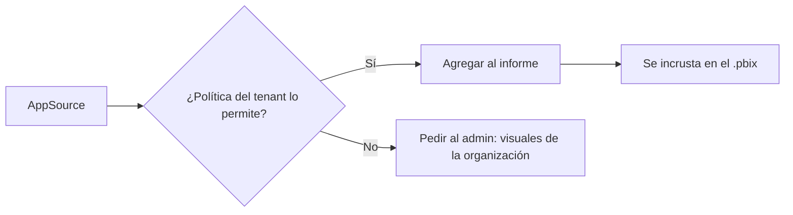

# Visuales de AppSource

Parte de: [[17-Power-BI/07 Gráficas propias/_Índice Gráficas propias|Gráficas propias]]

> [!info] Cómo avanzar
> `progreso`: **pendiente** → **viendo** (estudiando) → **visto** (contestaste la autoevaluación sin abrir las respuestas) → **dominado** (hiciste el laboratorio o lo aplicaste de verdad).

## Contenido

### Qué es
**AppSource** es la tienda de Microsoft donde terceros (y Microsoft) publican **visuales personalizados** para Power BI: Gantt, viñetas, calendarios de calor, diagramas Sankey, mapas especiales, tarjetas avanzadas. Se agregan al informe desde Desktop o el Service con **Visualizaciones → … → Obtener más objetos visuales** y quedan guardados dentro del archivo del informe.

### Cómo funciona
1. En el panel Visualizaciones, botón **…** → **Obtener más objetos visuales**.
2. Buscas, filtras por categoría o por **Certificados por Power BI** y eliges **Agregar**.
3. El visual aparece en el panel y se usa como cualquier otro: arrastras campos a sus áreas y lo formateas.
4. El visual se **incrusta en el .pbix**; quien abra el informe lo verá aunque no lo haya instalado. Cuando el publicador saca una versión nueva, se actualiza desde AppSource.

**Visuales certificados**
Un visual **certificado** pasó la revisión de código y pruebas de Microsoft: no hace solicitudes HTTP/WebSocket externas, no usa `eval`, `fetch` ni `innerHTML` con datos del usuario, no tiene JavaScript minificado y soporta la API de eventos de renderizado. Muestra una insignia (amarilla en AppSource, azul en Power BI). Además, los certificados tienen funciones extra: **exportar a PowerPoint** y **aparecer en suscripciones por correo**. La certificación revisa el código, no garantiza que el visual sea correcto en su lógica ni respalda al autor; y un visual no certificado no es necesariamente inseguro, simplemente no fue revisado.

**Costo**
Sí pueden tener costo. Hay visuales gratuitos, gratuitos con funciones adicionales de pago y visuales con licencia por usuario que se compra al publicador o mediante AppSource. La ficha de AppSource indica el modelo; revísalo antes de construir un informe crítico sobre uno.

**Gobierno**
En el portal de administración, el administrador de Fabric puede:
- Permitir o bloquear visuales de AppSource y visuales no certificados.
- Publicar **visuales de la organización** (aprobados, de una versión concreta) que aparecen para todos en una pestaña propia.

### Ejemplo
Para el seguimiento de proyectos de Ocelotl.Hermes necesitas un **diagrama de Gantt**. En AppSource filtras por certificados, comparas dos opciones gratuitas, revisas la ficha (publicador, fecha de última actualización, reseñas, si hay plan de pago) y agregas la que cumple. Antes de compartirlo con la dirección, confirmas con el administrador que el tenant permite ese visual y lo pides como **visual de la organización** para fijar la versión que todos usan.

### Cuándo usarlo y cuándo no
- **Úsalo** cuando necesitas un tipo de gráfico que no existe en lo nativo y hay uno maduro y certificado.
- **Evítalo** si el visual no está certificado y el informe tiene datos sensibles, si el publicador no lo mantiene, o si el costo por usuario no se justifica.
- Alternativas: [[Deneb (Vega y Vega-Lite)]] (un solo visual certificado y gratuito con el que haces casi cualquier gráfico) o [[SVG dentro de medidas DAX]].

### Errores comunes
1. **Asumir que certificado = gratuito**: son cosas independientes.
2. **Construir sobre un visual con prueba gratis** que luego muestra marcas de agua o deja de funcionar.
3. **Ignorar la política del tenant**: en Desktop funciona y en el Service sale bloqueado.
4. **Esperar que aparezca en suscripciones o exportación a PowerPoint** un visual no certificado: no se renderiza ahí.
5. **Demasiados visuales de terceros** en un informe: cada uno agrega peso y dependencia.

### Para profundizar
- [Obtener visuales de AppSource (Microsoft Learn)](https://learn.microsoft.com/en-us/power-bi/developer/visuals/power-bi-custom-visuals)
- [Visuales certificados de Power BI](https://learn.microsoft.com/en-us/power-bi/developer/visuals/power-bi-custom-visuals-certified)
- [Configuración de inquilino de visuales](https://learn.microsoft.com/en-us/fabric/admin/service-admin-portal-power-bi-visuals)

## Autoevaluación

Contesta primero en voz alta o en papel; luego despliega la respuesta.

> [!question]- ¿Qué significa que un visual de AppSource esté certificado?
> Microsoft revisó el código para cumplir requisitos (p. ej. no acceder a servicios externos). Los certificados pueden exportarse a PowerPoint y usarse en suscripciones de correo.

> [!question]- ¿Pueden tener costo?
> Sí: algunos son gratuitos, otros tienen funciones de pago o licencias (verificar con el proveedor).

