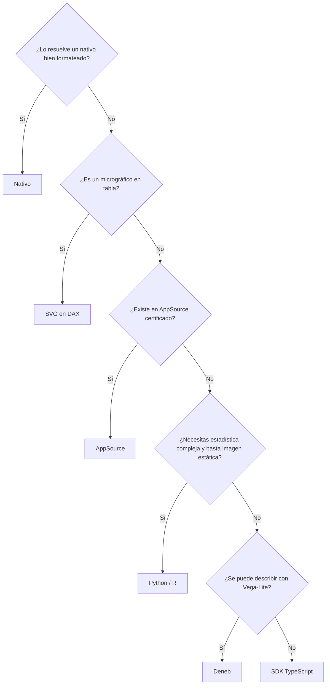

# Visuales personalizados - panorama de opciones

Parte de: [[17-Power-BI/07 Gráficas propias/_Índice Gráficas propias|Gráficas propias]]

> [!info] Cómo avanzar
> `progreso`: **pendiente** → **viendo** (estudiando) → **visto** (contestaste la autoevaluación sin abrir las respuestas) → **dominado** (hiciste el laboratorio o lo aplicaste de verdad).

## Contenido

### Qué es
Cuando los visuales nativos de Power BI no alcanzan (un gráfico de viñeta, un diagrama de Gantt, un sparkline dentro de una tabla, un gráfico con un diseño corporativo muy específico), hay varias rutas para crear o conseguir **visuales propios**. Esta nota da el mapa y te ayuda a elegir; cada opción tiene su propia nota.

### Cómo funciona
Las opciones, de menor a mayor esfuerzo:

1. **Exprimir lo nativo**: [[Formato condicional]], líneas de referencia, [[Cálculos visuales (visual calculations)]], tarjeta nueva, tooltips de página. Muchas veces el "visual que falta" es un nativo bien formateado.
2. **[[SVG dentro de medidas DAX]]**: una medida que devuelve una imagen SVG como texto; se muestra en tablas, matrices y tarjetas. Ideal para micrográficos (barras de progreso, semáforos, sparklines). Solo DAX.
3. **[[Deneb (Vega y Vega-Lite)]]**: visual certificado y gratuito de AppSource donde escribes una especificación declarativa en JSON (Vega-Lite o Vega). Casi cualquier gráfico, con interactividad (filtrado cruzado, tooltips) y sin programar en TypeScript.
4. **[[Visuales de AppSource]]**: cientos de visuales de terceros listos para usar (gratis o de pago), algunos certificados por Microsoft.
5. **[[Visuales de Python]] y [[Visuales de R]]**: scripts que generan una imagen estática con matplotlib/seaborn o ggplot2. Potentes para estadística, pero sin interactividad y con limitaciones en el Service.
6. **SDK de visuales**: un visual propio en TypeScript, empaquetado como `.pbiviz` (ver [[SDK de visuales de Power BI (TypeScript y pbiviz)]], [[Crear un visual propio con D3]] y [[Empaquetar, probar y publicar un visual propio]]). Control total, mayor costo de desarrollo y mantenimiento.

### Comparativa rápida
| Opción | Lenguaje | Interactivo | Esfuerzo | Riesgo/gobierno |
|---|---|---|---|---|
| SVG en DAX | DAX | Parcial (vive en la tabla) | Bajo | Ninguno extra |
| Deneb | JSON Vega-Lite | Sí | Bajo–medio | Visual certificado |
| AppSource | Ninguno | Sí | Muy bajo | Revisar publicador y certificación |
| Python/R | Python/R | No | Medio | Scripts y licencias en el Service |
| SDK | TypeScript | Sí | Alto | Tú lo mantienes |

**Para un gráfico muy específico sin programar en TypeScript**, la opción con menos esfuerzo suele ser **Deneb**: declaras datos, marcas y codificaciones en JSON y obtienes un visual interactivo que funciona en el Service sin instalar nada.

### Ejemplo
En Wee.Reporteria piden "un gráfico de viñeta por sucursal con real, meta y rango aceptable". Ruta: (1) no hay nativo; (2) no es micrográfico; (3) en AppSource hay un *Bullet Chart*, pero la empresa solo permite visuales certificados y el que encuentras no cumple el diseño; (4) no es estadística; (5) en Deneb se resuelve con capas de `bar` y `tick` en Vega-Lite. Listo en una tarde, sin proyecto TypeScript.

### Qué revisar antes de usar un visual de terceros en una organización
1. **Certificación**: los certificados pasaron revisión de código de Microsoft (no llaman servicios externos) y además se pueden exportar a PowerPoint y aparecer en suscripciones por correo.
2. **Privacidad**: ¿el visual envía datos fuera? Los no certificados pueden hacerlo.
3. **Publicador y soporte**: quién lo mantiene, frecuencia de actualizaciones.
4. **Licencia y costo**: algunos son gratis con funciones de pago o requieren licencia por usuario.
5. **Políticas del tenant**: el administrador puede bloquear visuales no certificados o permitir solo **visuales de la organización** aprobados en el portal de administración.

### Cuándo usarlo y cuándo no
Cada visual personalizado agrega dependencia y aprendizaje para quien mantenga el informe. Úsalos cuando el valor de negocio lo justifique; si el nativo da el 90 % del mensaje, quédate con el nativo.

### Errores comunes
1. **Saltar directo al SDK** para algo que resolvía Deneb o SVG.
2. **Instalar cualquier visual de AppSource** sin revisar certificación ni política del tenant.
3. **Python/R para gráficos interactivos**: no lo son.
4. **No documentar** el visual elegido y su versión; el siguiente autor no sabe de dónde salió.

### Para profundizar
- [Visuales personalizados de Power BI (Microsoft Learn)](https://learn.microsoft.com/en-us/power-bi/developer/visuals/power-bi-custom-visuals)
- [Visuales certificados](https://learn.microsoft.com/en-us/power-bi/developer/visuals/power-bi-custom-visuals-certified)
- [Administrar visuales de la organización](https://learn.microsoft.com/en-us/fabric/admin/organizational-visuals)

## Autoevaluación

Contesta primero en voz alta o en papel; luego despliega la respuesta.

> [!question]- ¿Qué opciones hay cuando los visuales nativos no bastan?
> 1) Visuales de AppSource. 2) Visuales de R o Python. 3) Deneb (Vega/Vega-Lite). 4) SVG generado con medidas DAX. 5) Programar uno propio con el SDK (TypeScript).

> [!question]- ¿Cuál requiere menos esfuerzo para un gráfico muy específico sin programar en TypeScript?
> Deneb o SVG en DAX: declarativos y dentro del informe, sin compilar ni empaquetar.

> [!question]- ¿Qué hay que revisar antes de usar un visual de terceros en una organización?
> Si está certificado, quién lo publica, si envía datos fuera, su licencia y si el administrador lo permite (visuales organizacionales).

## Práctica

- [[Lab 9 - Visual propio con Deneb o SVG en Power BI]]

