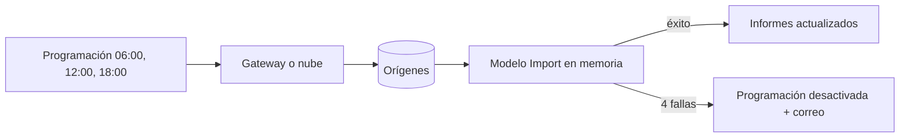

# Actualización programada

Parte de: [[17-Power-BI/08 Power BI Service/_Índice Power BI Service|Power BI Service]]

> [!info] Cómo avanzar
> `progreso`: **pendiente** → **viendo** (estudiando) → **visto** (contestaste la autoevaluación sin abrir las respuestas) → **dominado** (hiciste el laboratorio o lo aplicaste de verdad).

## Contenido

### Qué es
La **actualización programada** recarga automáticamente los datos de un modelo semántico en modo **Import** en el Service, en los horarios que definas. Sin ella, el modelo se queda con los datos del momento en que publicaste. (DirectQuery y Direct Lake no copian datos de la misma forma: DirectQuery consulta el origen en vivo y Direct Lake hace *framing*; ver [[Direct Lake]].)

### Cómo funciona
**Qué se necesita** para programarla en un modelo Import:
1. **Credenciales** válidas de cada origen en *Configuración del modelo → Credenciales del origen de datos* (OAuth, básica, clave, etc.).
2. Si el origen está en tu red local (SQL Server on-premises, carpeta compartida), una **[[Puerta de enlace de datos local (gateway)]]** en modo estándar con el origen configurado. Los orígenes en la nube accesibles públicamente no la requieren.
3. **Programación** en *Actualizar → Configurar una programación de actualización*: frecuencia diaria o semanal, zona horaria, horas, y destinatarios de notificaciones de error.
4. **Licencia**: hasta **8 actualizaciones al día** con Pro y hasta **48** con PPU o capacidad Premium/Fabric. Las actualizaciones a petición (manuales o por API) también consumen recursos. (Microsoft Learn, consultado nov 2026.)

**Comportamiento**
- La actualización intenta arrancar dentro de los 15 minutos del horario elegido y puede retrasarse si el servicio está ocupado.
- Tras **cuatro fallas consecutivas**, o un error irrecuperable que requiere cambiar la configuración (credenciales vencidas), Power BI **desactiva la programación**. Hay que corregir la causa, volver a activarla y aplicar. El detalle está en **Historial de actualizaciones**.
- Tras **dos meses sin que nadie vea** un informe o panel del modelo, la programación se **pausa** y se avisa al propietario.
- Para modelos grandes, combina con [[Actualización incremental]] y en capacidad usa la API de actualización mejorada (por tablas o particiones).



### Causa común de fallo: origen dinámico
Power BI tiene que poder **analizar la consulta sin ejecutarla** para saber a qué orígenes se conecta y pedir credenciales. Si la URL o la ruta se arma en tiempo de ejecución (por ejemplo, concatenando un parámetro calculado en `Web.Contents("https://api.itzamna.mx/pedidos?fecha=" & Fecha)` o recorriendo una lista de URLs), el Service dice que el modelo usa un **origen dinámico** y **no permite programar la actualización**, aunque en Desktop funcione. Solución: dejar fija la URL base y mover la parte variable a las opciones `RelativePath` y `Query` de `Web.Contents`:

```m
let
    Origen = Json.Document(
        Web.Contents(
            "https://api.itzamna.mx",
            [ RelativePath = "pedidos", Query = [ fecha = Date.ToText(FechaInicio, "yyyy-MM-dd") ] ]
        )
    )
in
    Origen
```

Otras causas frecuentes: credenciales vencidas (contraseña cambiada, token OAuth caducado), gateway apagado o sin el origen configurado, tiempo de espera excedido por consultas pesadas, y niveles de privacidad que bloquean combinar orígenes.

### Ejemplo
Modelo de ventas de Itzamna.Dionisio: SQL Server local vía gateway + catálogo en SharePoint Online (nube, sin gateway). Programación a las 6:00, 12:00 y 18:00 hora del centro de México; notificación al grupo `GRP-BI-Soporte`. Para cerrar mes, Finanzas dispara una actualización a petición desde un flujo de Power Automate o la [[API REST de Power BI]].

### Cuándo usarlo y cuándo no
- **Úsala** en todo modelo Import publicado.
- Si necesitas datos casi en tiempo real, considera DirectQuery, Direct Lake o modelos compuestos.
- No programes 48 actualizaciones "por si acaso": cargas al origen y a la capacidad. Alinea la frecuencia con la del ETL.

### Errores comunes
1. **Origen dinámico** (visto arriba).
2. **Programar antes de que termine el ETL**: actualizas datos viejos.
3. **Notificaciones solo al dueño**, que está de vacaciones.
4. **Credenciales personales** en orígenes de producción; usa cuentas de servicio o entidades de servicio.
5. **No revisar el historial** hasta que alguien se queja.

### Para profundizar
- [Configurar la actualización programada (Microsoft Learn)](https://learn.microsoft.com/en-us/power-bi/connect-data/refresh-scheduled-refresh)
- [Actualización de datos en Power BI](https://learn.microsoft.com/en-us/power-bi/connect-data/refresh-data)
- [Solución de problemas de actualización](https://learn.microsoft.com/en-us/power-bi/connect-data/refresh-troubleshooting-refresh-scenarios)

## Autoevaluación

Contesta primero en voz alta o en papel; luego despliega la respuesta.

> [!question]- ¿Qué se necesita para programar la actualización de un modelo Import?
> Credenciales válidas del origen en el Service, gateway si el origen es local, y configurar horarios en *Configuración del modelo semántico*. El número máximo de actualizaciones por día depende de la licencia (verificar en la página oficial).

> [!question]- ¿Qué pasa si una actualización falla varias veces seguidas?
> El Service puede deshabilitar la programación y notifica al dueño; hay que revisar el historial de actualización.

> [!question]- Causa común de fallo: origen dinámico.
> Consultas Web con URL construida dinámicamente no se pueden validar; usar `RelativePath`/`Query` con URL base fija.

