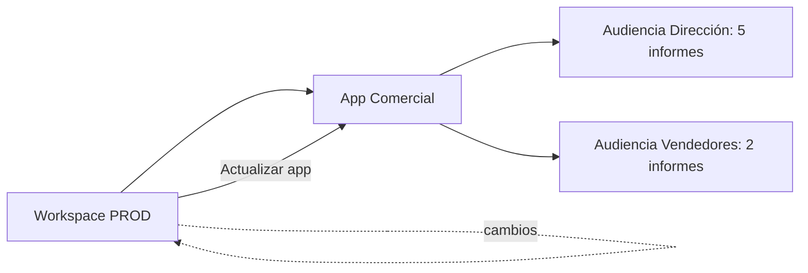

# Aplicaciones de Power BI

Parte de: [[17-Power-BI/08 Power BI Service/_Índice Power BI Service|Power BI Service]]

> [!info] Cómo avanzar
> `progreso`: **pendiente** → **viendo** (estudiando) → **visto** (contestaste la autoevaluación sin abrir las respuestas) → **dominado** (hiciste el laboratorio o lo aplicaste de verdad).

## Contenido

### Qué es
Una **app de Power BI** es un paquete de informes, paneles e informes paginados de un workspace que se publica para **consumidores** con una navegación propia, un logotipo y colores. El usuario la instala (o se le instala automáticamente) y la abre desde *Aplicaciones*; no ve el workspace ni el trabajo en progreso. Es la forma recomendada de distribuir contenido a usuarios finales.

### Cómo funciona
1. En el workspace (rol Administrador o Miembro), **Crear app**.
2. **Configuración**: nombre, descripción, logotipo, color, contacto de soporte.
3. **Contenido**: eliges qué informes y paneles incluir, los ordenas en secciones y puedes agregar vínculos externos.
4. **Audiencias**: puedes crear varias audiencias dentro de la misma app y decidir qué contenido ve cada una (por ejemplo, "Dirección" ve todo y "Vendedores" solo dos informes). Se asignan a **grupos de seguridad**.
5. **Permisos**: opciones para dar permiso de compilación sobre los modelos, permitir volver a compartir y **instalar automáticamente** la app para los destinatarios.
6. **Publicar**. Los cambios posteriores en el workspace **no se ven** en la app hasta que la **actualizas**: eso te da un control de versión de lo que ven los usuarios.

Licencias: igual que el resto, en capacidad compartida los consumidores necesitan Pro/PPU; en capacidad F64+/P pueden ser gratuitos. En Fabric también existen las **apps de la organización** (org apps) como elemento nuevo que permite más de una app por workspace (consulta su estado actual en Learn antes de adoptarlas).

### Ejemplo
App "Comercial Itzamna":
- Secciones: *Resumen* (informe ejecutivo), *Clientes* (informe de cartera), *Operación* (paginado de pedidos).
- Audiencia **Dirección** (`GRP-Direccion`): todo.
- Audiencia **Vendedores** (`GRP-Ventas`): Resumen y Clientes; [[Seguridad a nivel de fila (RLS)]] hace que cada vendedor vea solo su cartera.
- Instalación automática activada.
- Cuando el equipo de BI agrega una página nueva en el workspace, la revisa y luego **actualiza la app** en la junta de cambios del viernes.

### ¿Ventaja sobre dar rol de Espectador en el workspace?
1. **Separación**: los consumidores no ven elementos de trabajo, modelos, informes en prueba ni nada que agregues al workspace.
2. **Control de publicación**: lo que ven cambia solo cuando actualizas la app.
3. **Audiencias**: distinto contenido para distintos grupos sin crear workspaces extra.
4. **Experiencia**: navegación, secciones y marca propias; instalación automática.
5. **Escala**: cientos o miles de consumidores sin llenar la lista de acceso del workspace.

### Cuándo usarlo y cuándo no
- **Úsala** para todo contenido de producción con consumidores.
- **No** es necesaria para el equipo que desarrolla (rol en el workspace) ni para compartir algo puntual con una persona.
- Para usuarios externos dentro de tu app web, usa Embedded, no apps.

### Errores comunes
1. **Olvidar actualizar la app** y creer que los cambios ya se ven.
2. **Agregar a los consumidores también al workspace**, perdiendo la separación.
3. **Audiencias asignadas a personas**, no a grupos.
4. **Dar permiso de compilación** a todos los consumidores sin necesidad.
5. **Apps sin contacto ni descripción**: nadie sabe a quién preguntar.

### Para profundizar
- [Publicar una app en Power BI (Microsoft Learn)](https://learn.microsoft.com/en-us/power-bi/collaborate-share/service-create-distribute-apps)
- [Formas de compartir y distribuir contenido](https://learn.microsoft.com/en-us/power-bi/collaborate-share/service-how-to-collaborate-distribute-dashboards-reports)

## Autoevaluación

Contesta primero en voz alta o en papel; luego despliega la respuesta.

> [!question]- ¿Qué es una app de Power BI?
> Un paquete de informes y paneles de un workspace que se publica para consumidores, con navegación propia y audiencias.

> [!question]- ¿Ventaja de una app sobre dar rol de Lector en el workspace?
> Separa lo que está en desarrollo de lo publicado: los cambios no llegan a usuarios hasta actualizar la app; además permite audiencias con contenido distinto.

