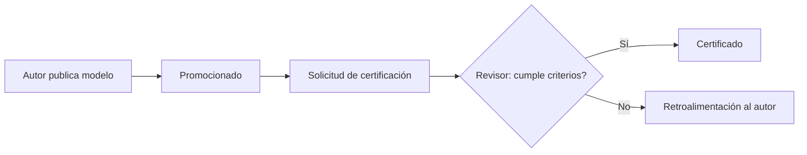

# Certificación y promoción de contenido

Parte de: [[17-Power-BI/08 Power BI Service/_Índice Power BI Service|Power BI Service]]

> [!info] Cómo avanzar
> `progreso`: **pendiente** → **viendo** (estudiando) → **visto** (contestaste la autoevaluación sin abrir las respuestas) → **dominado** (hiciste el laboratorio o lo aplicaste de verdad).

## Contenido

### Qué es
El **respaldo** (endorsement) es una insignia que se pone a un elemento del Service o de Fabric para indicar que es **confiable y recomendado para reutilizar**. Hay tres niveles (Microsoft Learn, consultado nov 2026):

| Insignia | Qué significa | Quién la aplica |
|---|---|---|
| **Promocionado** (Promoted) | "El autor cree que está listo para compartirse y reutilizarse" | Cualquiera con permiso de escritura sobre el elemento |
| **Certificado** (Certified) | Un revisor autorizado confirmó que cumple los estándares de calidad de la organización | Solo usuarios o grupos que el administrador de Fabric designa; cualquiera puede **solicitar** la certificación |
| **Datos maestros** (Master data) | Es la fuente central y autorizada de un dato clave (catálogo de clientes, productos) | Solo quienes designa el administrador; aplica a elementos con datos (modelos semánticos, lakehouses) |

Aplican a casi todos los elementos (modelos, informes, apps, dataflows, lakehouses…), **excepto paneles**.

### Cómo funciona
1. El administrador de Fabric **habilita la certificación** (y datos maestros) en la configuración del inquilino y define quién puede certificar; puede delegarlo a administradores de **dominio**, con revisores distintos por dominio.
2. La organización publica un **proceso**: qué criterios debe cumplir un modelo para certificarse (modelo estrella, medidas documentadas, RLS probado, actualización programada estable, propietario definido, etiqueta de confidencialidad) y a quién se solicita.
3. El autor abre la **Configuración del elemento → Respaldo** y elige *Promocionado*, o solicita la certificación con un vínculo a la documentación del proceso.
4. El revisor valida y marca *Certificado*.
5. Las insignias se ven en el catálogo de OneLake, en *Obtener datos* de Desktop (los certificados y promocionados aparecen primero) y en la búsqueda.

### ¿Para qué sirve?
- **Descubrimiento**: los usuarios encuentran rápido el modelo "bueno" entre decenas de copias.
- **Confianza**: en una junta, un número que sale de un modelo certificado no se discute.
- **Evitar duplicados**: si existe un modelo certificado de Ventas, nadie debería crear el suyo; se construyen informes encima con permiso de compilación (ver [[Modelos semánticos (antes datasets)]]).
- **Gobierno**: es una pieza central del modelo de autoservicio controlado ([[Gobierno de datos en Power BI]]).

### Ejemplo
En Itzamna, el equipo de BI publica "Ventas Itzamna" y lo marca **Promocionado** mientras lo validan con Finanzas. Una vez que cuadra contra el cierre contable de tres meses, el líder de datos (revisor designado del dominio Comercial) lo marca **Certificado**. El modelo "Clientes maestro" alimentado desde el CRM se marca **Datos maestros**. Cuando un analista abre Desktop y busca "ventas", ve primero el certificado.

### Cuándo usarlo y cuándo no
- **Promocionar**: contenido que consideras útil para otros, aunque no haya pasado revisión formal.
- **Certificar**: solo con un proceso real detrás; si todo se certifica, la insignia no significa nada.
- **No** como control de acceso: la insignia no da ni quita permisos.

### Errores comunes
1. **Certificar sin criterios escritos**.
2. **Certificados que nadie mantiene**: el dueño se fue y el modelo falla. Revisa periódicamente y quita la insignia si deja de cumplir.
3. **Confundir respaldo con permisos**: un usuario puede ver el modelo certificado en el catálogo y aun así no tener acceso.
4. **Esperar que las insignias se copien** al desplegar por canalización: el respaldo es de cada elemento y no se copia.

### Para profundizar
- [Información general del respaldo (Microsoft Learn)](https://learn.microsoft.com/en-us/fabric/governance/endorsement-overview)
- [Promocionar o certificar contenido](https://learn.microsoft.com/en-us/fabric/fundamentals/endorsement-promote-certify)

## Autoevaluación

Contesta primero en voz alta o en papel; luego despliega la respuesta.

> [!question]- ¿Diferencia entre *Promocionado* y *Certificado*?
> Promocionado lo marca el propio dueño ("está listo"). Certificado solo lo marcan personas autorizadas por el administrador tras revisión.

> [!question]- ¿Para qué sirve?
> Que los usuarios encuentren y confíen en el modelo oficial en vez de crear copias.

