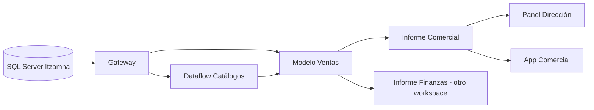

# Linaje de datos

Parte de: [[17-Power-BI/08 Power BI Service/_Índice Power BI Service|Power BI Service]]

> [!info] Cómo avanzar
> `progreso`: **pendiente** → **viendo** (estudiando) → **visto** (contestaste la autoevaluación sin abrir las respuestas) → **dominado** (hiciste el laboratorio o lo aplicaste de verdad).

## Contenido

### Qué es
La **vista de linaje** del workspace muestra, como un diagrama, **de dónde vienen y a dónde van los datos**: orígenes (bases de datos, archivos, APIs, gateways) → dataflows → modelos semánticos → informes → paneles y apps, incluidos elementos que viven en **otros workspaces**. Junto con el **análisis de impacto**, responde dos preguntas cotidianas: "¿de dónde sale este número?" y "si cambio esto, ¿qué se rompe?".

### Cómo funciona
1. En el workspace, cambia de **Vista de lista** a **Vista de linaje** (ícono en la barra superior).
2. Cada tarjeta es un elemento; las flechas indican el flujo de datos. Las tarjetas de orígenes muestran el tipo y el servidor; si pasan por un gateway, también se ve.
3. Al seleccionar un elemento se **resalta su linaje** completo hacia arriba y hacia abajo.
4. Desde la tarjeta de un modelo o dataflow, **Mostrar impacto** (análisis de impacto) lista todos los elementos descendentes, en este y otros workspaces, cuántas vistas tienen y quiénes los usan; puedes **notificar por correo** a los contactos de esos elementos antes de un cambio.
5. Solo ves lo que tus permisos permiten; los elementos de otros workspaces sin acceso aparecen limitados.
6. A nivel organización, Microsoft Purview y el catálogo de OneLake ofrecen vistas de linaje más amplias (entre servicios).

### Caso de uso
El DBA de Itzamna.Dionisio anuncia que va a **renombrar la vista `vw_VentasDetalle`** y mover la base a otro servidor. Antes de aprobarlo:

1. Abres la vista de linaje del workspace `Comercial - Modelos [PROD]` y ves que el origen `SQL01/ItzamnaVentas` alimenta al modelo "Ventas Itzamna" y al dataflow "Catálogos".
2. En el modelo, **Mostrar impacto**: 6 informes en 3 workspaces, 2 paneles, la app Comercial, 1,200 vistas en el último mes.
3. Usas **Notificar contactos** para avisar del cambio con fecha.
4. Planeas el cambio: actualizar el origen en el modelo y el dataflow, ajustar la conexión del gateway y probar en DEV primero.

Otros usos: **depurar** un número raro siguiendo su ruta hasta el origen; **auditar** qué informes dependen de un origen sensible; **limpiar** modelos huérfanos sin informes.

### Cuándo usarlo y cuándo no
- **Antes de cualquier cambio** en orígenes, modelos o dataflows compartidos.
- Para documentar la arquitectura de un área.
- No reemplaza la documentación de las medidas ni del ETL: muestra dependencias entre elementos, no la lógica de cada cálculo.

### Errores comunes
1. **Cambiar un modelo compartido sin revisar el impacto** y romper informes de otros equipos.
2. **Olvidar que hay elementos en otros workspaces** que no aparecen en la lista normal.
3. **No mantener los contactos** de los elementos: el análisis de impacto notifica a nadie.
4. **Depender de cadenas larguísimas** (dataflow → dataflow → modelo → modelo compuesto): el linaje lo muestra; úsalo para simplificar.

### Para profundizar
- [Vista de linaje de datos (Microsoft Learn)](https://learn.microsoft.com/en-us/power-bi/collaborate-share/service-data-lineage)
- [Análisis de impacto](https://learn.microsoft.com/en-us/power-bi/collaborate-share/service-dataset-impact-analysis)

## Autoevaluación

Contesta primero en voz alta o en papel; luego despliega la respuesta.

> [!question]- ¿Qué muestra la vista de linaje?
> La cadena origen → dataflow → modelo semántico → informe/panel/app de un workspace, y las dependencias entre ellos.

> [!question]- Caso de uso.
> Análisis de impacto: antes de cambiar una tabla del modelo, ver qué informes la usan y avisar a sus dueños.

