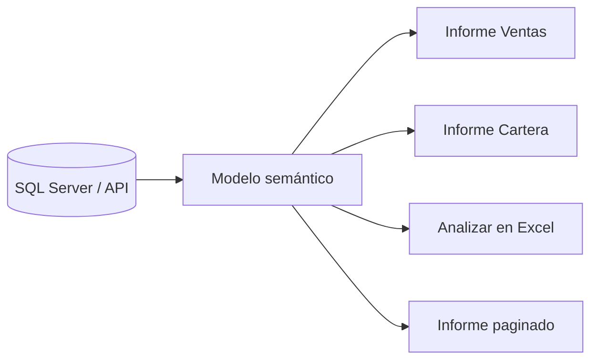

# Modelos semánticos (antes datasets)

Parte de: [[17-Power-BI/08 Power BI Service/_Índice Power BI Service|Power BI Service]]

> [!info] Cómo avanzar
> `progreso`: **pendiente** → **viendo** (estudiando) → **visto** (contestaste la autoevaluación sin abrir las respuestas) → **dominado** (hiciste el laboratorio o lo aplicaste de verdad).

## Contenido

### Qué es
Un **modelo semántico** es el modelo de datos publicado en el Service: tablas, relaciones, medidas DAX, jerarquías, roles de seguridad y la conexión a los orígenes. Hasta finales de 2023 se llamaba **dataset (conjunto de datos)**; Microsoft lo renombró para no confundirlo con otros "datasets" de Fabric. Cuando publicas un `.pbix` desde Desktop se crean **dos elementos**: el modelo semántico y el informe.

### Cómo funciona
- El modelo puede estar en modo **Import**, **DirectQuery**, **Direct Lake** o ser **compuesto** (ver [[Import, DirectQuery, Dual, Live Connection y Direct Lake]]).
- En su **configuración** se manejan credenciales de orígenes, [[Puerta de enlace de datos local (gateway)|gateway]], [[Actualización programada]], parámetros, RLS (asignación de miembros a roles), formato de almacenamiento grande y respaldo (endoso).
- **Separar modelo e informes**: un mismo modelo puede alimentar muchos informes, en el mismo o en otros workspaces. Los informes "delgados" (thin reports) se conectan en vivo al modelo (*Obtener datos → Modelos semánticos de Power BI*) y no contienen datos propios.
- **Permisos** sobre el modelo:
  - **Lectura** (Read): ver informes basados en él.
  - **Compilación** (Build): crear informes nuevos, consultas DAX, *Analizar en Excel*, modelos compuestos sobre él. Es lo que necesita alguien para **crear informes sobre un modelo que no es suyo**. Se otorga al compartir el modelo, con un rol de Colaborador o superior en el workspace, o desde la app.
  - **Volver a compartir** (Reshare) y **Escritura** (Write, para modificar el modelo).

### Ejemplo
En Itzamna.Dionisio tienes un modelo "Ventas Itzamna" (Import desde SQL Server con procedimientos y vistas, RLS por región). Lo publicas solo con la página vacía y luego:
- El equipo de BI construye tres informes delgados (Comercial, Finanzas, Operación) conectados en vivo.
- Un analista de Finanzas con **permiso de compilación** crea su propio informe o una tabla dinámica en Excel con *Analizar en Excel*, sin copiar datos.
- El modelo se marca como **Certificado** (ver [[Certificación y promoción de contenido]]) y se actualiza 4 veces al día.

Cuando cambias una medida, la cambias una vez y todos los informes la heredan.

### ¿Qué ventaja tiene separar modelo e informes?
1. **Una sola versión de la verdad**: las medidas se definen una vez.
2. **Menos actualizaciones y memoria**: no hay cinco copias del mismo modelo refrescándose.
3. **Trabajo en paralelo**: el modelador cambia el modelo y los autores de informes trabajan en sus archivos sin pisarse.
4. **Seguridad centralizada**: RLS se define en un lugar.
5. **Autoservicio controlado**: das permiso de compilación sobre un modelo certificado en lugar de acceso a la base de datos.

### Cuándo usarlo y cuándo no
- **Modelo compartido**: siempre que más de un informe use los mismos datos.
- **Modelo e informe en el mismo .pbix**: prototipos o informes únicos y pequeños.
- Para nuevas soluciones en Fabric, considera modelos **Direct Lake** sobre un lakehouse.

### Errores comunes
1. **Un modelo por informe** con medidas copiadas que divergen.
2. **Dar acceso a la base de datos** cuando bastaba permiso de compilación sobre el modelo.
3. **Olvidar asignar miembros a los roles de RLS** en el Service: el rol existe pero no filtra a nadie (o los usuarios sin rol no ven nada).
4. **Republicar el informe delgado con el modelo dentro** por error, creando un modelo duplicado.
5. **Pensar que el permiso de compilación es inofensivo**: permite ver todo lo que el modelo expone (respetando RLS); con OLS controlas columnas.

### Para profundizar
- [Modelos semánticos en el Service (Microsoft Learn)](https://learn.microsoft.com/en-us/power-bi/connect-data/service-datasets-understand)
- [Permiso de compilación](https://learn.microsoft.com/en-us/power-bi/connect-data/service-datasets-build-permissions)
- [Conectar a modelos semánticos desde Desktop](https://learn.microsoft.com/en-us/power-bi/connect-data/desktop-report-lifecycle-datasets)

## Autoevaluación

Contesta primero en voz alta o en papel; luego despliega la respuesta.

> [!question]- ¿Qué es un modelo semántico?
> El modelo publicado (tablas, relaciones, medidas, seguridad) al que se conectan los informes. Antes se llamaba *dataset*.

> [!question]- ¿Qué ventaja tiene separar modelo e informes?
> Un solo modelo certificado alimenta muchos informes (conexión dinámica), evita duplicar lógica y medidas.

> [!question]- ¿Qué permiso necesita alguien para crear informes sobre un modelo que no es suyo?
> Permiso de *Compilación* (Build) sobre el modelo semántico.

