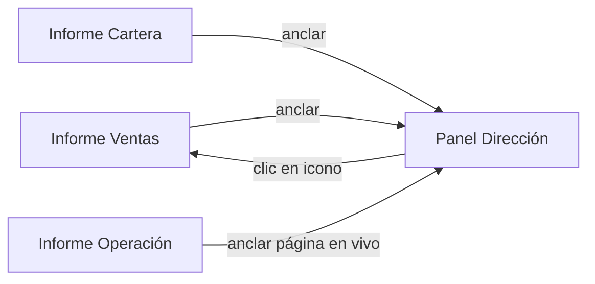

# Paneles (dashboards) vs informes

Parte de: [[17-Power-BI/08 Power BI Service/_Índice Power BI Service|Power BI Service]]

> [!info] Cómo avanzar
> `progreso`: **pendiente** → **viendo** (estudiando) → **visto** (contestaste la autoevaluación sin abrir las respuestas) → **dominado** (hiciste el laboratorio o lo aplicaste de verdad).

## Contenido

### Qué es
En el Power BI Service hay dos elementos que se confunden por su nombre en inglés:

- **Informe** (report): uno o varios **páginas** interactivas construidas en Desktop (o en el Service) sobre **un** modelo semántico. Tiene segmentaciones, filtros, drill, marcadores. Es donde se analiza.
- **Panel** (dashboard): **una sola página** que se arma **solo en el Service** anclando **iconos** (tiles) de uno o varios informes, de **distintos modelos**. Es un tablero de seguimiento: un vistazo rápido, y al hacer clic en un icono vas al informe de origen.

### Cómo funciona
| | Informe | Panel |
|---|---|---|
| Dónde se crea | Desktop o Service | Solo Service |
| Páginas | Varias | Una |
| Modelos | Uno (o compuesto) | Varios: iconos de informes distintos |
| Interactividad | Total: filtros, segmentaciones, filtro cruzado, drill | Mínima: clic lleva al origen |
| Panel de filtros | Sí | No |
| Alertas de datos | No (de forma nativa) | Sí, en iconos de tarjeta, KPI y medidor |
| Anclar páginas en vivo | — | Sí (ancla una página completa interactiva) |
| Iconos de streaming en tiempo real, imágenes, video, web | No como icono | Sí |

**Qué se puede hacer solo en paneles**
- **Combinar** visuales de varios informes y modelos en una sola vista.
- **Alertas de datos** sobre iconos de tarjeta, KPI y medidor (ver [[Suscripciones y alertas]]).
- Iconos de **datos en streaming** y de contenido web, imagen o video.
- Formas antiguas de Q&A en el panel: **Microsoft anunció en diciembre de 2025 el retiro de Q&A** (visual de Q&A y Q&A de paneles) para **diciembre de 2026**, sustituido por Copilot. No construyas nada nuevo sobre Q&A.

Para anclar: en un informe publicado, pasa el mouse sobre el visual → ícono de **chincheta (Anclar objeto visual)** → elige panel nuevo o existente. El icono se actualiza cuando se actualiza el modelo; el formato del icono es una "foto" del visual con los filtros del momento en que se ancló (si cambias el visual en el informe, vuelve a anclarlo).

### Ejemplo
La dirección de Itzamna quiere "una sola pantalla" con: ventas del día (informe Comercial), saldo vencido (informe Cartera, otro modelo), pedidos pendientes (informe Operación) y la tendencia mensual. Se arma un panel con esos cuatro iconos y se crea una alerta en la tarjeta de saldo vencido para avisar si pasa de $2 M. Para el análisis, cada icono lleva a su informe.

Alternativa moderna sin panel: un informe "Resumen" con un modelo compuesto que conecte varios modelos semánticos, o una página de app que agrupe vínculos.

### Cuándo usarlo y cuándo no
- **Panel**: vista ejecutiva de KPIs de varias fuentes, alertas por correo, pantallas de monitoreo.
- **Informe**: todo lo demás; es donde está la inversión de Microsoft y la interactividad.
- Muchos equipos ya no usan paneles y cubren el caso con informes, apps y alertas de Activator en Fabric.

### Errores comunes
1. **Esperar filtros y segmentaciones en un panel**: no los tiene.
2. **Crear un panel con un solo informe**: no aporta nada; comparte el informe.
3. **Iconos desactualizados** en formato: el panel no refleja cambios de diseño del visual hasta volver a anclar.
4. **Construir experiencias nuevas sobre Q&A** a pesar del retiro anunciado.
5. **Confundir "dashboard" (panel) con "informe con KPIs"** cuando un usuario pide "un dashboard".

### Para profundizar
- [Paneles para diseñadores (Microsoft Learn)](https://learn.microsoft.com/en-us/power-bi/create-reports/service-dashboards)
- [Anuncio de retiro de Q&A (blog de Power BI)](https://powerbi.microsoft.com/blog/deprecating-power-bi-qa)

## Autoevaluación

Contesta primero en voz alta o en papel; luego despliega la respuesta.

> [!question]- ¿Diferencia principal?
> Un informe tiene varias páginas e interacción completa y viene de un modelo. Un panel es una sola página del Service con *mosaicos anclados* de uno o varios informes, para monitoreo.

> [!question]- ¿Qué se puede hacer solo en paneles?
> Alertas de datos sobre mosaicos de tarjeta/KPI/medidor y preguntas de Q&A ancladas; unir visuales de distintos informes.

