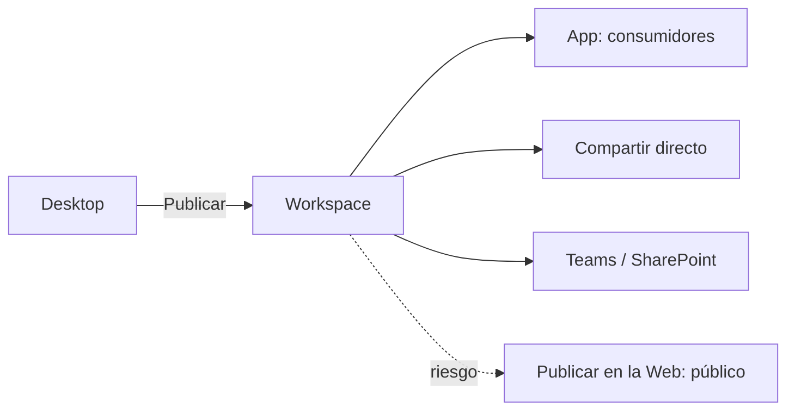

# Publicar y compartir informes

Parte de: [[17-Power-BI/08 Power BI Service/_Índice Power BI Service|Power BI Service]]

> [!info] Cómo avanzar
> `progreso`: **pendiente** → **viendo** (estudiando) → **visto** (contestaste la autoevaluación sin abrir las respuestas) → **dominado** (hiciste el laboratorio o lo aplicaste de verdad).

## Contenido

### Qué es
**Publicar** es subir un `.pbix` (o un proyecto) desde Power BI Desktop a un workspace del Service. **Compartir** es dar a otras personas acceso al informe ya publicado. Hay varias formas de compartir y cada una tiene un nivel distinto de control y riesgo.

### Cómo funciona
**Publicar**: en Desktop, **Inicio → Publicar**, eliges el workspace. Se crean (o actualizan) el modelo semántico y el informe.

**Volver a publicar con el mismo nombre**: Desktop avisa que ya existe y pregunta si quieres **reemplazarlo**. Si aceptas, se sobrescriben el informe y el modelo semántico con el contenido nuevo, manteniendo el mismo elemento (misma URL, permisos y paneles con iconos anclados). Si cambiaste nombres de campos o quitaste visuales, los iconos de paneles y los informes delgados que dependían de ellos pueden romperse. Por eso, en producción conviene publicar con [[Canalizaciones de implementación (deployment pipelines)|canalizaciones]] o desde Git, no a mano.

**Formas de dar acceso**

| Forma | Para quién | Comentario |
|---|---|---|
| **Rol en el workspace** | Equipo que crea o revisa | Ver [[Áreas de trabajo (workspaces)]] |
| **App de Power BI** | Consumidores finales | La forma recomendada de distribuir (ver [[Aplicaciones de Power BI]]) |
| **Compartir directo / vínculo** | Personas o grupos concretos; vínculos para "personas de la organización" o "personas específicas" | Útil para casos puntuales; difícil de auditar a escala |
| **Insertar en Teams, SharePoint Online o un portal** (*Insertar de forma segura*) | Usuarios internos, en la herramienta que ya usan | Respeta permisos y RLS |
| **Power BI Embedded** | Clientes externos en tu aplicación | Ver [[Power BI Embedded (incrustar en una aplicación React o .NET)]] |
| **Publicar en la Web** | Cualquier persona en internet | Público y anónimo |

Recuerda las licencias: en capacidad compartida, quien ve necesita Pro/PPU; en capacidad F64+/P, puede ser gratuito.

**Publicar en la Web: el riesgo**
Genera una URL y un código de inserción **públicos**: cualquiera con el vínculo (o un buscador que lo indexe) ve el informe **sin iniciar sesión**, y no hay forma de saber quién lo vio. No admite RLS. Úsalo solo para datos abiertos (estadísticas públicas, un blog). El administrador puede deshabilitarlo o limitarlo a un grupo en la configuración del tenant, y desde el portal de administración ve y puede eliminar todos los códigos de inserción. Un error frecuente es usarlo para "mandar un informe a un cliente": eso expone los datos al mundo.

### Ejemplo
Informe de inventario de Ocelotl.Hermes:
1. Publicas a `Operación - Informes [DEV]` para revisión con el equipo (rol Colaborador).
2. La canalización lo despliega a PROD.
3. Lo agregas a la app "Operación" con la audiencia "Almacenistas" (grupo de seguridad).
4. Lo insertas en el canal de Teams del almacén.
5. A un auditor externo **no** se le manda Publicar en la Web: se le invita como invitado B2B con licencia adecuada o se le envía un PDF por suscripción.

### Cuándo usarlo y cuándo no
- **App** para cualquier audiencia mayor a un puñado de personas.
- **Compartir directo** para una o dos personas y por poco tiempo.
- **Publicar en la Web** solo con datos públicos.

### Errores comunes
1. **Publicar en la Web datos internos.**
2. **Compartir a individuos** en lugar de grupos.
3. **Reemplazar en producción desde Desktop** sin revisar dependencias.
4. **Compartir un informe sin acceso al modelo** en otro workspace: el usuario ve error.
5. **Olvidar RLS**: compartir no filtra datos; el modelo sí.

### Para profundizar
- [Formas de compartir tu trabajo (Microsoft Learn)](https://learn.microsoft.com/en-us/power-bi/collaborate-share/service-how-to-collaborate-distribute-dashboards-reports)
- [Publicar en la Web](https://learn.microsoft.com/en-us/power-bi/collaborate-share/service-publish-to-web)
- [Compartir informes y paneles](https://learn.microsoft.com/en-us/power-bi/collaborate-share/service-share-dashboards)

## Autoevaluación

Contesta primero en voz alta o en papel; luego despliega la respuesta.

> [!question]- ¿Cuáles son las formas de dar acceso a un informe?
> Rol en el workspace, compartir el informe directamente (vínculo o personas), distribuir mediante una app, o incrustar (Teams, SharePoint, Embedded).

> [!question]- ¿Qué riesgo tiene *Publicar en la Web*?
> Hace el informe **público** en internet sin autenticación. Nunca para datos internos; suele estar desactivado por el administrador.

> [!question]- ¿Qué pasa al volver a publicar un .pbix con el mismo nombre?
> Reemplaza el informe y el modelo en ese workspace (conserva la URL y la configuración de actualización).

