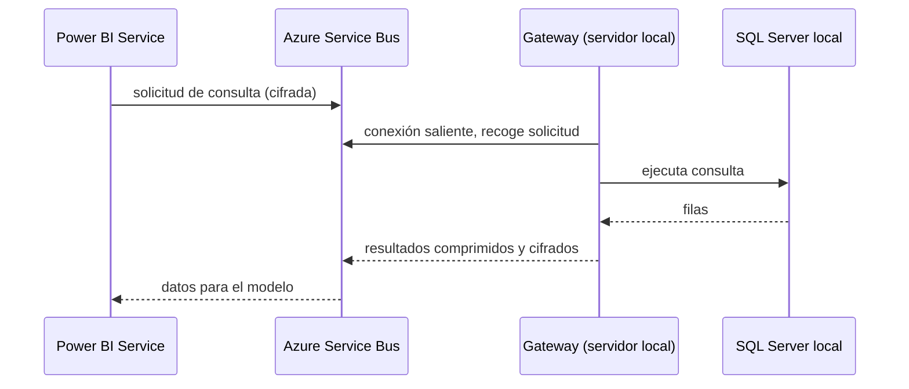

# Puerta de enlace de datos local (gateway)

Parte de: [[17-Power-BI/08 Power BI Service/_Índice Power BI Service|Power BI Service]]

> [!info] Cómo avanzar
> `progreso`: **pendiente** → **viendo** (estudiando) → **visto** (contestaste la autoevaluación sin abrir las respuestas) → **dominado** (hiciste el laboratorio o lo aplicaste de verdad).

## Contenido

### Qué es
La **puerta de enlace de datos local** (on-premises data gateway) es un programa que instalas en un servidor de tu red y que actúa como **puente seguro** entre los servicios en la nube de Microsoft (Power BI, Fabric, Power Apps, Power Automate, Logic Apps, Azure Analysis Services) y los orígenes que **no son accesibles desde internet**: SQL Server local, archivos en una carpeta compartida, Oracle on-premises, etc. Sin gateway, el Service no puede actualizar ni consultar esos datos.

### Cómo funciona
1. Instalas el gateway en un equipo **siempre encendido** de la red (no tu laptop), con acceso a los orígenes.
2. Lo registras con una cuenta de tu organización; queda asociado al tenant.
3. El gateway abre **conexiones salientes** (HTTPS) hacia Azure Service Bus; no necesitas abrir puertos de entrada en el firewall.
4. Cuando el Service necesita datos (actualización de un modelo Import, consulta DirectQuery), envía la solicitud cifrada por el bus; el gateway la recibe, ejecuta la consulta contra el origen local con las credenciales guardadas y devuelve los resultados.
5. En el Service, en **Administrar conexiones y puertas de enlace**, das de alta las **conexiones** (servidor, base de datos, credenciales) y quién puede usarlas; luego asocias el modelo semántico a esa conexión.

**Modo estándar vs. modo personal**

| | Estándar | Personal |
|---|---|---|
| Compartido | Sí, varios autores y administradores; conexiones centralizadas | No, solo para una persona (una por usuario) |
| DirectQuery / conexión dinámica a Analysis Services | Sí | No |
| Se ejecuta como servicio de Windows | Sí | No, es una aplicación interactiva |
| Servicios | Power BI, Power Apps, Power Automate, Logic Apps, AAS | Solo Power BI |
| Clúster y alta disponibilidad | Sí | No |
| Requiere admin local para instalar | Sí | No |

(Microsoft Learn, consultado nov 2026.) Para cualquier uso de equipo o producción, el **estándar**.

**¿Y los orígenes en la nube?** Para orígenes en la nube accesibles por internet (Azure SQL Database con acceso público, SharePoint Online, OneDrive, Dataverse, la mayoría de APIs SaaS), **no necesitas gateway**: el Service se conecta directo. Sí lo necesitas si ese origen en la nube está detrás de una red privada (Azure SQL con *private endpoint*); en ese caso existe la **puerta de enlace de red virtual (VNet)**, administrada por Microsoft, o un gateway estándar instalado en una VM dentro de esa red.

### Ejemplo
Itzamna tiene SQL Server 2022 en su centro de datos. Instalas el gateway estándar en una VM Windows Server dedicada (`GW-BI-01`) y un segundo nodo (`GW-BI-02`) en el **mismo clúster** para alta disponibilidad. Creas la conexión `SQL-Itzamna-Ventas` con una cuenta de servicio de solo lectura y das permiso de uso al grupo `GRP-BI-Desarrolladores`. Los modelos de ventas y cartera usan esa conexión para su [[Actualización programada]].

### Cuándo usarlo y cuándo no
- **Úsalo** para orígenes locales o en redes privadas.
- **No** para orígenes públicos en la nube.
- En proyectos nuevos, evalúa mover datos a la nube (Azure SQL, Fabric) para depender menos del gateway.

### Errores comunes
1. **Instalarlo en una laptop**: se apaga y fallan las actualizaciones.
2. **Un solo nodo** en producción: si se cae, todo se detiene. Usa clúster.
3. **Modo personal en producción**.
4. **Nombres de servidor distintos** entre Desktop y la conexión del gateway (`localhost` vs `SQL01.itzamna.local`): el modelo no se asocia.
5. **No actualizar** el gateway: Microsoft publica versiones mensuales y las antiguas dejan de ser compatibles.

### Para profundizar
- [¿Qué es una puerta de enlace de datos local? (Microsoft Learn)](https://learn.microsoft.com/en-us/data-integration/gateway/service-gateway-onprem)
- [Gateway en modo personal](https://learn.microsoft.com/en-us/power-bi/connect-data/service-gateway-personal-mode)
- [Instalar una puerta de enlace](https://learn.microsoft.com/en-us/data-integration/gateway/service-gateway-install)

## Autoevaluación

Contesta primero en voz alta o en papel; luego despliega la respuesta.

> [!question]- ¿Para qué sirve el gateway?
> Conectar el Service con orígenes en la red local (SQL Server on-premises, archivos en un servidor) para actualizar o usar DirectQuery.

> [!question]- ¿Diferencia entre modo estándar y personal?
> Estándar: compartido por varios usuarios, admite DirectQuery y se administra centralmente. Personal: solo para un usuario y solo Import.

> [!question]- ¿Necesitas gateway para un origen en la nube (Azure SQL, SharePoint Online)?
> Normalmente no, salvo que se mezcle con orígenes locales en la misma consulta o el origen esté detrás de una red privada.

