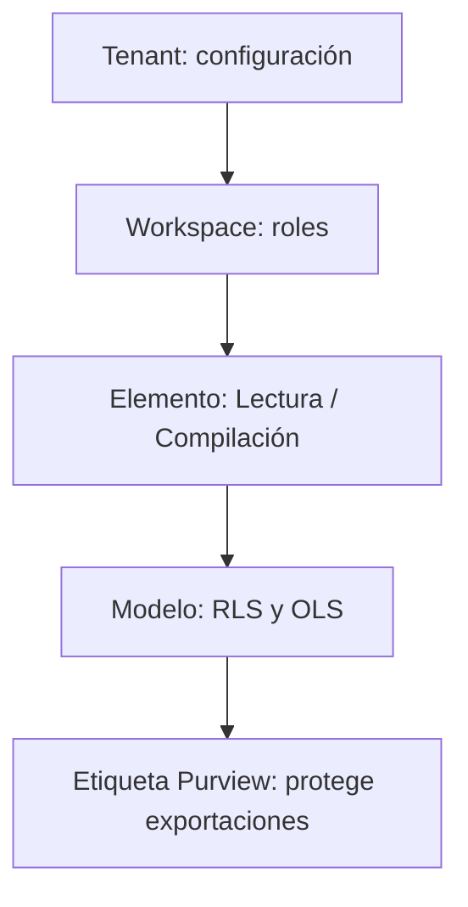

# Seguridad y permisos en el Service

Parte de: [[17-Power-BI/08 Power BI Service/_Índice Power BI Service|Power BI Service]]

> [!info] Cómo avanzar
> `progreso`: **pendiente** → **viendo** (estudiando) → **visto** (contestaste la autoevaluación sin abrir las respuestas) → **dominado** (hiciste el laboratorio o lo aplicaste de verdad).

## Contenido

### Qué es
La seguridad en Power BI es **por capas**: quién entra al tenant y qué puede hacer, qué workspaces ve, qué elementos puede abrir o reutilizar, qué filas y columnas del modelo ve, y cómo se protege la información cuando sale del Service (exportaciones). Ninguna capa sola basta; se combinan.

### Cómo funciona
**Niveles de control**

| Nivel | Qué controla | Dónde |
|---|---|---|
| **Tenant** | Funciones permitidas: publicar en la web, exportar, compartir con externos, visuales personalizados, Copilot, XMLA | Portal de administración (configuración del inquilino), por grupos |
| **Capacidad / dominio** | Quién asigna workspaces, configuración de cargas | Portal de administración |
| **Workspace** | Roles Administrador, Miembro, Colaborador, Espectador | [[Áreas de trabajo (workspaces)]] |
| **Elemento** | Permisos sobre informe o modelo: Lectura, Volver a compartir, **Compilación**, Escritura | Compartir / Administrar permisos |
| **App** | Audiencias y permisos de la app | [[Aplicaciones de Power BI]] |
| **Datos dentro del modelo** | [[Seguridad a nivel de fila (RLS)]] y [[Seguridad a nivel de objeto (OLS)]] | Roles del modelo semántico |
| **Información** | Etiquetas de confidencialidad de Microsoft Purview | Elementos y archivos exportados |

**¿Por qué asignar a grupos de seguridad?**
- Altas y bajas se administran **en un solo lugar** (Entra ID, normalmente por TI o RR. HH.): cuando alguien entra o sale de Ventas, cambia su grupo y automáticamente gana o pierde acceso a workspaces, apps y roles de RLS.
- **Auditoría** sencilla: "¿quién ve Finanzas?" se responde mirando un grupo.
- Menos errores: no hay listas de 200 correos copiadas en 15 lugares.
- Los roles de RLS también aceptan grupos.

**Etiquetas de confidencialidad (Purview)**
Las **etiquetas de confidencialidad** de Microsoft Purview Information Protection (por ejemplo *Público, General, Confidencial, Altamente confidencial*) se aplican a informes, modelos y otros elementos. Muestran la clasificación al usuario y, lo más importante, **viajan con los datos exportados**: al exportar a Excel, PowerPoint o PDF, el archivo hereda la etiqueta y su **protección** (cifrado, restricción de quién puede abrirlo), además de poder heredarse de modelos a informes descendentes. El administrador las habilita en el tenant y puede hacerlas obligatorias o con etiqueta predeterminada. Las define el equipo de seguridad en Purview, no en Power BI.

### Ejemplo
Informe de nómina para Pochteca.Nomisma:
- Tenant: *Publicar en la Web* deshabilitado; exportar a Excel solo para `GRP-Finanzas`.
- Workspace `RH - PROD`: Admin `GRP-BI-Admins`, Colaborador `GRP-BI-RH`.
- App "RH" con audiencia `GRP-Gerentes`.
- Modelo con RLS dinámico: cada gerente ve solo su área ([[DAX - seguridad dinámica con USERPRINCIPALNAME]]); OLS oculta la columna `SalarioBase` al rol Gerentes.
- Etiqueta **Altamente confidencial**: si alguien exporta a Excel, el archivo queda cifrado y solo abre para personas de la organización.

### Cuándo usarlo y cuándo no
Siempre se usan todas las capas en contenido sensible. En contenido público interno basta con workspace + app, pero aun así con grupos.

### Errores comunes
1. **Filtros ocultos como seguridad** (ver [[Filtros de visual, página e informe]]).
2. **Permisos a personas** en lugar de grupos.
3. **Dar Compilación** a quien solo necesita ver: puede consultar todo el modelo (respetando RLS) y exportar.
4. **Administradores o miembros del workspace esperando RLS**: RLS solo aplica a Espectadores (y a quien accede por app o permiso de lectura); quien edita el modelo ve todo.
5. **Etiquetas sin protección**: solo informativas; el archivo exportado viaja sin cifrado.

### Para profundizar
- [Seguridad en Power BI (Microsoft Learn)](https://learn.microsoft.com/en-us/power-bi/enterprise/service-admin-power-bi-security)
- [Roles en áreas de trabajo](https://learn.microsoft.com/en-us/power-bi/collaborate-share/service-roles-new-workspaces)

## Autoevaluación

Contesta primero en voz alta o en papel; luego despliega la respuesta.

> [!question]- ¿En qué niveles se controlan permisos?
> Inquilino (configuración del administrador), workspace (roles), elemento (compartir, Build, reshare), datos (RLS/OLS) y etiquetas de confidencialidad.

> [!question]- ¿Por qué asignar permisos a grupos de seguridad?
> Simplifica altas y bajas: cambias la membresía del grupo, no cada informe.

> [!question]- ¿Qué hacen las etiquetas de confidencialidad (Purview)?
> Clasifican el contenido (Confidencial, Interno) y la protección puede viajar con las exportaciones a Excel/PDF.

