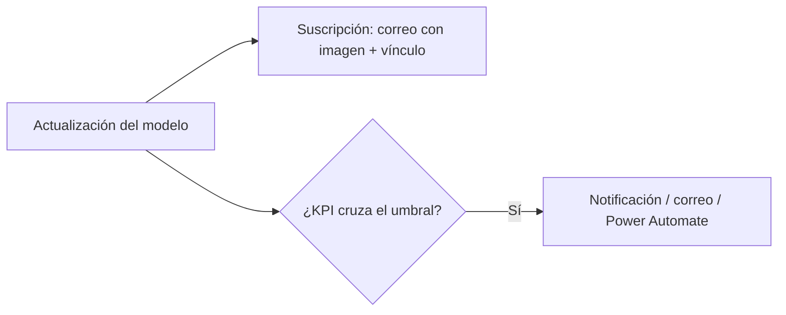

# Suscripciones y alertas

Parte de: [[17-Power-BI/08 Power BI Service/_Índice Power BI Service|Power BI Service]]

> [!info] Cómo avanzar
> `progreso`: **pendiente** → **viendo** (estudiando) → **visto** (contestaste la autoevaluación sin abrir las respuestas) → **dominado** (hiciste el laboratorio o lo aplicaste de verdad).

## Contenido

### Qué es
- Una **suscripción** envía por **correo** una instantánea de un informe, página o panel en un horario (o después de cada actualización), con un vínculo al contenido y, opcionalmente, el informe adjunto en PDF o PowerPoint.
- Una **alerta de datos** envía una notificación cuando un número **cruza un umbral** (por ejemplo, saldo vencido > $2 M).

Ambas convierten el informe en algo que "llega" a la gente en vez de esperar a que lo abra.

### Cómo funciona
**Suscripciones** (Microsoft Learn, consultado nov 2026)
- Se crean desde el informe o panel: **Suscribirse al informe → Crear suscripción**.
- Para **suscribirte a ti mismo**: acceso al contenido + Pro/PPU, o que el workspace esté en capacidad Premium/Fabric.
- Para **suscribir a otros**: Pro/PPU y rol de Colaborador, Miembro o Administrador. Destinatarios externos solo desde capacidad Premium/Fabric de pago (no PPU ni prueba).
- Frecuencias: **por hora, diaria, semanal, mensual** o **después de la actualización de datos** (una vez al día, tras la primera actualización programada).
- Adjuntos: informe completo en **PDF o PowerPoint** si el workspace está en Premium/PPU (máx. 20 páginas y < 25 MB); los paginados admiten PDF, PPTX, XLSX, DOCX, CSV y XML.
- Límite de 24 suscripciones por informe o panel.
- Visuales personalizados **no certificados**, Power Apps, Power Automate y algunos otros no se dibujan en la instantánea.

**¿Respetan RLS?** Con matices:
- Si te suscribes a ti mismo, ves tus datos.
- Si suscribes a **otros**, la **imagen del correo** (y en paginados, el adjunto) se genera con los **permisos del dueño de la suscripción**, no del destinatario. Al abrir el vínculo, cada destinatario ve solo lo que su RLS permite. Power BI muestra una advertencia, pero es fácil pasarla por alto: revisa que la instantánea no exponga datos confidenciales.
- Para mandar a cada persona **su** versión filtrada existen las **suscripciones dinámicas por destinatario**: un modelo semántico con correos y valores de filtro define quién recibe qué. Requieren workspace en capacidad Premium o Fabric y permiso de compilación sobre el modelo de destinatarios.

**Alertas de datos**
- Se configuran en **paneles**, sobre iconos de **tarjeta, KPI y medidor**: en el icono, **… → Administrar alertas**, condición (por encima / por debajo de un valor) y frecuencia máxima (como mucho una vez cada hora o cada 24 h).
- Se evalúan al actualizarse los datos; llegan al centro de notificaciones y por correo. Solo las ve quien las crea y respetan su RLS.
- Requieren Pro/PPU. Se pueden conectar a **Power Automate** para disparar acciones.
- En Fabric también existe **Activator** (botón *Establecer alerta* en visuales de informe) para reglas sobre visuales de informes y flujos de eventos.

### Ejemplo
- Suscripción del informe "Cierre diario" de Pochteca.Nomisma, **después de la actualización**, a la dirección (grupo de distribución), con PDF adjunto.
- En el panel ejecutivo, alerta en la tarjeta "Saldo vencido" *por encima de 2,000,000*, como máximo cada 24 h; un flujo de Power Automate la lleva a un canal de Teams.
- Para los 40 vendedores, cada uno con su cartera: **suscripción dinámica por destinatario** (el workspace está en capacidad F), en lugar de 40 suscripciones manuales que además mostrarían la cartera del dueño en la imagen.

### Cuándo usarlo y cuándo no
- **Suscripción**: reportes recurrentes que alguien revisa en su correo.
- **Alerta**: excepciones que requieren acción.
- **No** como sustituto de seguridad ni para mandar datos a externos sin capacidad.

### Errores comunes
1. **Suscribir a otros con un informe con RLS** y exponer datos en la imagen.
2. **Alertas en informes**: las nativas viven en iconos de panel (o usa Activator).
3. **Visual no certificado** que aparece vacío en el correo.
4. **Renombrar o borrar la página suscrita**: la suscripción se rompe.
5. **Bookmark en la suscripción**: se aplica el filtro del marcador, no el que tenías en pantalla.

### Para profundizar
- [Suscripciones por correo para informes y paneles (Microsoft Learn)](https://learn.microsoft.com/en-us/power-bi/collaborate-share/end-user-subscribe)
- [Suscripciones dinámicas por destinatario](https://learn.microsoft.com/en-us/power-bi/collaborate-share/power-bi-dynamic-report-subscriptions)
- [Alertas de datos en el Service](https://learn.microsoft.com/en-us/power-bi/create-reports/service-set-data-alerts)

## Autoevaluación

Contesta primero en voz alta o en papel; luego despliega la respuesta.

> [!question]- ¿Qué es una suscripción?
> Envío programado por correo de una instantánea (o adjunto) de un informe o panel a usuarios con acceso.

> [!question]- ¿Dónde se configuran alertas de datos?
> En mosaicos de paneles (tarjeta, KPI, medidor) cuando el valor cruza un umbral; también existen alertas basadas en reglas con Data Activator en Fabric (verificar disponibilidad).

> [!question]- ¿Las suscripciones respetan RLS?
> Sí: cada destinatario recibe lo que su seguridad le permite ver (según la configuración de la suscripción).

