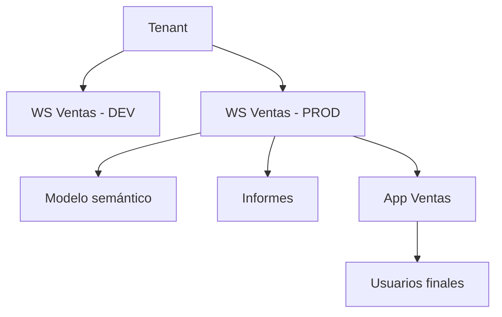

# Áreas de trabajo (workspaces)

Parte de: [[17-Power-BI/08 Power BI Service/_Índice Power BI Service|Power BI Service]]

> [!info] Cómo avanzar
> `progreso`: **pendiente** → **viendo** (estudiando) → **visto** (contestaste la autoevaluación sin abrir las respuestas) → **dominado** (hiciste el laboratorio o lo aplicaste de verdad).

## Contenido

### Qué es
Un **área de trabajo** (workspace) es el contenedor del Power BI Service (y de Fabric) donde viven y se colaboran los elementos: modelos semánticos, informes, paneles, dataflows, informes paginados y, en Fabric, lakehouses, notebooks, etc. Es la unidad de **permisos**, de **licenciamiento** (se asigna o no a una capacidad) y de **ciclo de vida** (se conecta a Git o a una canalización de implementación).

### Cómo funciona
**Roles** (de mayor a menor):

| Rol | Puede |
|---|---|
| **Administrador** | Todo: actualizar o eliminar el workspace, agregar/quitar a cualquiera en cualquier rol |
| **Miembro** | Agregar personas con rol de Miembro o menor, publicar/actualizar la app, compartir elementos, crear y editar contenido |
| **Colaborador** (Contributor) | Crear, editar y eliminar contenido, programar actualizaciones, crear suscripciones; no publica la app ni administra usuarios (salvo que se le permita actualizar la app) |
| **Espectador** (Viewer) | Ver e interactuar; recibe suscripciones; no edita. Analizar en Excel solo con permiso de compilación |

Licencias: si el workspace está en **capacidad compartida** (sin Premium/Fabric), todos sus usuarios, incluidos los espectadores, necesitan **Pro o PPU**. En **capacidad Premium/Fabric F64+**, los espectadores pueden tener licencia gratuita. Los workspaces de PPU solo los usan usuarios PPU. (Microsoft Learn, consultado nov 2026.)

**Mi área de trabajo** (My workspace) es el espacio **personal** de cada usuario: sirve para pruebas y borradores, no para colaborar. No tiene roles, no se puede conectar a canalizaciones de implementación ni compartir como equipo, y si la persona deja la empresa su contenido queda en riesgo. Nunca publiques ahí algo de producción.

### Ejemplo
Organización para el área comercial de Itzamna:

- `Comercial - Modelos [DEV]`, `[TEST]`, `[PROD]`: solo modelos semánticos, conectados a una [[Canalizaciones de implementación (deployment pipelines)|canalización]]. Admin: equipo de BI; Colaborador: desarrolladores.
- `Comercial - Informes [PROD]`: informes conectados en vivo al modelo de PROD. Miembro: líder de BI; Colaboradores: analistas.
- Una **app** "Comercial" publicada desde el workspace de informes para todos los vendedores (ver [[Aplicaciones de Power BI]]).
- Permisos siempre a **grupos de seguridad** de Entra ID (`GRP-BI-Comercial-Dev`), no a personas.

### Buenas prácticas de organización
1. **Un workspace por área de negocio y etapa** (DEV/TEST/PROD), con convención de nombres.
2. **Separar modelos e informes** cuando varios informes comparten un modelo.
3. **Mínimo privilegio**: consumidores por app, no como Espectadores del workspace de desarrollo.
4. **Al menos dos administradores** (o un grupo) para no depender de una persona.
5. Descripción y contacto en la configuración del workspace; asignarlo a un **dominio** en Fabric si tu organización los usa.
6. Workspaces de producción en capacidad si los lectores tienen licencia gratuita.

### Cuándo usarlo y cuándo no
- **Workspace compartido**: todo lo que vean o mantengan otras personas.
- **Mi área de trabajo**: experimentos personales.
- No crees un workspace por informe: se vuelve inmanejable. Tampoco uno gigante para toda la empresa.

### Errores comunes
1. **Producción en Mi área de trabajo**.
2. **Agregar a todos como Miembro** "para que no pregunten": cualquiera puede borrar o compartir.
3. **Consumidores como Espectadores del workspace** de desarrollo: ven trabajo en progreso. Usa apps.
4. **Permisos a personas** individuales: cuando alguien cambia de puesto, nadie actualiza.
5. **Ignorar el licenciamiento**: espectadores gratuitos en un workspace sin capacidad no pueden ver nada.

### Para profundizar
- [Roles en áreas de trabajo (Microsoft Learn)](https://learn.microsoft.com/en-us/power-bi/collaborate-share/service-roles-new-workspaces)
- [Áreas de trabajo en Power BI](https://learn.microsoft.com/en-us/power-bi/collaborate-share/service-new-workspaces)
- [Roles de área de trabajo en Fabric](https://learn.microsoft.com/en-us/fabric/fundamentals/roles-workspaces)

## Autoevaluación

Contesta primero en voz alta o en papel; luego despliega la respuesta.

> [!question]- ¿Qué roles hay en un workspace?
> Administrador, Miembro, Colaborador y Lector. Los tres primeros pueden editar contenido; Lector solo ve (y le aplica RLS).

> [!question]- ¿Qué es *Mi área de trabajo*?
> El espacio personal de cada usuario; no es para compartir contenido de equipo.

> [!question]- Buena práctica de organización.
> Separar workspaces por equipo/proyecto y por entorno (Desarrollo, Pruebas, Producción), y asignar permisos a grupos, no a personas.

