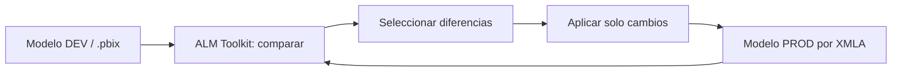

# ALM Toolkit

Parte de: [[17-Power-BI/09 Avanzado/_Índice Avanzado|Avanzado]]

> [!info] Cómo avanzar
> `progreso`: **pendiente** → **viendo** (estudiando) → **visto** (contestaste la autoevaluación sin abrir las respuestas) → **dominado** (hiciste el laboratorio o lo aplicaste de verdad).

## Contenido

### Qué es
**ALM Toolkit** es una herramienta gratuita y de código abierto para Windows que **compara y fusiona modelos tabulares**: dos modelos semánticos de Power BI (un `.pbix` abierto en Desktop, un archivo `.bim` o un proyecto, o un modelo publicado vía [[Punto de conexión XMLA]]) o modelos de Analysis Services. Muestra las diferencias objeto por objeto (tablas, columnas, medidas, relaciones, roles, grupos de cálculo) y te deja **desplegar solo los cambios** elegidos al destino. El nombre viene de *Application Lifecycle Management*.

### Cómo funciona
1. **Origen**: normalmente tu modelo en desarrollo (el `.pbix` abierto en Desktop o un modelo de DEV en el Service).
2. **Destino**: el modelo publicado en producción, conectado por XMLA (`powerbi://api.powerbi.com/v1.0/myorg/Comercial%20-%20Modelos%20%5BPROD%5D`).
3. **Comparar**: la herramienta lista cada objeto con su estado: *Crear*, *Actualizar*, *Eliminar*, *Omitir* o *Igual*, y muestra el código (TMSL/DAX) de origen y destino lado a lado.
4. **Seleccionar acciones**: eliges qué aplicar (por ejemplo, solo las 3 medidas nuevas y no la tabla en pruebas).
5. **Validar** y **Actualizar**: aplica solo esos cambios en el destino. Opcionalmente genera un script para revisarlo o ejecutarlo después.
6. Después del despliegue, si cambiaste estructura (columnas nuevas), refrescas solo las tablas afectadas.

Para escribir en un modelo del Service necesitas XMLA de **lectura y escritura** (capacidad Premium/Fabric o PPU) y permisos de escritura en el workspace.

### Ejemplo
El modelo "Ventas Itzamna" en producción pesa 18 GB, usa [[Actualización incremental]] con 5 años de particiones y tarda 2 horas en actualizarse completo. Agregaste una medida `Margen %` y corregiste otra. Con ALM Toolkit:
- Comparas Desktop (DEV) contra PROD.
- Seleccionas las dos medidas y omites todo lo demás.
- Aplicas. En segundos el modelo de producción tiene las medidas, **sin tocar las particiones ni los datos** y sin volver a cargar nada.

### Ventaja frente a volver a publicar el .pbix completo
- **No reemplaza los datos**: al republicar desde Desktop se sube el modelo entero con los datos de tu equipo (o vacío) y se pierden las **particiones de actualización incremental** creadas en el Service; habría que refrescar todo.
- **Cambios granulares y revisables**: ves exactamente qué cambia antes de aplicarlo.
- **Respeta lo que solo existe en el Service**: particiones, miembros de roles y configuraciones que no están en tu archivo.
- **Rapidez** en modelos grandes.
- Útil para **comparar** dos versiones y responder "¿qué cambió entre DEV y PROD?".

### Cuándo usarlo y cuándo no
- **Úsalo** en modelos grandes o con actualización incremental, cuando haces cambios de metadatos frecuentes y quieres despliegues quirúrgicos.
- **Alternativas**: [[Canalizaciones de implementación (deployment pipelines)]] (despliegan metadatos sin datos entre etapas), [[Power BI con Git y control de versiones]] con [[TMDL y proyectos PBIP]], o Tabular Editor con despliegue por XMLA.
- **No** lo necesitas para modelos pequeños sin particiones: republicar es suficiente.

### Errores comunes
1. **Aplicar "todo"** sin revisar y borrar objetos que solo existían en producción.
2. **XMLA solo de lectura**: la comparación funciona, el despliegue falla.
3. **Olvidar refrescar** las tablas con columnas nuevas: quedan vacías.
4. **Modificar por XMLA y luego querer descargar el .pbix**: después de escribir por XMLA ya no se puede descargar el modelo como `.pbix`; conserva tu archivo fuente.
5. **Comparar contra el workspace equivocado** (DEV contra DEV).

### Para profundizar
- [ALM Toolkit (sitio oficial)](http://alm-toolkit.com/)
- [Conectividad con el punto de conexión XMLA (Microsoft Learn)](https://learn.microsoft.com/en-us/fabric/enterprise/powerbi/service-premium-connect-tools)

## Autoevaluación

Contesta primero en voz alta o en papel; luego despliega la respuesta.

> [!question]- ¿Qué hace ALM Toolkit?
> Compara dos modelos tabulares (p. ej. un .pbix local y uno publicado vía XMLA) y despliega solo las diferencias seleccionadas.

> [!question]- ¿Ventaja frente a volver a publicar el .pbix completo?
> Puedes actualizar medidas o tablas sin reemplazar todo el modelo ni perder particiones de actualización incremental.

