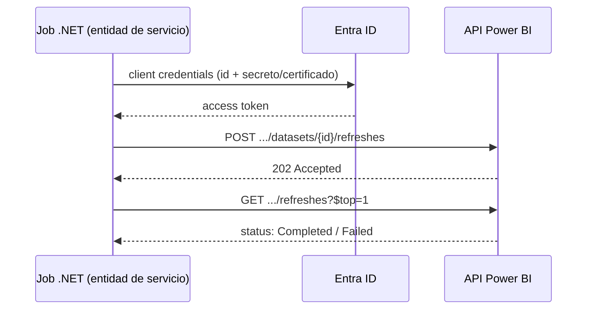

# API REST de Power BI

Parte de: [[17-Power-BI/09 Avanzado/_Índice Avanzado|Avanzado]]

> [!info] Cómo avanzar
> `progreso`: **pendiente** → **viendo** (estudiando) → **visto** (contestaste la autoevaluación sin abrir las respuestas) → **dominado** (hiciste el laboratorio o lo aplicaste de verdad).

## Contenido

### Qué es
La **API REST de Power BI** permite automatizar desde código casi todo lo que haces en el Service: listar workspaces, informes y modelos; **desencadenar y monitorear actualizaciones**; importar `.pbix`; administrar permisos de workspaces; generar *embed tokens* para [[Power BI Embedded (incrustar en una aplicación React o .NET)|Embedded]]; exportar informes a PDF; operar canalizaciones de implementación; y, con las API de administración, inventariar todo el tenant. La URL base es `https://api.powerbi.com/v1.0/myorg/`. Fabric añade su propia API (`https://api.fabric.microsoft.com/v1/`) para los elementos de Fabric.

### Cómo funciona
**Autenticación**: con **Microsoft Entra ID** (OAuth 2.0). Obtienes un *access token* para el recurso de Power BI y lo mandas en `Authorization: Bearer <token>`.
- **Usuario delegado**: la app actúa en nombre de un usuario que inicia sesión (flujo interactivo, MSAL).
- **Entidad de servicio** (service principal): una app registrada en Entra ID con secreto o certificado, para procesos desatendidos. Requisitos: habilitar en el portal de administración la opción que permite a entidades de servicio usar las API de Power BI (idealmente limitada a un grupo de seguridad), y **agregar la entidad de servicio al workspace** con un rol (Miembro o Administrador para operaciones de escritura).
- Scope: `https://analysis.windows.net/powerbi/api/.default`.

**Operaciones frecuentes**
| Acción | Método y ruta |
|---|---|
| Listar workspaces | `GET /groups` |
| Listar modelos de un workspace | `GET /groups/{groupId}/datasets` |
| Desencadenar actualización | `POST /groups/{groupId}/datasets/{datasetId}/refreshes` |
| Historial de actualizaciones | `GET /groups/{groupId}/datasets/{datasetId}/refreshes?$top=5` |
| Generar embed token | `POST /GenerateToken` |

Las actualizaciones por API cuentan contra los límites de la licencia (8 al día en Pro; en capacidad, la API de **actualización mejorada** permite refrescar tablas o particiones concretas y consultar su estado).



### Ejemplo: desencadenar una actualización
Un worker de .NET 10 en Azure que, al terminar el ETL de Itzamna.Dionisio, refresca el modelo. Secretos en Azure Key Vault (fuera del repo), autenticación con `Azure.Identity`:

```csharp
using System.Net.Http.Headers;
using System.Net.Http.Json;
using Azure.Core;
using Azure.Identity;

// Credencial de la entidad de servicio; en Azure se recomienda identidad administrada o certificado
var credencial = new ClientSecretCredential(
    tenantId: config["PowerBi:TenantId"],
    clientId: config["PowerBi:ClientId"],
    clientSecret: config["PowerBi:ClientSecret"]);

AccessToken token = await credencial.GetTokenAsync(
    new TokenRequestContext(["https://analysis.windows.net/powerbi/api/.default"]), ct);

using var http = new HttpClient { BaseAddress = new Uri("https://api.powerbi.com/v1.0/myorg/") };
http.DefaultRequestHeaders.Authorization = new AuthenticationHeaderValue("Bearer", token.Token);

var groupId = config["PowerBi:WorkspaceId"];
var datasetId = config["PowerBi:DatasetId"];

// Pedir la actualización; con entidad de servicio la notificación por correo no aplica
using var cuerpo = JsonContent.Create(new { notifyOption = "NoNotification" });
var resp = await http.PostAsync($"groups/{groupId}/datasets/{datasetId}/refreshes", cuerpo, ct);
resp.EnsureSuccessStatusCode(); // 202 Accepted: la actualización quedó en cola
```

Para consultar el resultado, lee `GET .../refreshes?$top=1` y revisa el campo `status`. Las opciones de correo (`MailOnFailure`, `MailOnCompletion`) son para llamadas hechas en nombre de un usuario; con entidad de servicio se usa `NoNotification` y el aviso lo das tú (Teams, correo propio). En Azure DevOps, el mismo llamado puede ir en un paso de PowerShell con el módulo `MicrosoftPowerBIMgmt`.

### Cuándo usarlo y cuándo no
- **Úsala** para encadenar la actualización al fin del ETL, inventariar contenido, automatizar altas de workspaces y permisos, Embedded y CI/CD.
- Para tareas de modelado (cambiar medidas, particiones), usa el [[Punto de conexión XMLA]] o TMDL.
- Para un flujo sencillo sin código, Power Automate tiene la acción *Actualizar un modelo semántico*.

### Errores comunes
1. **401/403 con entidad de servicio**: falta habilitar la opción del tenant o agregarla al workspace.
2. **Secretos en el repo** o en `appsettings.json`: usa Key Vault o identidad administrada.
3. **Ignorar el estado asíncrono**: 202 no significa que terminó.
4. **Sondeo agresivo** del historial que choca con límites de tasa (429). Espera entre consultas.
5. **Usar la cuenta de una persona** ("usuario maestro") para procesos: si cambia su contraseña, todo falla.

### Para profundizar
- [Referencia de la API REST de Power BI (Microsoft Learn)](https://learn.microsoft.com/en-us/rest/api/power-bi/)
- [Datasets - Refresh Dataset In Group](https://learn.microsoft.com/en-us/rest/api/power-bi/datasets/refresh-dataset-in-group)
- [Insertar contenido con entidad de servicio](https://learn.microsoft.com/en-us/power-bi/developer/embedded/embed-service-principal)

## Autoevaluación

Contesta primero en voz alta o en papel; luego despliega la respuesta.

> [!question]- ¿Para qué sirve la API REST?
> Automatizar: listar workspaces e informes, desencadenar actualizaciones, cambiar parámetros, clonar/exportar informes, administrar permisos y generar embed tokens.

> [!question]- ¿Cómo se autentica?
> Con un token OAuth2 de Microsoft Entra ID (usuario o entidad de servicio con los permisos y la configuración de inquilino necesarios).

> [!question]- Ejemplo: desencadenar una actualización.
> `POST https://api.powerbi.com/v1.0/myorg/groups/{groupId}/datasets/{datasetId}/refreshes` con el token en el encabezado `Authorization: Bearer ...`.

