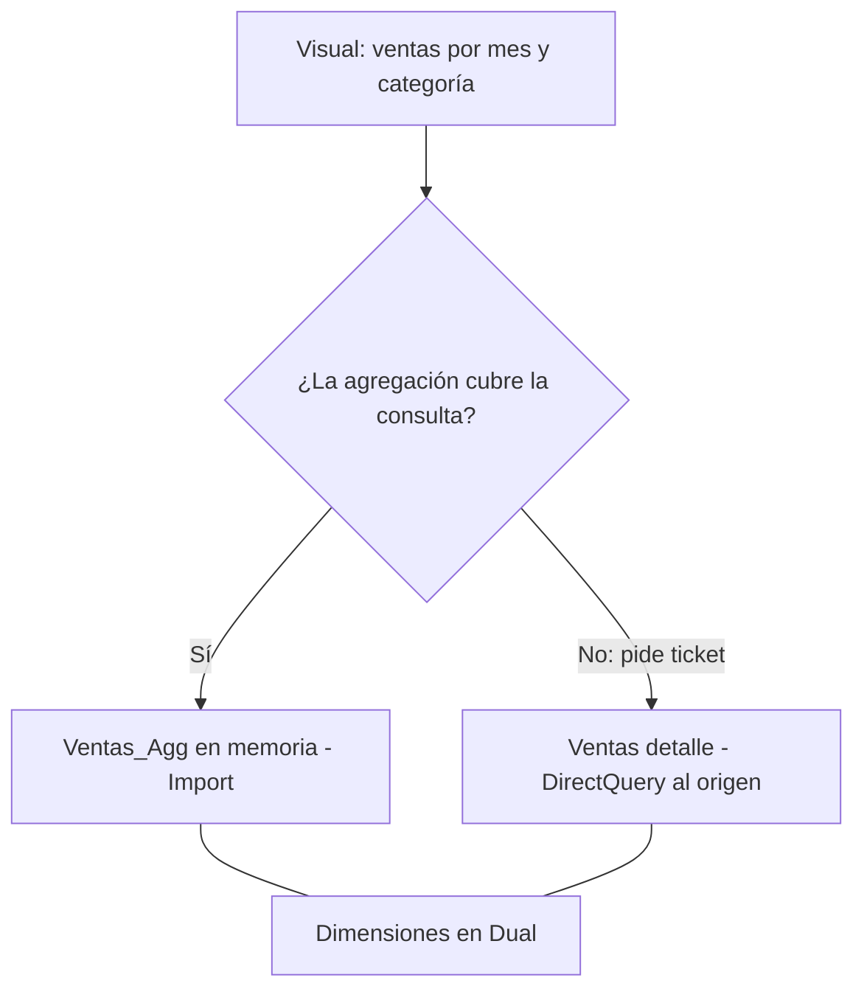

# Agregaciones

Parte de: [[17-Power-BI/09 Avanzado/_Índice Avanzado|Avanzado]]

> [!info] Cómo avanzar
> `progreso`: **pendiente** → **viendo** (estudiando) → **visto** (contestaste la autoevaluación sin abrir las respuestas) → **dominado** (hiciste el laboratorio o lo aplicaste de verdad).

## Contenido

### Qué es
Las **agregaciones** son tablas resumidas (por ejemplo, ventas por día, producto y sucursal) que se cargan **en memoria (Import)** junto a una tabla de detalle enorme que se queda en **DirectQuery**. Cuando un visual pide datos a un nivel que la tabla agregada puede responder, el motor la usa automáticamente (respuesta en milisegundos); si pide más detalle (ticket por ticket), va al origen. El usuario no se entera: las medidas siguen apuntando a la tabla de detalle.

### Cómo funciona
1. Tienes un **modelo compuesto** (ver [[Modelos compuestos]]): la tabla de hechos `Ventas` de 2,000 millones de filas en DirectQuery contra SQL Server o un warehouse.
2. Creas la tabla `Ventas_Agg` (en el origen como vista materializada o en Power Query) agrupada por `FechaKey`, `ProductoKey`, `SucursalKey` con `SUM(Importe)` y `COUNT(*)`, y la cargas en **Import**.
3. En la vista de modelo, sobre `Ventas_Agg`: **Administrar agregaciones**. Para cada columna indicas el **resumen** (*Suma*, *Recuento*, *Mín*, *Máx*, *Agrupar por*) y la **tabla y columna de detalle** a la que equivale.
4. La tabla de agregación queda oculta.
5. **Las dimensiones relacionadas deben estar en modo Dual** (ver [[Modo de almacenamiento Dual]]): así pueden comportarse como Import cuando la consulta usa la agregación y como DirectQuery cuando la consulta va al detalle. Si las dimensiones fueran solo DirectQuery, la relación con la tabla Import sería "débil" y la agregación no se usaría; si fueran solo Import, las consultas de detalle no podrían unirse eficientemente en el origen.
6. Opcional: **precedencia** cuando hay varias tablas de agregación (una mensual y otra diaria).

También existen **agregaciones automáticas** en capacidad Premium/Fabric, que el servicio crea y entrena con base en las consultas reales.

### Ejemplo
Ocelotl.Hermes registra cada evento de rastreo de paquetes: 3,500 millones de filas en Azure SQL. El tablero muestra conteos por día, estado y región, y una página de detalle por guía.

- `Eventos` (DirectQuery), `Eventos_Agg` por `FechaKey`, `EstadoKey`, `RegionKey` con `Recuento de filas` (Import, unos 2 millones de filas).
- `Calendario`, `Estado`, `Region` en **Dual**.
- Medida `Eventos # = COUNTROWS ( Eventos )`.
- La página de resumen se responde con la agregación; la página de detalle, filtrada por una guía, va a SQL.

**¿Cómo verificas que se usó la agregación?**
- En **DAX Studio** (o SQL Server Profiler) conectado al modelo, activa **Server Timings / trazas** y busca el evento **Aggregate Table Rewrite Query**: indica si la consulta fue reescrita para usar la agregación (*match found*) o por qué no (*attempt failed* con el motivo).
- En [[Rendimiento - Performance Analyzer y VertiPaq Analyzer|Performance Analyzer]], un visual que usa la agregación **no muestra consulta DirectQuery** y responde muy rápido; uno que no la usa muestra tiempo de DirectQuery.
- Revisa también el origen (SQL): si no llegan consultas al cargar el resumen, la agregación está funcionando.

### Cuándo usarlo y cuándo no
- **Úsalas** con tablas de hechos demasiado grandes para Import completo y patrones de consulta mayormente resumidos.
- **No** si el modelo cabe en Import (más simple) o si trabajas en Fabric con [[Direct Lake]], que resuelve volumen de otra forma.
- Si los usuarios casi siempre piden detalle, la agregación no aporta.

### Errores comunes
1. **Dimensiones en DirectQuery o Import** en vez de Dual: la agregación no se usa.
2. **Medidas que el resumen no cubre** (`DISTINCTCOUNT` sin columna agrupada, o columnas de la tabla de hechos que no están en la agregación).
3. **Tipos de datos distintos** entre columna agregada y de detalle: la configuración lo rechaza.
4. **Agregación desactualizada** respecto al detalle: refresca la tabla Import en sincronía con el origen.
5. **No probar** con trazas y suponer que funciona.

### Para profundizar
- [Agregaciones definidas por el usuario (Microsoft Learn)](https://learn.microsoft.com/en-us/power-bi/transform-model/aggregations-advanced)
- [Agregaciones automáticas](https://learn.microsoft.com/en-us/power-bi/enterprise/aggregations-auto)
- [DAX Studio](https://daxstudio.org/)

## Autoevaluación

Contesta primero en voz alta o en papel; luego despliega la respuesta.

> [!question]- ¿Qué son las agregaciones?
> Tablas resumidas (p. ej. ventas por día y categoría) en Import que el motor usa automáticamente cuando la consulta lo permite, y cae a la tabla de detalle (DirectQuery) cuando no.

> [!question]- ¿Qué modo deben tener las dimensiones relacionadas?
> Dual, para que la consulta pueda resolverse con la agregación importada o con el detalle en DirectQuery.

> [!question]- ¿Cómo verificas que se usó la agregación?
> Con DAX Studio / SQL Profiler, revisando los eventos de *Aggregate Table Rewrite Query* (aciertos y fallos).

