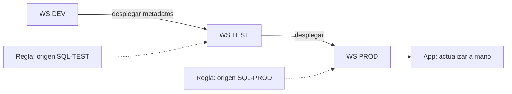

# Canalizaciones de implementación (deployment pipelines)

Parte de: [[17-Power-BI/09 Avanzado/_Índice Avanzado|Avanzado]]

> [!info] Cómo avanzar
> `progreso`: **pendiente** → **viendo** (estudiando) → **visto** (contestaste la autoevaluación sin abrir las respuestas) → **dominado** (hiciste el laboratorio o lo aplicaste de verdad).

## Contenido

### Qué es
Las **canalizaciones de implementación** (deployment pipelines) son una función del Service/Fabric para mover contenido **entre etapas** —por defecto Desarrollo → Prueba → Producción— cada una ligada a su propio workspace. Con un clic (o por API) copias informes, modelos semánticos, dataflows, paginados y elementos de Fabric de una etapa a la siguiente, comparas qué cambió y aplicas **reglas** para que cada etapa use su propio origen de datos.

### Cómo funciona
(Microsoft Learn, consultado nov 2026)
1. **Crear la canalización** y definir de **2 a 10 etapas** (por defecto 3); se pueden renombrar.
2. **Asignar un workspace a cada etapa**. Todos los workspaces deben estar en una licencia de Fabric: capacidad Fabric (F), Premium (P) o de prueba; PPU funciona solo para elementos de Power BI. (Si un workspace solo Pro puede usarse: pendiente de confirmar; el FAQ de CI/CD indica que se requiere licencia de capacidad o PPU.)
3. **Comparar** etapas: la vista muestra elementos nuevos, distintos o iguales, con diferencias de metadatos.
4. **Desplegar**: todo o elementos seleccionados. Los elementos se **emparejan** entre etapas; el desplegado **sobrescribe** a su pareja en el destino. Lo que no existe en el origen no se toca.
5. **Reglas de implementación**: se definen en la etapa destino sobre un elemento y hacen que conserve su propio valor al desplegar. Lo típico: **reglas de origen de datos** (el modelo en PROD apunta a `SQL-PROD`, en DEV a `SQL-DEV`) y **reglas de parámetros** (el parámetro `Servidor` de Power Query vale distinto por etapa). Tras crear o cambiar una regla hay que volver a desplegar.
6. **Automatizar** con la API REST de Power BI o de Fabric, por ejemplo desde Azure DevOps.

**Qué no se copia al desplegar**
- **Los datos**: solo metadatos. Tras desplegar un modelo nuevo hay que actualizarlo en el destino.
- URL, ID, **permisos** del workspace o del elemento, **configuración del workspace**.
- **Contenido y configuración de la app**: la app de cada etapa se actualiza a mano.
- Marcadores personales.
- En modelos semánticos: asignación de miembros de roles (RLS), **programación de actualización**, **credenciales** de orígenes, configuración de caché de consultas y **respaldo** (endoso).

### Ejemplo
Canalización "Comercial" en Itzamna:
- DEV (`Comercial [DEV]`), TEST (`Comercial [TEST]`), PROD (`Comercial [PROD]`), todos en capacidad F.
- Regla de parámetros en TEST y PROD: `Servidor = sql-test.itzamna.local` y `sql-prod.itzamna.local`.
- Flujo: el desarrollador publica a DEV (o sincroniza desde Git), el analista valida en TEST con datos reales anonimizados, el líder despliega a PROD el viernes y actualiza la app.
- En PROD se configuran **una sola vez** credenciales, programación de actualización y miembros de RLS, porque no se copian.

### Cuándo usarlo y cuándo no
- **Úsalas** cuando hay más de un ambiente y quieres un proceso repetible de promoción con control de cambios.
- Combínalas con [[Power BI con Git y control de versiones]]: Git en DEV para versionar, canalización para promover.
- **No** valen la pena para un informe personal o de un solo usuario.

### Errores comunes
1. **Esperar que se copien los datos** o la programación de actualización.
2. **Olvidar las reglas** y que PROD quede apuntando a la base de desarrollo.
3. **Cambiar directamente en PROD**: el siguiente despliegue lo sobrescribe.
4. **No actualizar la app** tras desplegar.
5. **Elementos con el mismo nombre no emparejados**: se crea un duplicado en lugar de sobrescribir.

### Para profundizar
- [Introducción a las canalizaciones de implementación (Microsoft Learn)](https://learn.microsoft.com/en-us/fabric/cicd/deployment-pipelines/intro-to-deployment-pipelines)
- [Proceso de implementación: qué se copia y qué no](https://learn.microsoft.com/en-us/fabric/cicd/deployment-pipelines/understand-the-deployment-process)
- [Crear reglas de implementación](https://learn.microsoft.com/en-us/fabric/cicd/deployment-pipelines/create-rules)

## Autoevaluación

Contesta primero en voz alta o en papel; luego despliega la respuesta.

> [!question]- ¿Qué son?
> Herramienta del Service para mover contenido entre etapas (Desarrollo → Pruebas → Producción), cada una con su workspace.

> [!question]- ¿Qué son las reglas de implementación?
> Configuración por etapa para cambiar parámetros u orígenes de datos (p. ej. servidor de pruebas vs producción) al desplegar.

> [!question]- ¿Qué no se copia al desplegar?
> Los datos (hay que actualizar en la etapa destino) y ciertos permisos; revisar la documentación de qué elementos se copian.

