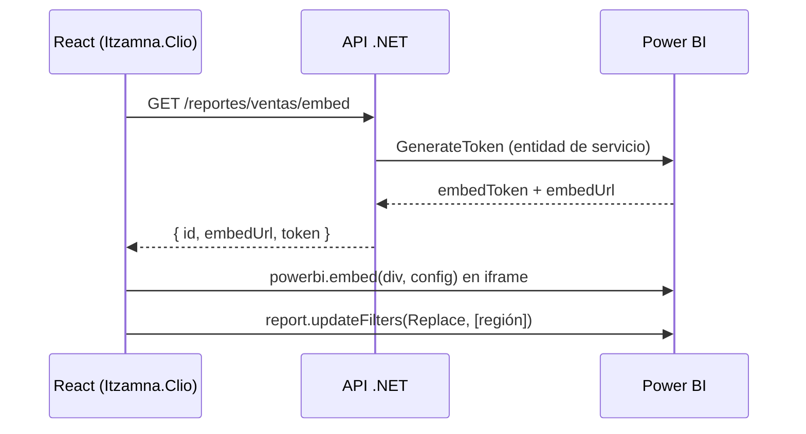

# Cliente JavaScript de Power BI

Parte de: [[17-Power-BI/09 Avanzado/_Índice Avanzado|Avanzado]]

> [!info] Cómo avanzar
> `progreso`: **pendiente** → **viendo** (estudiando) → **visto** (contestaste la autoevaluación sin abrir las respuestas) → **dominado** (hiciste el laboratorio o lo aplicaste de verdad).

## Contenido

### Qué es
**powerbi-client** es la librería oficial de JavaScript/TypeScript (paquete npm `powerbi-client`) para **insertar** informes, paneles, visuales individuales y otros elementos de Power BI en una página web y **controlarlos desde código**: aplicar filtros, cambiar de página, leer el estado, escuchar eventos (carga, clic en un punto, errores) y exportar datos. Es la pieza del navegador en cualquier escenario de [[Power BI Embedded (incrustar en una aplicación React o .NET)]].

### Cómo funciona
1. Tu **backend** obtiene un token (embed token para "la app es dueña de los datos", o token de Entra ID del usuario para "el usuario es dueño") y la **URL de inserción** del informe mediante la [[API REST de Power BI]].
2. El **frontend** crea una configuración (`IEmbedConfiguration`) con `type`, `id`, `embedUrl`, `accessToken`, `tokenType` y opciones (`settings`: panel de filtros, navegación de páginas).
3. Llama a `powerbi.embed(contenedor, config)`, que crea un `iframe` y devuelve un objeto `Report`.
4. Sobre ese objeto usas la API: `getPages()`, `setPage()`, `getFilters()`, `updateFilters()`, `setFilters()`, `exportData()`, `on('loaded' | 'rendered' | 'dataSelected' | 'error', ...)`.

**Filtros desde código**: armas un objeto de filtro con el **modelo** (`models` de `powerbi-models`): *Basic* (lista de valores), *Advanced* (condiciones), *Relative date*, *Top N*. Se aplican al informe, a una página o a un visual. Ojo: los filtros de cliente **no son seguridad**: el usuario puede quitarlos; la seguridad va en RLS con *effective identity*.

**Envoltorio para React**: sí, el paquete oficial **`powerbi-client-react`** expone el componente `PowerBIEmbed`, que recibe la configuración, un mapa de manejadores de eventos y una función para obtener la instancia del informe. (También hay envoltorio para Angular: `powerbi-client-angular`.)



### Ejemplo
Componente de Itzamna.Clio (React + Vite + TypeScript):

```tsx
import { useState } from "react";
import { PowerBIEmbed } from "powerbi-client-react";
import { models, Report } from "powerbi-client";

type EmbedInfo = { id: string; embedUrl: string; token: string };

export function InformeVentas({ info, region }: { info: EmbedInfo; region: string }) {
  const [reporte, setReporte] = useState<Report>();

  // Aplica un filtro básico Sucursal[Region] = región seleccionada en la app
  async function filtrarRegion() {
    if (!reporte) return;
    const filtro: models.IBasicFilter = {
      $schema: "http://powerbi.com/product/schema#basic",
      target: { table: "Sucursal", column: "Region" },
      operator: "In",
      values: [region],
      filterType: models.FilterType.Basic
    };
    await reporte.updateFilters(models.FiltersOperations.Replace, [filtro]);
  }

  return (
    <>
      <button onClick={filtrarRegion}>Ver {region}</button>
      <PowerBIEmbed
        embedConfig={{
          type: "report",
          id: info.id,
          embedUrl: info.embedUrl,
          accessToken: info.token,
          tokenType: models.TokenType.Embed,
          settings: { panes: { filters: { visible: false } } }
        }}
        eventHandlers={new Map([
          ["loaded", () => console.info("Informe cargado")],
          ["error", (e) => console.error(e?.detail)]
        ])}
        cssClassName="informe"
        getEmbeddedComponent={(r) => setReporte(r as Report)}
      />
    </>
  );
}
```

Instalación: `npm i powerbi-client powerbi-client-react`. El token debe renovarse antes de expirar (evento o temporizador que llama a `report.setAccessToken(nuevo)`).

### Cuándo usarlo y cuándo no
- **Úsalo** siempre que insertes Power BI en una aplicación web propia y necesites integrarlo con la UI (filtros sincronizados con tu app, navegación, eventos).
- Para insertar en SharePoint o Teams no hace falta: usa *Insertar de forma segura* o las pestañas nativas.
- Para sitios públicos sin login, la opción (con sus riesgos) es Publicar en la Web, no este cliente.

### Errores comunes
1. **Usar filtros del cliente como seguridad.**
2. **Tipo de token equivocado** (`Aad` vs `Embed`): el informe no carga.
3. **No renovar el token**: tras expirar, el informe deja de responder.
4. **Nombres de tabla/columna** en el filtro que no coinciden exactamente con el modelo.
5. **Recrear el iframe** en cada render de React; deja que el componente lo maneje y cambia la configuración solo cuando cambie el informe.

### Para profundizar
- [API de cliente de análisis integrados de Power BI (Microsoft Learn)](https://learn.microsoft.com/en-us/javascript/api/overview/powerbi/)
- [Filtros de informes con la API de JavaScript](https://learn.microsoft.com/en-us/javascript/api/overview/powerbi/control-report-filters)
- [powerbi-client-react (GitHub)](https://github.com/microsoft/powerbi-client-react)

## Autoevaluación

Contesta primero en voz alta o en papel; luego despliega la respuesta.

> [!question]- ¿Qué es powerbi-client?
> La biblioteca JavaScript para incrustar informes en una página y controlarlos: cambiar página, aplicar filtros, escuchar eventos (loaded, dataSelected).

> [!question]- ¿Cómo aplicas un filtro desde código?
> Con `report.setFilters([...])` o `updateFilters`, pasando un filtro básico (`$schema`, `target: {table, column}`, `operator: "In"`, `values`).

> [!question]- ¿Existe envoltorio para React?
> Sí: `powerbi-client-react` con el componente `PowerBIEmbed`.

